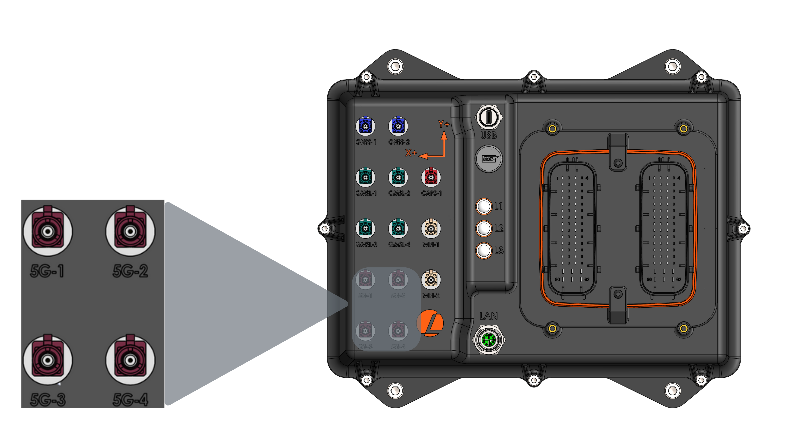
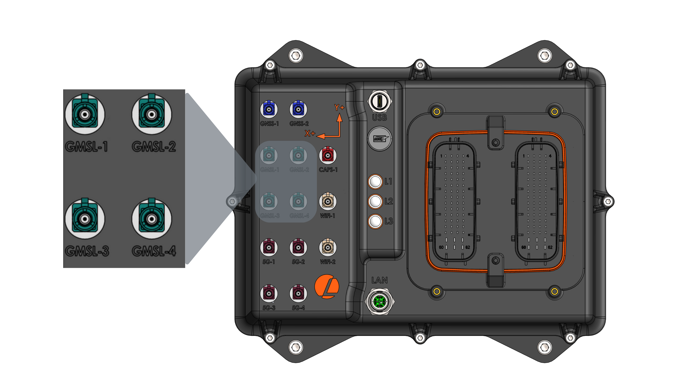
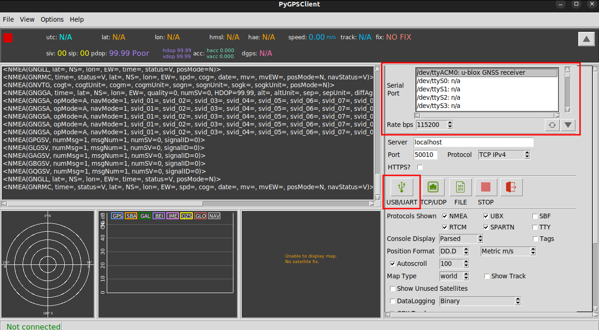
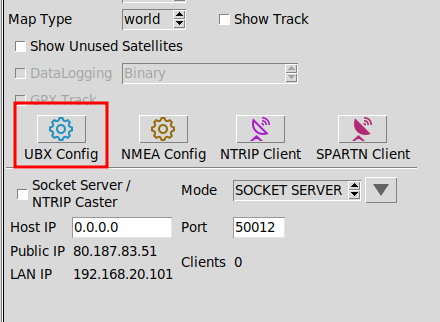
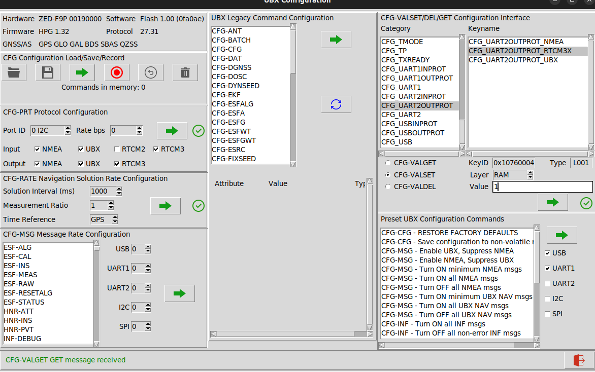
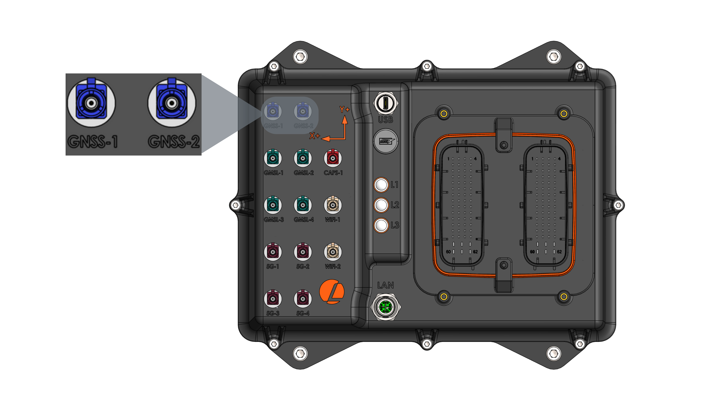
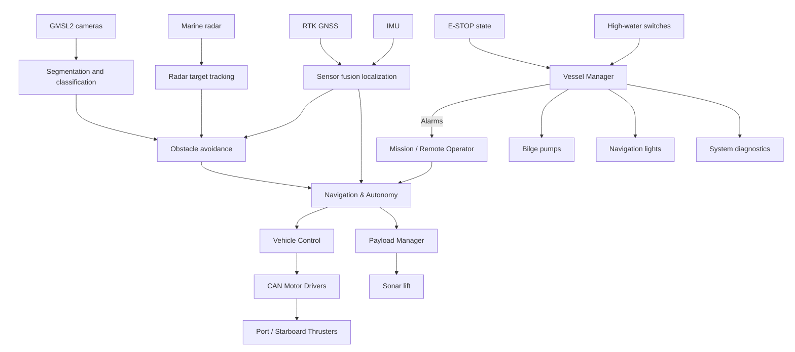
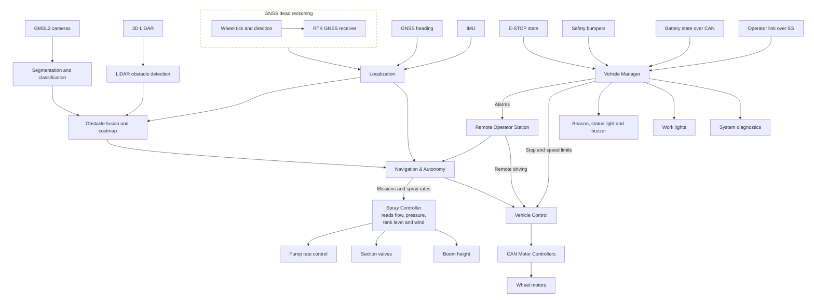

# --- release-notes.mdx ---

---
sidebar_position: 3
description: Which documentation, software, and hardware versions belong together, and what changed in each release.
---

# Release Notes

Each row is a documentation release. The software and hardware columns show the versions that release describes.
"No change" means that column did not move from the previous row.

<table style={{ width: '100%', display: 'table' }}>
  <thead>
    <tr>
      <th>Documentation</th>
      <th>Software</th>
      <th>Hardware</th>
    </tr>
  </thead>
  <tbody>
    <tr>
      <td style={{ verticalAlign: 'top' }}>
        <strong>1.0.4</strong>
        <ul>
          <li>Reference Designs section added, with Small USV and UGV reference designs</li>
          <li>Telit Cinterion FN990A28 added as an optional 5G module</li>
          <li>M12 X-coded Ethernet cable accessory page added</li>
          <li>Dev Breakout Board I/O and CAN counts corrected</li>
          <li>RTK Correction, RTK Positioning, RTK Heading, IMU, Software Management, and CAN Bus pages aligned with software 2.1.0</li>
          <li>GMSL2 camera type change, E-STOP commands, and RTK2go login corrected</li>
        </ul>
      </td>
      <td style={{ verticalAlign: 'top' }}>
        <strong>2.1.0</strong>
        <ul>
          <li>NTRIP client with a timed position refresh and a growing retry delay</li>
          <li>NTRIP client accepts anonymous casters and stops retrying after a refused login or an unknown mountpoint</li>
          <li>GNSS receiver command watchdog</li>
          <li>IMU accelerometer dynamic calibration on by default</li>
          <li>IMU covariances for every orientation mode and for the magnetic field</li>
          <li>can0 bitrate, bus-off restart delay, and transmit queue length configurable in /opt/automatepro/.env</li>
          <li>ROS log directory kept under a size limit</li>
          <li>GNSS and IMU nodes respawn, with a configurable respawn delay per driver group</li>
        </ul>
      </td>
      <td style={{ verticalAlign: 'top' }}>
        <strong>v1.2</strong>
        <ul>
          <li>No change</li>
        </ul>
      </td>
    </tr>
    <tr>
      <td style={{ verticalAlign: 'top' }}>
        <strong>1.0.3</strong>
        <ul>
          <li>Hardware installation split into mounting and cooling, breakout board, and camera mounting pages</li>
          <li>DIN rail installation rewritten and heat sinking guidance added</li>
          <li>Main connector crimp kit and camera mount accessory pages added</li>
          <li>E-STOP signal-path diagram and GPIO line names added</li>
          <li>Release notes reworked into a documentation, software, and hardware compatibility matrix</li>
        </ul>
      </td>
      <td style={{ verticalAlign: 'top' }}>
        <strong>2.0.0</strong>
        <ul>
          <li>No change</li>
        </ul>
      </td>
      <td style={{ verticalAlign: 'top' }}>
        <strong>v1.2</strong>
        <ul>
          <li>DIN rail mount updated</li>
          <li>Minor camera mounting changes</li>
        </ul>
      </td>
    </tr>
    <tr>
      <td style={{ verticalAlign: 'top' }}>
        <strong>1.0.2</strong>
        <ul>
          <li>Manual corrected against the software as shipped</li>
          <li>Software Management page added</li>
          <li>IMU, GMSL2 camera, and GNSS pages rewritten, including automatic recovery</li>
          <li>Examples aligned with automatepro_tutorials v1.1.0</li>
        </ul>
      </td>
      <td style={{ verticalAlign: 'top' }}>
        <strong>2.0.0</strong>
        <ul>
          <li>Moved to JetPack 6.2.2, adding support for Jetson Super Mode</li>
          <li>IMU calibration save and reinitialize services, plus magnetometer and accuracy reporting</li>
          <li>GMSL2 camera H.264 streaming and automatic hardware recovery</li>
          <li>Dedicated Foxglove Bridge service</li>
          <li>GNSS receiver recovery through the shared reset line</li>
        </ul>
      </td>
      <td style={{ verticalAlign: 'top' }}>
        <strong>v1.1</strong>
        <ul>
          <li>Minor circuit board changes</li>
          <li>Heat sink updated with a fan to support Jetson Super Mode</li>
          <li>Minor enclosure changes</li>
          <li>CAN and RS485 termination resistors added</li>
        </ul>
      </td>
    </tr>
    <tr>
      <td style={{ verticalAlign: 'top' }}>
        <strong>1.0.1</strong>
        <ul>
          <li>Configuration paths moved to /opt/automatepro</li>
          <li>GNSS Configuration GUI page added</li>
          <li>Examples linked to automatepro_tutorials</li>
          <li>Release Notes page added</li>
        </ul>
      </td>
      <td style={{ verticalAlign: 'top' }}>
        <strong>1.2.0</strong>
        <ul>
          <li>Installer for initial setup and updates</li>
          <li>IO controller analog and digital input configuration</li>
          <li>Stability and bug fixes</li>
        </ul>
      </td>
      <td style={{ verticalAlign: 'top' }}>
        <strong>v1.0</strong>
        <ul>
          <li>No change</li>
        </ul>
      </td>
    </tr>
    <tr>
      <td style={{ verticalAlign: 'top' }}>
        <strong>1.0.0</strong>
        <ul>
          <li>First release</li>
        </ul>
      </td>
      <td style={{ verticalAlign: 'top' }}>
        <strong>1.0.0</strong>
        <ul>
          <li>First release</li>
          <li>Core features implemented</li>
        </ul>
      </td>
      <td style={{ verticalAlign: 'top' }}>
        <strong>v1.0</strong>
        <ul>
          <li>Initial production hardware</li>
        </ul>
      </td>
    </tr>
  </tbody>
</table>


# --- quick-start-guide.mdx ---

---
sidebar_position: 1
---

import automateproComponentsImg from './images/automatepro-components-1.png';
import automateproDevBoardImg from './images/automatepro_dev_board.png';
import automateproCLeavySealImg from './images/automatepro_TE_Leavyseal.png';
import connectBreakoutBoard from './mp4/connect-breakout-board.mp4';
import connectFakra from './mp4/connect-fakra.mp4';
import connectEthernet from './mp4/connect-ethernet-cable.mp4';
import connectPowerSupply from './mp4/connect-power-supply.mp4';
import foxgloveInstallation from './mp4/foxglove-installation.mp4';

# Quick Start Guide

Welcome to **AutomatePro**. This guide provides clear, step-by-step instructions to help you set up and begin using your AutomatePro system quickly.

AutomatePro offers two connection options. The production version uses TE Leavyseal connectors for full IP67 protection. The development-board option is intended for prototyping and rapid development, using terminal blocks for easier connectivity.

Both options are interchangeable; however, this Quick Start Guide uses the development-board version for easier prototyping and wiring.

<div style={{ columnCount: 2, columnGap: '150px' }}>
<div>
    <p><strong>AutomatePro with Development Board</strong></p>
    
  </div>
  <div>
    <p><strong>AutomatePro with TE Leavyseal</strong></p>
    
  </div>
</div>

## What's in the Box

The exact contents depend on the configuration ordered. For this guide, assume the following components are included:

- **AutomatePro main unit**
- **Power supply**
- **Ethernet cable**
- **Optional accessories** (varies by configuration)

These are as follows:


## Connecting AutomatePro

### Hardware Connection

Use the provided power supply and Ethernet cable to connect your AutomatePro device, as shown in the illustrations below.

1. **Connect the breakout board, if applicable.**

   If your configuration includes a breakout board, securely attach it to the AutomatePro unit. Ensure all pins are properly aligned before applying pressure to avoid damage.

   <div style={{ display: 'flex', justifyContent: 'center', padding: '20px', margin: '0px 0px 30px 0px' }}>
       <video src={connectBreakoutBoard} controls preload="metadata" playsInline aria-label="Connect breakout board" style={{width: '70%'}}/>
   </div>

2. **Connect FAKRA antennas and cameras.**

   Attach GNSS, Wi-Fi, 5G, and camera FAKRA connectors to their designated ports. The connectors are color-coded for easy identification. Make sure each connector is fully inserted and securely locked to ensure a stable and reliable connection.

   <div style={{ display: 'flex', justifyContent: 'center', padding: '20px', margin: '0px 0px 30px 0px' }}>
       <video src={connectFakra} controls preload="metadata" playsInline aria-label="Connect FAKRA cables" style={{width: '70%'}}/>
   </div>

3. **Connect Ethernet.**

   Use the supplied Ethernet cable to establish a wired network connection. Insert one end into AutomatePro and connect the other end to your router, switch, or development network.

   <div style={{ display: 'flex', justifyContent: 'center', padding: '20px', margin: '0px 0px 30px 0px' }}>
       <video src={connectEthernet} controls preload="metadata" playsInline aria-label="Connect Ethernet cable" style={{width: '70%'}}/>
   </div>

4. **Connect power.**

   Plug the provided power supply into AutomatePro. Ensure the connector polarity aligns with the labeled indicators to prevent improper connection.

   <div style={{ display: 'flex', justifyContent: 'center', padding: '20px', margin: '0px 0px 30px 0px' }}>
       <video src={connectPowerSupply} controls preload="metadata" playsInline aria-label="Connect power supply" style={{width: '70%'}}/>
   </div>

5. **Power on AutomatePro.**

   Once all connections are in place, turn on the power supply to start AutomatePro. The device begins its boot sequence and the status LEDs start blinking. Refer to the [Status LED functions](/automatepro/system-overview#led-functions) for more information on interpreting LED behavior.

### Accessing AutomatePro

Once powered on and connected to the network, AutomatePro receives an IP address from your network's DHCP server. You can identify this IP address by checking the DHCP client list on your router, or by using a network scanning tool such as `nmap` or `arp-scan` to detect connected devices on your network.

After locating the IP address, you can access AutomatePro through either **SSH** for command-line access or **Remote Desktop** for graphical access.

#### SSH (Command-Line Access)

Use SSH for command-line access:

```bash
ssh admin@<ip-address>
```

:::info
Default credentials:

```text
username: admin
password: password
```
:::

:::warning[Important]
Change the default password after the first login.
:::

#### Remote Desktop (Graphical Access)

For graphical access, follow the [Remote Desktop Guide](/automatepro/manual/misc/desktop#remote-desktop).

To configure Wi-Fi, refer to the [Wi-Fi Setup Guide](/automatepro/manual/connectivity/wifi#using-nmcli).

## Verify the System

Run these checks from an SSH session on AutomatePro.

1. Confirm the main services are running:

   ```bash
   systemctl status automatepro-core-driver automatepro-io-agent automatepro-foxglove-bridge
   ```

   Healthy services show `active (running)`. If a service is stopped, inspect logs with:

   ```bash
   sudo journalctl -u automatepro-core-driver -n 100 --no-pager
   ```

2. Confirm ROS 2 can see the driver nodes:

   ```bash
   source /opt/ros/humble/setup.bash
   ros2 node list
   ```

   Depending on the installed hardware options, you should see nodes such as:

   ```text
   /automatepro_driver_manager
   /automatepro_gnss_position_node
   /automatepro_gnss_heading_node
   /automatepro_imu_driver
   /automatepro_cam1_node
   /automatepro_cam2_node
   ```

3. Confirm common sensor topics are present:

   ```bash
   ros2 topic list | grep -E '/sensor/imu|/sensor/gnss|/camera/.*/image_raw|/io/'
   ```

   Optional hardware only appears when that hardware and its driver are enabled.

:::tip
For service management, configuration paths, package installation, and log commands, see [Software Management](/automatepro/manual/misc/software-services).
:::

## Foxglove Interface

AutomatePro can be monitored and controlled using [Foxglove Studio](https://foxglove.dev/), a powerful visualization and observability tool designed for robotics applications.

1. **Install Foxglove Studio.**

   Download and install Foxglove Studio from the [official website](https://foxglove.dev/download). Follow the installation instructions appropriate for your operating system.

2. **Import AutomatePro dashboards and extensions.**

   Download the AutomatePro Foxglove extension and preconfigured dashboards from the [automatepro_foxglove repository](https://github.com/Lemvos/automatepro_foxglove). Import both into Foxglove Studio by following the steps in the video tutorial below or in the repository documentation.

   <div style={{ display: 'flex', justifyContent: 'center', padding: '20px', margin: '0px 0px 30px 0px' }}>
       <video src={foxgloveInstallation} controls preload="metadata" playsInline aria-label="Foxglove installation" style={{width: '100%'}}/>
   </div>

3. **Connect Foxglove Studio to AutomatePro.**

   Connect Foxglove Studio to AutomatePro by entering the IP address and default bridge port in the connection dialog:

   ```bash
   ws://<ip-address>:8765
   ```

<div style={{ display: 'flex', justifyContent: 'center', margin: '0px 0px 30px 0px' }}>
    <iframe width="100%" style={{"aspect-ratio": "16 / 9", "justifyContent": 'center', "padding": '20px', "margin": '0px 0px 30px 0px'}}
        src="https://www.youtube.com/embed/WDgLLtXSkhQ?si=cR46lrNCMHGbpyEx" title="YouTube video player"
        frameborder="0" allow="accelerometer; autoplay; clipboard-write; encrypted-media; gyroscope; picture-in-picture; web-share"
        referrerpolicy="strict-origin-when-cross-origin" allowfullscreen>
    </iframe>
</div>


# --- system-overview.mdx ---

---
sidebar_position: 2
toc_max_heading_level: 5
---

# System Overview

import AutomateProImg from './images/AutomatePro_Breakout.png'

AutomatePro is a rugged, all-in-one ROS 2 platform designed for outdoor robotics and automation. It combines critical subsystems such as high-performance computing (with AI/ML acceleration), extensive I/O, an integrated 9-axis IMU and RTK GNSS, and robust IP67-rated housing. With support for 4G/5G, Wi-Fi, Bluetooth, and a wide voltage input range, it provides a reliable and flexible foundation for advanced robotic applications. Pre-configured software tools ensure fast and seamless deployment.

The system’s integrated I/O significantly reduces the need for external components. Features include H-bridges or solid-state switches, digital and analog inputs/outputs, and support for warning systems (lights and sound). For navigation, it supports precise RTK GNSS (3–6 cm accuracy), dead reckoning via wheel inputs, differential heading, and satellite-based RTK correction—ideal for environments where magnetometers are unreliable.

AutomatePro supports a wide range of communication protocols including CAN, Ethernet, RS485, GMSL2, and USB 3.0. This makes it easy to connect with cameras, LIDARs, radars, motor controllers, and remote monitoring systems. Internally, it includes two regulated power outputs (12V and 5V) with voltage and current monitoring to support additional peripherals like sensors or actuators.

Available with three levels of compute based on the NVIDIA [Jetson Orin Series](https://developer.nvidia.com/embedded/jetson-modules) (from Orin Nano 8GB to Orin NX 16GB), AutomatePro comes pre-loaded with JetPack 6.2.2 and ROS 2 drivers for all onboard hardware. These drivers are pre-installed and tested, offered by default in Docker containers for modular updates and maintenance. For advanced users, native host execution is also supported.

An overview of the AutomatePro:


### Features

Depending on the configuration, AutomatePro can be equipped with the following features:


<div style={{ columnCount: 2, columnGap: '20px' }}>
  <p>
    <strong>Software:</strong><br />
    - Base ROS 2 drivers for all sensors and IO<br />
    - Linux Ubuntu 22.04<br />
    - JetPack 6.2.2<br /><br />

    <strong>Sensors:</strong><br />
    - 9-axis IMU (3-axis compass, 3-axis gyro, 3-axis accelerometer)<br />
    - GNSS RTK positioning (Wheel tick and direction input optional)<br />
    - GNSS Heading<br />
    - 2x or 4x GMSL2 Camera Inputs with PoC (Power Over Coax)<br /><br />

    <strong>Integrated IO:</strong><br />
    - 10x Digital Inputs<br />
    - 12x Digital Outputs (~500mA)<br />
    - 12x Digital Drive software configurable as half or full-bridge (7A)<br />
    - 14x Analog Inputs (0-10V or 4-20mA (on request))<br />
    - E-STOP Input<br />
    - Warning Light and Buzzer Drivers<br /><br />

    <strong>Connectivity:</strong><br />
    - 5G/4G Connectivity<br />
    - Wi-Fi<br />
    - Bluetooth<br />
    - RS485<br />
    - CAN FD Bus<br />
    - 1GbE Ethernet<br />
    - USB 3.1 with Alt Mode for DisplayPort connection<br /><br />

    <strong>Power System:</strong><br />
    - 15.5V to 58V Supply Voltage Range<br />
    - Extensive power supply monitoring with current and voltage sensing on most onboard power supplies and all external facing supplies<br />
    - 12V 8A Onboard power supply for external systems<br />
    - 5V 3A onboard power supply for external systems<br /><br />

    <strong>Environmental:</strong><br />
    - IP67 water ingress protection<br />
    - Robust keyed connectors to prevent systems from being incorrectly connected<br /><br />

    <strong>Market Ready:</strong><br />
    - Rapid development with dev tool kit
    - Range of supported external sensors and components
  </p>
</div>


## Hardware Architecture

A high-level layout of AutomatePro shows the interconnections between the different systems. Most IO is controlled by the MCU, while high-bandwidth systems such as GMSL, USB3, Wi-Fi, and GbE are fed directly to the Jetson SOM. A communication bridge between the MCU and SOM transfers data and is initiated on startup.

import AutomatePro_Hardware_Diagram_Connection_Overview from './images/AutomatePro_Hardware_Diagrams_Connection_Overview.png'


<br/>
<br/>

A simplified layout of AutomatePro's internal power supplies is shown below. This includes only the power supplies that are relevant to external systems and excludes regulators for onboard systems. The diagram also shows onboard current and voltage measurements for the different rails, along with onboard fuses.

import AutomatePro_Hardware_Diagram_PSU from './images/AutomatePro_Hardware_Diagram_PSU.png'


<br/>
<br/>


### Connector Pin Map & Functions
The two primary connectors used on AutomatePro are from the TE Leavyseal connector series. The pin allocation is shown below:

import connector_def from './images/Connector_Definition.png'


#### Connector A
import ReactTable from './components/sortable_table';

<ReactTable
  columns={[
    {
      Header: 'PIN NO.',
      accessor: 'pinNo',
    },
    {
      Header: 'PIN NAME',
      accessor: 'pinName',
    },
    {
      Header: 'I/O TYPE',
      accessor: 'ioType',
    },
    {
      Header: 'DESCRIPTION',
      accessor: 'description',
    },
  ]}
  data={[
  { pinNo: 'A1', pinName: 'NC', ioType: 'N/A', description: 'Not Connected' },
  { pinNo: 'A2', pinName: '+12V', ioType: 'Power Out', description: '12V out with 0.75A self-resetting fuse' },
  { pinNo: 'A3', pinName: 'GND', ioType: 'Ground', description: 'Sensor Ground' },
  { pinNo: 'A4', pinName: 'AIN_01', ioType: 'Input', description: '0-10V analog input (or 4-20mA on request)' },
  { pinNo: 'A5', pinName: 'E-STOP', ioType: 'Input', description: 'E-Stop button sensor for detecting when E-Stop has been pressed.' },
  { pinNo: 'A6', pinName: '+12V', ioType: 'Power Out', description: '12V out with 0.75A self-resetting fuse' },
  { pinNo: 'A7', pinName: 'GND', ioType: 'Ground', description: 'Sensor Ground' },
  { pinNo: 'A8', pinName: 'AIN_02', ioType: 'Input', description: '0-10V analog input (or 4-20mA on request)' },
  { pinNo: 'A9', pinName: 'GND', ioType: 'Ground', description: '' },
  { pinNo: 'A10', pinName: '+12V', ioType: 'Power Out', description: '12V out with 0.75A self-resetting fuse' },
  { pinNo: 'A11', pinName: 'GND', ioType: 'Ground', description: 'Sensor Ground' },
  { pinNo: 'A12', pinName: 'AIN_03', ioType: 'Input', description: '0-10V analog input (or 4-20mA on request)' },
  { pinNo: 'A13', pinName: 'RS485_P', ioType: 'Input/Output', description: 'RS485 serial communications' },
  { pinNo: 'A14', pinName: '+12V', ioType: 'Power Out', description: '12V out with 0.75A self-resetting fuse' },
  { pinNo: 'A15', pinName: 'GND', ioType: 'Ground', description: 'Sensor Ground' },
  { pinNo: 'A16', pinName: 'AIN_04', ioType: 'Input', description: '0-10V analog input (or 4-20mA on request)' },
  { pinNo: 'A17', pinName: 'RS485_N', ioType: 'Input/Output', description: 'RS485 serial communications' },
  { pinNo: 'A18', pinName: '+12V', ioType: 'Power Out', description: '12V out with 0.75A self-resetting fuse' },
  { pinNo: 'A19', pinName: 'GND', ioType: 'Ground', description: 'Sensor Ground' },
  { pinNo: 'A20', pinName: 'AIN_05', ioType: 'Input', description: '0-10V analog input (or 4-20mA on request)' },
  { pinNo: 'A21', pinName: 'GND', ioType: 'Ground', description: '' },
  { pinNo: 'A22', pinName: '+12V', ioType: 'Power Out', description: '12V out with 0.75A self-resetting fuse' },
  { pinNo: 'A23', pinName: 'GND', ioType: 'Ground', description: 'Sensor Ground' },
  { pinNo: 'A24', pinName: 'AIN_06', ioType: 'Input', description: '0-10V analog input (or 4-20mA on request)' },
  { pinNo: 'A25', pinName: 'CAN1_L', ioType: 'Input/Output', description: 'CAN channel 1 communications' },
  { pinNo: 'A26', pinName: '+12V', ioType: 'Power Out', description: '12V out with 0.75A self-resetting fuse' },
  { pinNo: 'A27', pinName: 'GND', ioType: 'Ground', description: 'Sensor Ground' },
  { pinNo: 'A28', pinName: 'AIN_07', ioType: 'Input', description: '0-10V analog input (or 4-20mA on request)' },
  { pinNo: 'A29', pinName: 'CAN1_H', ioType: 'Input/Output', description: 'CAN channel 1 communications' },
  { pinNo: 'A30', pinName: '+5V', ioType: 'Power Out', description: '5V out with 0.75A self-resetting fuse' },
  { pinNo: 'A31', pinName: 'GND', ioType: 'Ground', description: 'Sensor Ground' },
  { pinNo: 'A32', pinName: 'AIN_08', ioType: 'Input', description: '0-10V analog input (or 4-20mA on request)' },
  { pinNo: 'A33', pinName: 'GND', ioType: 'Ground', description: '' },
  { pinNo: 'A34', pinName: '+5V', ioType: 'Power Out', description: '5V out with 0.75A self-resetting fuse' },
  { pinNo: 'A35', pinName: 'GND', ioType: 'Ground', description: 'Sensor Ground' },
  { pinNo: 'A36', pinName: 'AIN_09', ioType: 'Input', description: '0-10V analog input (or 4-20mA on request)' },
  { pinNo: 'A37', pinName: 'CAN2_L', ioType: 'Input/Output', description: 'CAN channel 2 communications' },
  { pinNo: 'A38', pinName: '+5V', ioType: 'Power Out', description: '5V out with 0.75A self-resetting fuse' },
  { pinNo: 'A39', pinName: 'GND', ioType: 'Ground', description: 'Sensor Ground' },
  { pinNo: 'A40', pinName: 'AIN_10', ioType: 'Input', description: '0-10V analog input (or 4-20mA on request)' },
  { pinNo: 'A41', pinName: 'CAN2_H', ioType: 'Input/Output', description: 'CAN channel 2 communications' },
  { pinNo: 'A42', pinName: '+5V', ioType: 'Power Out', description: '5V out with 0.75A self-resetting fuse' },
  { pinNo: 'A43', pinName: 'GND', ioType: 'Ground', description: 'Sensor Ground' },
  { pinNo: 'A44', pinName: 'AIN_11', ioType: 'Input', description: '0-10V analog input (or 4-20mA on request)' },
  { pinNo: 'A45', pinName: 'GND', ioType: 'Ground', description: '' },
  { pinNo: 'A46', pinName: '+5V', ioType: 'Power Out', description: '5V out with 0.75A self-resetting fuse' },
  { pinNo: 'A47', pinName: 'GND', ioType: 'Ground', description: 'Sensor Ground' },
  { pinNo: 'A48', pinName: 'AIN_12', ioType: 'Input', description: '0-10V analog input (or 4-20mA on request)' },
  { pinNo: 'A49', pinName: 'NC', ioType: 'N/A', description: 'Do not connect' },
  { pinNo: 'A50', pinName: '+5V', ioType: 'Power Out', description: '5V out with 0.75A self-resetting fuse' },
  { pinNo: 'A51', pinName: 'GND', ioType: 'Ground', description: 'Sensor Ground' },
  { pinNo: 'A52', pinName: 'AIN_13', ioType: 'Input', description: '0-10V analog input (or 4-20mA on request)' },
  { pinNo: 'A53', pinName: 'NC', ioType: 'N/A', description: 'Do not connect' },
  { pinNo: 'A54', pinName: '+5V', ioType: 'Power Out', description: '5V out with 0.75A self-resetting fuse' },
  { pinNo: 'A55', pinName: 'GND', ioType: 'Ground', description: 'Sensor Ground' },
  { pinNo: 'A56', pinName: 'AIN_14', ioType: 'Input', description: '0-10V analog input (or 4-20mA on request)' },
  { pinNo: 'A57', pinName: 'ACTU_PWR', ioType: 'Power Input', description: 'Power Supply for all Digital Drives' },
  { pinNo: 'A58', pinName: 'NC', ioType: 'N/A', description: 'Do not connect' },
  { pinNo: 'A59', pinName: 'NC', ioType: 'N/A', description: 'Do not connect' },
  { pinNo: 'A60', pinName: 'ACTU_PWR', ioType: 'Power Input', description: 'Power Supply for all Digital Drives' },
  { pinNo: 'A61', pinName: '+12V_IO_OUT', ioType: 'Power Out', description: '+12V out with 8A self-resetting fuse - Used for any high current applications' },
  { pinNo: 'A62', pinName: 'NC', ioType: 'N/A', description: 'Do not connect' },
  ]}
/>
import AutomateProConnectorA from './images/AutomatePro_Connector_A.png'

##### Connector A - Pin map looking top down


#### Connector B

  <ReactTable
  columns = {[
    {
      Header: 'PIN NO.',
      accessor: 'pinNo',
    },
    {
      Header: 'PIN NAME',
      accessor: 'pinName',
    },
    {
      Header: 'I/O TYPE',
      accessor: 'ioType',
    },
    {
      Header: 'DESCRIPTION',
      accessor: 'description',
    },
  ]}

  data = {[
    { pinNo: 'B1', pinName: 'DI_01', ioType: 'Input', description: 'Digital Inputs' },
    { pinNo: 'B2', pinName: 'DO_H_01', ioType: 'Output', description: 'Highside Digital Output @12V' },
    { pinNo: 'B3', pinName: 'DD_H_01', ioType: 'Output', description: 'High Current Drive Output' },
    { pinNo: 'B4', pinName: 'DD_L_01', ioType: 'Sink', description: 'High Current Sink' },
    { pinNo: 'B5', pinName: 'DI_02', ioType: 'Input', description: 'Digital Inputs' },
    { pinNo: 'B6', pinName: 'DO_H_02', ioType: 'Output', description: 'Highside Digital Output @12V' },
    { pinNo: 'B7', pinName: 'DD_H_02', ioType: 'Output', description: 'High Current Drive Output' },
    { pinNo: 'B8', pinName: 'DD_L_02', ioType: 'Sink', description: 'High Current Sink' },
    { pinNo: 'B9', pinName: 'DI_03', ioType: 'Input', description: 'Digital Inputs' },
    { pinNo: 'B10', pinName: 'DO_H_03', ioType: 'Output', description: 'Highside Digital Output @12V' },
    { pinNo: 'B11', pinName: 'DD_H_03', ioType: 'Output', description: 'High Current Drive Output' },
    { pinNo: 'B12', pinName: 'DD_L_03', ioType: 'Sink', description: 'High Current Sink' },
    { pinNo: 'B13', pinName: 'DI_04', ioType: 'Input', description: 'Digital Inputs' },
    { pinNo: 'B14', pinName: 'DO_H_04', ioType: 'Output', description: 'Highside Digital Output @12V' },
    { pinNo: 'B15', pinName: 'DD_H_04', ioType: 'Output', description: 'High Current Drive Output' },
    { pinNo: 'B16', pinName: 'DD_L_04', ioType: 'Sink', description: 'High Current Sink' },
    { pinNo: 'B17', pinName: 'DI_05', ioType: 'Input', description: 'Digital Inputs' },
    { pinNo: 'B18', pinName: 'DO_H_05', ioType: 'Output', description: 'Highside Digital Output @12V' },
    { pinNo: 'B19', pinName: 'DD_H_05', ioType: 'Output', description: 'High Current Drive Output' },
    { pinNo: 'B20', pinName: 'DD_L_05', ioType: 'Sink', description: 'High Current Sink' },
    { pinNo: 'B21', pinName: 'DI_06', ioType: 'Input', description: 'Digital Inputs' },
    { pinNo: 'B22', pinName: 'DO_H_06', ioType: 'Output', description: 'Highside Digital Output @12V' },
    { pinNo: 'B23', pinName: 'DD_H_06', ioType: 'Output', description: 'High Current Drive Output' },
    { pinNo: 'B24', pinName: 'DD_L_06', ioType: 'Sink', description: 'High Current Sink' },
    { pinNo: 'B25', pinName: 'DI_07', ioType: 'Input', description: 'Digital Inputs' },
    { pinNo: 'B26', pinName: 'DO_L_01', ioType: 'Sink', description: 'Low side Sink' },
    { pinNo: 'B27', pinName: 'DD_H_07', ioType: 'Output', description: 'High Current Drive Output' },
    { pinNo: 'B28', pinName: 'DD_L_07', ioType: 'Sink', description: 'High Current Sink' },
    { pinNo: 'B29', pinName: 'DI_08', ioType: 'Input', description: 'Digital Inputs' },
    { pinNo: 'B30', pinName: 'DO_L_02', ioType: 'Sink', description: 'Low side Sink' },
    { pinNo: 'B31', pinName: 'DD_H_08', ioType: 'Output', description: 'High Current Drive Output' },
    { pinNo: 'B32', pinName: 'DD_L_08', ioType: 'Sink', description: 'High Current Sink' },
    { pinNo: 'B33', pinName: 'DI_09', ioType: 'Input', description: 'Digital Inputs' },
    { pinNo: 'B34', pinName: 'DO_L_03', ioType: 'Sink', description: 'Low side Sink' },
    { pinNo: 'B35', pinName: 'DD_H_09', ioType: 'Output', description: 'High Current Drive Output' },
    { pinNo: 'B36', pinName: 'DD_L_09', ioType: 'Sink', description: 'High Current Sink' },
    { pinNo: 'B37', pinName: 'DI_10', ioType: 'Input', description: 'Digital Inputs' },
    { pinNo: 'B38', pinName: 'DO_L_04', ioType: 'Sink', description: 'Low side Sink' },
    { pinNo: 'B39', pinName: 'DD_H_10', ioType: 'Output', description: 'High Current Drive Output' },
    { pinNo: 'B40', pinName: 'DD_L_10', ioType: 'Sink', description: 'High Current Sink' },
    { pinNo: 'B41', pinName: 'NC', ioType: 'N/A', description: 'Not Connected' },
    { pinNo: 'B42', pinName: 'DO_L_05', ioType: 'Sink', description: 'Low side Sink' },
    { pinNo: 'B43', pinName: 'DD_H_11', ioType: 'Output', description: 'High Current Drive Output' },
    { pinNo: 'B44', pinName: 'DD_L_11', ioType: 'Sink', description: 'High Current Sink' },
    { pinNo: 'B45', pinName: 'NC', ioType: 'N/A', description: 'Not Connected' },
    { pinNo: 'B46', pinName: 'DO_L_06', ioType: 'Sink', description: 'Low side Sink' },
    { pinNo: 'B47', pinName: 'DD_H_12', ioType: 'Output', description: 'High Current Drive Output' },
    { pinNo: 'B48', pinName: 'DD_L_12', ioType: 'Sink', description: 'High Current Sink' },
    { pinNo: 'B49', pinName: 'WARNING_LIGHT_1', ioType: 'Sink', description: 'High Current Sink for connecting external light' },
    { pinNo: 'B50', pinName: 'WARNING_LIGHT_2', ioType: 'Sink', description: 'High Current Sink for connecting external light' },
    { pinNo: 'B51', pinName: 'WHEEL_TICK', ioType: 'Input', description: 'Non standard. Contact Lemvos for more information' },
    { pinNo: 'B52', pinName: 'WHEEL_DIRECTION', ioType: 'Input', description: 'Non standard. Contact Lemvos for more information' },
    { pinNo: 'B53', pinName: 'NC', ioType: 'N/A', description: 'Not Connected' },
    { pinNo: 'B54', pinName: 'WARNING_BUZZER', ioType: 'Sink', description: 'High Current Sink for connecting external warning buzzer/alarm' },
    { pinNo: 'B55', pinName: 'NC', ioType: 'N/A', description: 'Not Connected' },
    { pinNo: 'B56', pinName: 'NC', ioType: 'N/A', description: 'Not Connected' },
    { pinNo: 'B57', pinName: 'VBATT', ioType: 'Power Input', description: 'Provides Power to the AutomatePro' },
    { pinNo: 'B58', pinName: 'NC', ioType: 'N/A', description: 'Not Connected' },
    { pinNo: 'B59', pinName: 'GND', ioType: 'Ground', description: 'AutomatePro ground' },
    { pinNo: 'B60', pinName: 'VBATT', ioType: 'Power Input', description: 'Provides Power to the AutomatePro' },
    { pinNo: 'B61', pinName: 'NC', ioType: 'N/A', description: 'Not Connected' },
    { pinNo: 'B62', pinName: 'GND', ioType: 'Ground', description: 'AutomatePro ground' },
  ]}
  />


import AutomateProConnectorB from './images/AutomatePro_Connector_B.png'

##### Connector B - Pin map looking top down


### Operating Conditions
The table provides both the absolute maximum and minimum limits, as well as the recommended operating conditions. It is strongly advised that nominal operations remain within the recommended operating values.
  <ReactTable
  columns = {[
    {
      Header: 'DESCRIPTION',
      accessor: 'description',
    },
    {
      Header: 'ABSOLUTE MAX/MINS',
      accessor: 'absoluteMaxMins',
    },
    {
      Header: 'RECOMMENDED OPERATING VALUES',
      accessor: 'recommendedOperatingValues',
    },
    {
      Header: 'UNITS',
      accessor: 'units',
    },
    {
      Header: 'TOLERANCE',
      accessor: 'tolerance',
    },
  ]}

  data = {[  {
    description: 'Main AutomatePro Power Input [VBATT]',
    absoluteMaxMins: '',
    recommendedOperatingValues: '',
    units: '',
    tolerance: '',
  },
  {
    description: 'Supply Voltage Range',
    absoluteMaxMins: '15.00-60',
    recommendedOperatingValues: '15.5-58',
    units: 'VDC',
    tolerance: '',
  },
  {
    description: 'Expected Power Consumption',
    absoluteMaxMins: '',
    recommendedOperatingValues: '10-200¹',
    units: 'W',
    tolerance: '',
  },
  {
    description: 'Actuator Power Input (Digital Drive) [ACTU_PWR]',
    absoluteMaxMins: '',
    recommendedOperatingValues: '',
    units: '',
    tolerance: '',
  },
  {
    description: 'Voltage Range',
    absoluteMaxMins: '6-60',
    recommendedOperatingValues: '7-42',
    units: 'VDC',
    tolerance: '',
  },
  {
    description: 'Max Current',
    absoluteMaxMins: '60',
    recommendedOperatingValues: '55',
    units: 'A',
    tolerance: '',
  },
  {
    description: 'IO 5V Supply Output [+5V]',
    absoluteMaxMins: '',
    recommendedOperatingValues: '',
    units: '',
    tolerance: '',
  },
  {
    description: 'Output Voltage',
    absoluteMaxMins: '-',
    recommendedOperatingValues: '5',
    units: 'VDC',
    tolerance: '0.5',
  },
  {
    description: 'Current Cutoff',
    absoluteMaxMins: '-',
    recommendedOperatingValues: '3',
    units: 'A',
    tolerance: '',
  },
  {
    description: 'IO 12V Supply Output [+12V]',
    absoluteMaxMins: '',
    recommendedOperatingValues: '',
    units: '',
    tolerance: '',
  },
  {
    description: 'Output Voltage',
    absoluteMaxMins: '-',
    recommendedOperatingValues: '12',
    units: 'VDC',
    tolerance: '0.5',
  },
  {
    description: 'Current Cutoff',
    absoluteMaxMins: '-',
    recommendedOperatingValues: '8',
    units: 'A',
    tolerance: '',
  },
  {
    description: 'Digital Output [DO_H_01-06]',
    absoluteMaxMins: '',
    recommendedOperatingValues: '',
    units: '',
    tolerance: '',
  },
  {
    description: 'Output Voltage',
    absoluteMaxMins: '-',
    recommendedOperatingValues: '12.0',
    units: 'VDC',
    tolerance: '0.5',
  },
  {
    description: 'Max Current Source',
    absoluteMaxMins: '-',
    recommendedOperatingValues: '600.0',
    units: 'mA',
    tolerance: '',
  },
  {
    description: 'PWM Frequency',
    absoluteMaxMins: '-',
    recommendedOperatingValues: '0.5',
    units: 'kHz',
    tolerance: '',
  },
  {
    description: 'Duty Cycle',
    absoluteMaxMins: '-',
    recommendedOperatingValues: '0-100',
    units: '%',
    tolerance: '',
  },
  {
    description: 'Software Response Rate',
    absoluteMaxMins: '-',
    recommendedOperatingValues: '200.0',
    units: 'ms',
    tolerance: '',
  },
  {
    description: 'Digital Output [DO_L_01-06]',
    absoluteMaxMins: '',
    recommendedOperatingValues: '',
    units: '',
    tolerance: '',
  },
  {
    description: 'Sink Voltage',
    absoluteMaxMins: '0-60',
    recommendedOperatingValues: '0-42',
    units: 'VDC',
    tolerance: '',
  },
  {
    description: 'Max Current Sink',
    absoluteMaxMins: '1000',
    recommendedOperatingValues: '600.0',
    units: 'mA',
    tolerance: '',
  },
  {
    description: 'PWM Frequency (DO_L_01-04)',
    absoluteMaxMins: '-',
    recommendedOperatingValues: '15.0',
    units: 'kHz',
    tolerance: '',
  },
  {
    description: 'Duty Cycle',
    absoluteMaxMins: '-',
    recommendedOperatingValues: '0-100',
    units: '%',
    tolerance: '',
  },
  {
    description: 'Software Response Rate',
    absoluteMaxMins: '-',
    recommendedOperatingValues: '200.0',
    units: 'ms',
    tolerance: '',
  },
  {
    description: 'Digital Drive [DD_x_xx]',
    absoluteMaxMins: '',
    recommendedOperatingValues: '',
    units: '',
    tolerance: '',
  },
  {
    description: 'Drive Voltage',
    absoluteMaxMins: '6-60',
    recommendedOperatingValues: '7-42',
    units: 'VDC',
    tolerance: '',
  },
  {
    description: 'Rated Current/Channel',
    absoluteMaxMins: '7',
    recommendedOperatingValues: '5.0',
    units: 'A',
    tolerance: '',
  },
  {
    description: 'PWM Frequency',
    absoluteMaxMins: '-',
    recommendedOperatingValues: '15.0',
    units: 'kHz',
    tolerance: '',
  },
  {
    description: 'Duty Cycle',
    absoluteMaxMins: '-',
    recommendedOperatingValues: '0-100',
    units: '%',
    tolerance: '',
  },
  {
    description: 'Software Response Rate',
    absoluteMaxMins: '-',
    recommendedOperatingValues: '200.0',
    units: 'ms',
    tolerance: '',
  },
  {
    description: 'Warning System',
    absoluteMaxMins: '',
    recommendedOperatingValues: '',
    units: '',
    tolerance: '',
  },
  {
    description: 'Drive Voltage',
    absoluteMaxMins: '0-40',
    recommendedOperatingValues: '0-24',
    units: 'VDC',
    tolerance: '',
  },
  {
    description: 'Rated Current/Channel',
    absoluteMaxMins: '5',
    recommendedOperatingValues: '3.0',
    units: 'A',
    tolerance: '',
  },
  {
    description: 'Software Response Rate',
    absoluteMaxMins: '-',
    recommendedOperatingValues: '200.0',
    units: 'ms',
    tolerance: '',
  },
  {
    description: 'Analog Inputs [AIN_xx]',
    absoluteMaxMins: '',
    recommendedOperatingValues: '',
    units: '',
    tolerance: '',
  },
  {
    description: 'Input Voltage',
    absoluteMaxMins: '0-12',
    recommendedOperatingValues: '0-10',
    units: 'VDC',
    tolerance: '',
  },
  {
    description: 'Sample Rate',
    absoluteMaxMins: '-',
    recommendedOperatingValues: '33.3',
    units: 'Hz',
    tolerance: '',
  },
  {
    description: 'Digital Input [DI_xx]',
    absoluteMaxMins: '',
    recommendedOperatingValues: '',
    units: '',
    tolerance: '',
  },
  {
    description: 'Input Voltage Range',
    absoluteMaxMins: '5-30',
    recommendedOperatingValues: '5-24',
    units: 'VDC',
    tolerance: '1',
  },
  {
    description: 'Max Sample Rate',
    absoluteMaxMins: '-',
    recommendedOperatingValues: '33.3³',
    units: 'Hz',
    tolerance: '',
  },
  {
    description: 'Environmental',
    absoluteMaxMins: '',
    recommendedOperatingValues: '',
    units: '',
    tolerance: '',
  },
  {
    description: 'Operational Temperature Range',
    absoluteMaxMins: '',
    recommendedOperatingValues: '-20 to +45²',
    units: '°C',
    tolerance: '',
  },
  {
    description: 'Ingress Protection',
    absoluteMaxMins: '',
    recommendedOperatingValues: 'IP67',
    units: '-',
    tolerance: '',
  },
  {
    description: 'Mass',
    absoluteMaxMins: '',
    recommendedOperatingValues: '2.2',
    units: 'kg',
    tolerance: '',
  },

  ]}
  />
:::info[Info]
<sup>1</sup> Power consumption depends heavily on attached external systems. Without any external systems connected, the maximum consumption is < 30 W (NX 16GB).

<sup>2</sup> Extended-temperature devices exist; contact Lemvos for more information.

<sup>3</sup> The digital inputs are checked every 30 ms. `/io/din` is published only when an input changes, once at startup, and when requested with the `/io/din/request` service.
:::
### LED Functions

import LEDs from './images/LEDs.png'

<div style={{ columnCount: 2, columnGap: '20px'}}>
  <p>
    <strong></strong><br />
| LED Designator | LED Color  | Function                                      |
|----------------|------------|-----------------------------------------------|
| L1             | GREEN      | Power good - checks all onboard power supplies   |
| L1             | BLUE       | Wi-Fi - WLAN                                   |
| L1             | RED        | nE-STOP - LED will be off when E-STOP is pressed (E-STOP input low) |
| L2             | BLUE       | Ethernet Link                                 |
| L2             | RED        | Ethernet ACT                                  |
| L3             | GREEN      | SSD Read/Write LED                            |
| L3             | BLUE       | WWAN - 5G RF function is on                   |
| L3             | RED        | Wi-Fi - Bluetooth                              |


    <strong></strong><br />
      

    </p>
</div>


### Dimensions

import AMP_GA from './images/AMP-100-AMP-ASSY-REV-A.png'


All dimensions are in millimeters (mm).


### Compute Modules
AutomatePro supports a range of NVIDIA Jetson Orin modules, each catering to different performance and resource requirements.

Supported NVIDIA Jetson Orin modules:
- Jetson Orin Nano 8GB
- Jetson Orin NX 8GB
- Jetson Orin NX 16GB

:::info[Info]
For more information on the performance of the different modules, refer to the [Jetson Orin Series page](https://developer.nvidia.com/embedded/jetson-modules).
:::

## Software Architecture

import SoftwareArchImg from './images/software-arch.png'


<div className="image-container">
  
</div>

### OS
AutomatePro operates on Jetson Linux 36.5, which features Linux kernel 5.15 and an Ubuntu 22.04-based root filesystem.
This OS is optimized for the NVIDIA Jetson platform and includes all necessary drivers and libraries pre-installed, ensuring seamless integration and performance.

For more information, refer to the [NVIDIA Developer Guide](https://docs.nvidia.com/jetson/archives/r36.5/DeveloperGuide/index.html).

Jetson Linux 36.5 is part of the [NVIDIA JetPack SDK (ver. 6.2.2)](https://developer.nvidia.com/embedded/jetpack), which provides a comprehensive set of tools and libraries for developing end-to-end accelerated
AI and ML applications on the Jetson platform.

The kernel is configured with the PREEMPT_RT patch to ensure low-latency and high-priority task execution,
which is crucial for real-time robotics applications.
For more information on the PREEMPT_RT patch, refer to the [official documentation](https://wiki.linuxfoundation.org/realtime/start).

AutomatePro is pre-flashed with the compatible OS. If required, the OS can also be flashed manually. Refer to the
[flashing guide](./manual/diagnostics/flashing.mdx) for detailed instructions.

### ROS 2
AutomatePro is ROS 2 native and provides necessary abstractions to interact with the hardware.
Below is a high-level overview of the ROS 2 nodes.


import ROSImg2 from './images/ros2-overview2.png'

<div className="image-container">
  
</div>
### Docker
AutomatePro leverages Docker for containerized deployment, enhancing ease of deployment, scalability, and management.

#### Containers
By default, the core driver and IO Agent run in Docker containers, while hardware setup and bridge services run as host-level systemd services.
Advanced deployments can still run ROS 2 nodes directly on the host system if required.

All Docker Compose files are in the `/opt/automatepro` directory. They are further orchestrated using `systemd` services.
- `automatepro-core-driver.service` - Core driver nodes for handling GNSS, IMU, Cameras, etc.
- `automatepro-io-agent.service` - IO agent for handling digital and analog I/Os, warning systems, etc.
- `automatepro-foxglove-bridge.service` - Host-side Foxglove Bridge for remote monitoring.
- `automatepro-viz.service` - Host-side AutomatePro model and IMU transform publishers for visualization.

##### Core Driver
The `automatepro-core-driver` container runs the essential drivers that abstract the hardware to the ROS 2 nodes.

- [RTK Positioning](./manual/sensors/gnss/position.mdx)
- [RTK Heading](./manual/sensors/gnss/heading.mdx)
- [RTK Correction](./manual/sensors/gnss/correction.mdx)
- [IMU](./manual/sensors/imu.mdx)
- [GMSL2 Camera](./manual/sensors/gmsl2-camera.mdx)

##### IO Agent
The `automatepro-io-agent` container is responsible for the communication between ROS 2 and the micro-ROS node running on the MCU, which handles analog and digital I/Os, warning systems, etc.

For more details on IO capabilities, see:
- [Analog Input](./manual/io/analog-in.mdx)
- [Digital Input](./manual/io/digital-in.mdx)
- [Digital Output](./manual/io/digital-out.mdx)
- [Digital Drive Out](./manual/io/digital-drive-out.mdx)
- [Warning Systems](./manual/io/warning-systems.mdx)

For IO controller hardware and firmware diagnostic topics and fields, see [IO Controller](./manual/diagnostics/io-controller.mdx).

<details>
  <summary>Developer Notes: IO Controller firmware</summary>

The IO controller firmware runs on a dedicated MCU as a micro-ROS node named `io_controller`. The firmware uses ROS domain ID `255` on the MCU side and communicates with the compute system through the micro-ROS Agent container started by `automatepro-io-agent.service`.

The packaged IO Agent uses the serial transport path `/dev/serial/by-id/usb-LEMVOS_AMP_IO-Controller_0000000000001-if00`. The upstream micro-ROS Agent also supports other transports such as UDP and TCP, but the AutomatePro service is configured for the serial IO-controller path.

</details>

##### Foxglove Bridge and Visualization
`automatepro-foxglove-bridge.service` starts the Foxglove Bridge used by the [Quick Start Guide](./quick-start-guide.mdx). It runs on the host, loads `/opt/automatepro/.env`, and launches the bridge from `/opt/automatepro/config/ros/foxglove_bridge_launch.xml`. After editing the launch file, restart the bridge:

```bash
sudo systemctl restart automatepro-foxglove-bridge.service
```

`automatepro-viz.service` runs the AutomatePro model and IMU transform publishers on the host for visualization. The base package installs, enables, and starts it.

Production systems that do not need remote visualization can disable the bridge service:

```bash
sudo systemctl disable --now automatepro-foxglove-bridge.service
```


# --- din-rail-mount.mdx ---

---
description: 35 mm DIN rail mounting bracket for the AutomatePro, supplied with rubber stand-offs and fasteners.
---
# DIN Rail Mount

import DIN_Rail_Plate from './images/din-rail-mount-plate.png'
import DIN_Rail_Exploded from './images/din-rail-mount-exploded.png'

<div style={{ display: 'flex', gap: '20px', alignItems: 'flex-start' }}>
  <div style={{ flex: 1 }}>
    | **Parameter**       | **Value**                                                          |
    |---------------------|--------------------------------------------------------------------|
    | Part Number         | AMP-1005                                                           |
    | DIN Rail            | 35 mm top-hat rail (EN 60715)                                      |
    | Kit Contents        | DIN rail mounting plate<br />4x Rubber stand-offs<br />4x M6 nuts<br />4x M6x16 socket head cap screws |
    | Mounting            | AutomatePro bolts to the stand-offs on the plate<br />Assembly clips onto the DIN rail |
    | Orientation         | Any orientation<br />Y+ axis upward recommended                    |
    | Heat Sink Clearance | 6 mm minimum to mounting surface                                   |
    | Installation        | [DIN Rail Installation](../manual/hardware-installation/mechanical.mdx#din-rail-installation) |
  </div>
  <div style={{ flex: 1, textAlign: 'center' }}>
    
    <br />
    
  </div>
</div>
<br />

The rubber stand-offs isolate the AutomatePro from vibration and keep the heat sink clear of the mounting plate. In high-vibration environments, use a threadlocker or wedge washers on the fasteners.


# --- rtk-gnss-antenna.mdx ---

---
description: RTK GNSS antenna for high-precision positioning.
---
# RTK GNSS Antenna

import RTK_GNSS_Antenna from './images/rtk-gnss-antenna.png'

<div style={{ columnCount: 2, columnGap: '20px' }}>
  <p>
    <strong></strong><br />
    | Parameter            | Value                                                                 |
    |----------------------|-----------------------------------------------------------------------|
    | Part Number          | AMP-1002-3M                                                           |
    | Number of Antennas   | 1x GNSS only                                                          |
    | GNSS Connector       | 1x FAKRA Type C - Signal Blue<br />IP67 Connector                     |
    | Mounting Type        | Screw (through hole panel)                                            |
    | Cable Length         | 3m                                                                    |
    | Ingress Protection   | IP67                                                                  |


    <strong></strong><br />

    

  </p>
</div>
<br />
[Device Datasheet](https://cdn.taoglas.com/datasheets/MA850.A.LBICG.001.pdf) or [Device Datasheet](https://www.quectel.com/content/uploads/2026/03/Quectel_GNSS_Antenna_YEGN010L1AM_Datasheet_V1.0.pdf)

# --- 7in1-antenna.mdx ---

---
description: 7-in-1 combination antenna covering GNSS, Wi-Fi, and cellular bands.
---
# 7-in-1 Combination Antenna
import combo_antenna from './images/multi-antenna.png'

<div style={{ columnCount: 2, columnGap: '20px' }}>
  <p>
    <strong></strong><br />
    | Parameter            | Value                                                                 |
    |----------------------|-----------------------------------------------------------------------|
    | Part Number          | AMP-1001-3M                                                           |
    | Number of Antennas   | 7                                                                     |
    | 5G Connector         | 4x FAKRA Type D - Claret Violet<br />IP67 Connector                   |
    | GNSS Connector       | 1x FAKRA Type C - Signal Blue<br />IP67 Connector                     |
    | Wi-Fi/BLE Connector  | 2x FAKRA Type I - Beige<br />IP67 Connector                           |
    | Mounting Type        | Screw (through hole panel)                                            |
    | Cable Length         | 3m                                                                    |
    | Ingress Protection   | IP67                                                                  |


    <strong></strong><br />

    

  </p>
</div>
<br />


[Device Datasheet](https://www.taoglas.com/datasheets/MA1559.A.001.pdf) or [Device Datasheet](https://www.quectel.com/content/uploads/2024/03/Preliminary_Quectel_Antenna_YEMN926J1A_Datasheet_V1.0_20230531.pdf)


# --- camera-mount-feedthrough-shade.mdx ---

---
description: Panel feed-through mount with sun shade for the AutomatePro GMSL2 camera.
sidebar_position: 2
---
# Camera Mount / Feed-Through / Shade

import Camera_Mount_Assembled from './images/camera-mount-assembled.png'
import Camera_Mount_Exploded from './images/camera-mount-exploded.png'

<div style={{ display: 'flex', gap: '20px', alignItems: 'flex-start' }}>
  <div style={{ flex: 1 }}>
    | **Parameter**       | **Value**                                                          |
    |---------------------|--------------------------------------------------------------------|
    | Part Number         | AMP-1011                                                           |
    | Compatible Camera   | [GMSL2 Monocular Camera](./gmsl2-camera.mdx) (AMP-1003)            |
    | Function            | Panel feed-through camera mount with sun shade and camera heat sink |
    | Kit Contents        | Feed-through base with camera bracket<br />Shade cover<br />Panel gasket<br />Mounting hardware |
    | Mounting            | 4x screws through panel, sealed with gasket                        |
    | Cable Routing       | Camera FAKRA cable passes through the base into the enclosure      |
    | Installation        | [Camera Mounting](../../manual/hardware-installation/camera-mounting.mdx) |
  </div>
  <div style={{ flex: 1, textAlign: 'center' }}>
    
    <br />
    
  </div>
</div>
<br />


# --- gmsl2-camera.mdx ---

---
description: Sony ISX031 GMSL2 monocular camera for the AutomatePro.
sidebar_position: 1
---
# Sony ISX031 GMSL2 Monocular Camera

import gmsl2_cam from './images/camera-ISX031.png'

<div style={{ columnCount: 2, columnGap: '20px' }}>
  <p>
    <strong></strong><br />
    | **Parameter**   | **Value**                                                                 |
    |-----------------|--------------------------------------------------------------------------|
    | Part Number     | AMP-1003-60F (60° FOV)<br />AMP-1003-100F (100° FOV)<br />AMP-1003-118F (118° FOV)<br />AMP-1003-196F (196° FOV) |
    | FOV             | 60°/100°/118°/196°                                                       |
    | ISP             | Built-in - with integrated HDR for improved low light performance        |
    | Image Sensor    | SONY 2.95MP ISX031 RGGB                                                  |
    | Power           | Power Over Coax (PoC)                                                    |
    | Output Data     | YUV422@8bit                                                              |
    | Frame Rate      | 1920*1536@30fps                                                          |
    | Connector       | FAKRA Z Coded                                                            |
    | Operating temperature range | -40 to +85 °C                                           |
    | Ingress Rating  | IP67                                                                     |
    | Dimensions      | 25mm x 25mm x 18.6mm                                                     |


    <strong></strong><br />

    

  </p>
</div>
<br />

[Device Datasheet](./datasheets/SG3S-ISX031C-GMSL2F.pdf)


# --- fakra-z-cables.mdx ---

---
description: FAKRA Type Z cables for connecting GMSL2 cameras.
---
# FAKRA Type Z Camera Cables

import FAKRA_Cable from './images/FAKRA-cable.jpg'

<div style={{ columnCount: 2, columnGap: '20px' }}>
  <p>
    <strong></strong><br />
    | **Parameter** | **Value** |
    |---------------|-----------|
    | Part Number   | AMP-1007-15M (Cable Length 15m +-0.15m)<br />AMP-1007-05M (Cable Length 5m +-0.15m)<br />AMP-1007-02M (Cable Length 2m +-0.15m) |
    | Connector 1   | FAKRA Type Z - Water Blue<br />IP67 Connector |
    | Connector 2   | FAKRA Type Z - Water Blue<br />IP67 Connector |
    | Cable Type    | Dacar302-4 or Dacar302-3 |

    <strong></strong><br />

    

  </p>
</div>


# --- m12-m12-cable.mdx ---

---
description: M12 X-coded to M12 X-coded cable for AutomatePro Ethernet.
---
# M12x to M12x Cable

import M12x_M12x_Cable from './images/M12X-to-M12X.jpg'

<div style={{ columnCount: 2, columnGap: '20px' }}>
  <p>
    <strong></strong><br />
    | **Parameter**  | **Value**                |
    |----------------|--------------------------|
    | Part Number    | AMP-1006-X2M (Cable Length 2m +-0.15m)<br />AMP-1006-X3M (Cable Length 3m +-0.15m) |
    | Connector 1    | M12 X-coded<br />IP67 Connector |
    | Connector 2    | M12 X-coded<br />IP67 Connector |
    | Cable Length   | 2m or 3m                 |
    | Cable Type     | Cat5e                    |

    <strong></strong><br />

    

  </p>
</div>


# --- main-connector-crimp-kit.mdx ---

---
description: Mating TE Leavyseal connectors and crimp contacts for the AutomatePro main connectors.
---
# Main Connector and Crimp Kit

import Crimp_Kit from './images/amp-connector-crimp-kit.jpg'

<div style={{ columnCount: 2, columnGap: '20px' }}>
  <p>
    <strong></strong><br />
    | **Parameter**       | **Value**                                                       |
    |---------------------|-----------------------------------------------------------------|
    | Part Number         | AMP-1009                                                        |
    | Connector Series    | TE Leavyseal                                                    |
    | Mates With          | AutomatePro main Connector A and Connector B<br />62 pins each  |
    | Kit Contents        | Mating connector housings<br />Crimp contacts                   |
    | Ingress Protection  | IP67 when mated                                                 |

    <strong></strong><br />

    

  </p>
</div>
<br />

Use this kit to build a production wiring harness once development on the breakout board is complete. The pin allocation for both connectors is listed in the [Connector Pin Map](../../system-overview.mdx#connector-pin-map--functions).

If you need a complete harness solution for your application, talk to Lemvos about having it manufactured for you.


# --- m12-rj45-cable.mdx ---

---
description: M12 X-coded to RJ45 cable for AutomatePro Ethernet.
---
# M12x to RJ45 Cable

import M12x_Cable from './images/M12X-to-RJ45.jpg'

<div style={{ columnCount: 2, columnGap: '20px' }}>
  <p>
    <strong></strong><br />
    | **Parameter**  | **Value**                |
    |----------------|--------------------------|
    | Part Number    | AMP-1006-2M (Cable Length 2m +-0.15m)           |
    | Connector 1    | M12 X-coded<br />IP67 Connector |
    | Connector 2    | RJ45 |
    | Cable Length   | 2m                       |
    | Cable Type     | Cat5e                    |

    <strong></strong><br />

    

  </p>
</div>

# --- breakout-board.mdx ---

---
icon: images/breakout_board.png
description: Development breakout board that stacks on the AutomatePro and brings its I/O, power, and communications out to terminal blocks.
---
# AutomatePro Dev Breakout Board

import AutomatePro_Breakout_Board from './images/automatepro+breakout-board.png'
import Breakout_board from './images/breakout-board.png'

The development board is designed to be placed directly on top of the AutomatePro via the 124-pin connector, breaking out the I/O, Power, and Communications into a set of terminal blocks. This setup speeds up development time by eliminating the need to create cable harnesses during the initial development phase.

<div style={{ columnCount: 2, columnGap: '20px' }}>
  <p>
    <strong></strong><br />
    | **Parameter**     | **Value**                                                                 |
    |-------------------|---------------------------------------------------------------------------|
    | Part Number       | AMP-1004                                                                  |
    | Interface         | AutomatePro 124-pin main connector (Connector A + B)                      |
    | Mounting          | Stacks directly on the AutomatePro<br />4x M3 x 30 bolts                  |
    | Installation      | [Dev Breakout Board Mounting Instructions](../../manual/hardware-installation/breakout-board-mounting-instructions.mdx) |
    | Terminal Blocks   | Power<br />Digital-Ins<br />Digital-Outs<br />Digital-Drives<br />Analog-Inputs<br />Comms & Misc |
    | Power             | VBATT max 58 VDC<br />ACTU_PWR max 42 VDC / 25 A                           |
    | I/O Broken Out    | 10x Digital In<br />12x Digital Out<br />12x Digital Drive half-bridges<br />14x Analog In<br />E-STOP, warning lights, buzzer |
    | Communications    | 1x CAN<br />1x RS485                                                      |
    | Prototyping       | Connector A and B header footprints                                       |

    <strong></strong><br />

    

    

  </p>
</div>
<br />


# --- software-services.mdx ---

---
description: Install, update, and manage AutomatePro packages and services.
---
# Software Management

AutomatePro software is managed with Debian packages, systemd services, Docker Compose stacks, and ROS 2 configuration files under `/opt/automatepro`.

## Install or Update AutomatePro

AutomatePro systems are normally installed from the Lemvos AutomatePro package registry.

:::info
Registry access may require a Cloudsmith API key provided by Lemvos.
:::

1. Add the AutomatePro package repository:

   ```bash
   curl -1sLf 'https://dl.cloudsmith.io/API_KEY/lemvos/automatepro/setup.deb.sh' | sudo -E bash
   ```

2. Install or update the base package:

   ```bash
   sudo apt update
   sudo apt install automatepro-installer
   ```

The base `automatepro-installer` package depends on `automatepro-installer-wwan`, which installs the Quectel 5G connection manager.

`/opt/automatepro/.env` is a configuration file of the package: when you have changed it and a new version ships a different one, the update asks what to do, and `N`, the default, keeps your file.

## Installation Prompts

During installation, the package may ask configuration questions.

| Prompt | Select or enter | Result |
|--------|-----------------|--------|
| `automatepro-installer/override_cfg` | `true` only when you intentionally want packaged defaults. | Replaces this package's files in `/opt/automatepro/config` with files from `/opt/automatepro/defconfig` and keeps the previous versions in `/opt/automatepro/config.dpkg-old`. When `false`, only missing config files are copied into the existing config directory. |

:::warning[Important]
Do not override configuration on a tuned field system unless you have backed up `/opt/automatepro/config`.
:::

## Service Overview

The main services are:

| Service | Purpose |
|---------|---------|
| `automatepro-gmsl2.service` | Initializes GMSL2 camera kernel modules and camera hardware. |
| `automatepro-gmsl2-ipc.path` | Watches the camera recovery IPC path for restart requests. |
| `automatepro-gmsl2-reactor.service` | Restarts GMSL2 hardware after the IPC path is triggered. |
| `automatepro-gmsl2-reload.service` | Reloads the GMSL2 sensor module so connected cameras are detected. Runs once at boot, on a camera recovery request, or when you restart it; skipped while a camera is streaming. |
| `automatepro-io-agent.service` | Starts the micro-ROS Agent container for the IO controller MCU. Each start resets the MCU and releases the E-STOP. |
| `automatepro-core-driver.service` | Starts the core ROS 2 driver container for GNSS, IMU, cameras, RTK correction clients, and the driver manager. |
| `automatepro-foxglove-bridge.service` | Starts the host-side Foxglove Bridge on the configured bridge port. |
| `automatepro-viz.service` | Runs the AutomatePro model and IMU transform publishers on the host for visualization. The base package enables and starts it. |
| `automatepro-start-can0.service` | Brings the `can0` interface up at boot with the `CAN0_*` values below, 500 kbps by default. Stopping it takes `can0` down. |
| `automatepro-ros-log-monitor.timer` | Runs `automatepro-ros-log-monitor.service` 15 minutes after boot and then hourly. |
| `automatepro-ros-log-monitor.service` | Removes the oldest ROS launch directories and node log files from `AUTOMATEPRO_LOG_DIR` while it uses more than `AUTOMATEPRO_LOG_MAX_BYTES`. It keeps files a process has open. |
| `automatepro-wwan.service` | Runs the Quectel connection manager for the optional 5G modem. The `automatepro-installer-wwan` package enables and starts it; see [5G](/automatepro/manual/connectivity/5g). |

For IO controller diagnostic topics and message fields, see [IO Controller](/automatepro/manual/diagnostics/io-controller).

Check the current status of all AutomatePro services:

```bash
systemctl list-units --all 'automatepro-*'
```

Healthy services show `active` and `running`. The one-shot setup services `automatepro-gmsl2`, `automatepro-gmsl2-reload`, and `automatepro-start-can0` show `exited`, `automatepro-gmsl2-ipc.path` shows `waiting`, and `automatepro-gmsl2-reactor` stays `inactive` until a camera recovery request. `automatepro-ros-log-monitor.timer` shows `waiting`, and `automatepro-ros-log-monitor` stays `inactive` between runs.

## Logs

The services and their containers log to the system journal. Read a service's log with `sudo journalctl -u <service>`, for example `sudo journalctl -u automatepro-core-driver`.

## Configuration Files

Runtime configuration lives under `/opt/automatepro/config`. Packaged defaults live under `/opt/automatepro/defconfig`.

| Path | Purpose |
|------|---------|
| `/opt/automatepro/.env` | Enables or disables drivers and sets ROS 2 environment values. |
| `/opt/automatepro/config/ros/camera_params.yaml` | Camera driver parameters. |
| `/opt/automatepro/config/ros/gnss_position_params.yaml` | GNSS position receiver parameters. |
| `/opt/automatepro/config/ros/gnss_heading_params.yaml` | GNSS heading receiver parameters. |
| `/opt/automatepro/config/ros/imu_params.yaml` | IMU driver parameters. |
| `/opt/automatepro/config/ros/ntrip_params.yaml` | NTRIP correction client parameters. |
| `/opt/automatepro/config/ros/spartn_params.yaml` | SPARTN correction client parameters. |
| `/opt/automatepro/config/ros/driver_manager_params.yaml` | Driver manager parameters, including camera recovery. |
| `/opt/automatepro/config/ros/core_driver_bringup_params.yaml` | Respawn delay of each core driver group. |
| `/opt/automatepro/config/ros/foxglove_bridge_launch.xml` | Foxglove Bridge launch configuration used by `automatepro-foxglove-bridge.service`. |
| `/opt/automatepro/defconfig/ros/` | Default copies installed by the package. |

After changing files in `/opt/automatepro/config/ros`, restart the service that uses them. For sensor driver changes, restart `automatepro-core-driver`.

## Enable or Disable Drivers

Edit `/opt/automatepro/.env` to control which core drivers start:

```bash
sudo nano /opt/automatepro/.env
```

Common flags:

| Variable | Packaged default | Set to `1` to enable |
|----------|------------------|----------------------|
| `ROS_DRIVER_GNSS_POSITION` | `1` | GNSS position driver |
| `ROS_DRIVER_GNSS_HEADING` | `1` | GNSS heading driver |
| `ROS_DRIVER_GNSS_RTK_CORRECTION_SPARTN` | `0` | SPARTN correction client |
| `ROS_DRIVER_GNSS_RTK_CORRECTION_NTRIP` | `0` | NTRIP correction client |
| `ROS_DRIVER_IMU` | `1` | IMU driver |
| `ROS_DRIVER_CAM_1` | `1` | Camera 1 driver |
| `ROS_DRIVER_CAM_2` | `1` | Camera 2 driver |
| `ROS_DRIVER_MANAGER` | `1` | Driver manager and camera recovery monitor |

Apply changes:

```bash
sudo systemctl restart automatepro-core-driver
```

Other values in `/opt/automatepro/.env`:

| Variable | Packaged default | Purpose |
|----------|------------------|---------|
| `ROS_DOMAIN_ID` | `0` | ROS 2 domain ID of the AutomatePro services. |
| `XRCE_DOMAIN_ID_OVERRIDE` | `0` | ROS 2 domain ID the IO Agent uses for the IO controller topics. Keep it equal to `ROS_DOMAIN_ID`. |
| `GMSL2_CAM_TYPE` | `SG3S-ISX031C-GMSL2F` | GMSL2 camera type. `SG3S-ISX031C-GMSL2F` uses the 3 Gbps link rate; `SG3S-ISX031C-GMSL2` does not. |
| `NTRIP_USERNAME`, `NTRIP_PASSWORD` | not set | Credentials for the NTRIP correction client. |
| `AUTOMATEPRO_LOG_MAX_BYTES` | not set | Disk usage in bytes of `AUTOMATEPRO_LOG_DIR` above which the log monitor removes the oldest ROS logs; 2 GiB when not set. |
| `CAN0_BITRATE` | not set | `can0` bitrate in bit/s, 1 to 1000000; 500000 when not set. |
| `CAN0_RESTART_MS` | not set | Delay in milliseconds before `can0` restarts after bus-off; 0, the default, turns automatic restart off. |
| `CAN0_TXQUEUELEN` | not set | `can0` transmit queue length in frames; 1000 when not set. |

A value outside its range makes `automatepro-start-can0.service` fail before it changes `can0`. Apply a change with `sudo systemctl restart automatepro-start-can0`.

## Change the ROS Domain ID

Set the same domain ID for `ROS_DOMAIN_ID` and `XRCE_DOMAIN_ID_OVERRIDE`. Nothing derives one from the other, so changing only `ROS_DOMAIN_ID` leaves the IO Agent on the old domain and the IO controller topics do not appear. This example sets domain `7`:

```bash
sudo sed -i -e "s/^ROS_DOMAIN_ID=.*/ROS_DOMAIN_ID=7/" \
            -e "s/^XRCE_DOMAIN_ID_OVERRIDE=.*/XRCE_DOMAIN_ID_OVERRIDE=7/" \
            /opt/automatepro/.env
```

Restart the services that read the value:

```bash
sudo systemctl restart automatepro-io-agent automatepro-core-driver automatepro-foxglove-bridge automatepro-viz
```

The services read the domain ID from `/opt/automatepro/.env`, but `ros2` commands in your terminal use `ROS_DOMAIN_ID` from your shell, which AutomatePro sets in `~/.bashrc`. Change it there to the same value, or those commands do not see the AutomatePro topics:

```bash
sed -i "s/^export ROS_DOMAIN_ID=.*/export ROS_DOMAIN_ID=7/" ~/.bashrc
source ~/.bashrc
```

Check the new value:

```bash
grep ROS_DOMAIN_ID ~/.bashrc
```

Other open terminals keep the old value until you run `source ~/.bashrc` in them or open a new one.

`/opt/automatepro/.env` keeps your edits across package upgrades.

## Verify ROS 2 After Changes

To check the drivers after a change, follow [Verify the System](/automatepro/quick-start-guide#verify-the-system) in the Quick Start Guide.


# --- desktop.mdx ---

---
description: Ubuntu desktop environment accessed over remote desktop (XRDP).
---
# Desktop Environment

AutomatePro comes with a generic Ubuntu desktop environment. This allows users to interact with the system using a graphical user interface (GUI).
Currently, the desktop environment is only available on the remote desktop.

## Remote Desktop

AutomatePro comes pre-installed with the XRDP server, which allows users to establish a remote desktop connection using the RDP protocol.

To use the remote desktop feature, you need an RDP client on your computer. Any client software that supports the RDP protocol should work.

Here are our recommendations:

### Linux:

#### Remmina
Remmina is a remote desktop client that supports multiple protocols, including RDP. It is usually
pre-installed on Ubuntu systems and a few other distributions.

If it is not installed, follow this [guide](https://remmina.org/how-to-install-remmina/) to install.

Once installed, follow these steps to connect to AutomatePro:
1. Click "+" (New Connection).
2. Set Protocol to RDP - Remote Desktop Protocol.
3. Enter AutomatePro's IP address in the Server field.
4. Enter the credentials:
        - Username: `admin`
        - Password: `password` or the password you set during the setup.
5. Click Save and Connect.

### Windows:

You can use the pre-installed Remote Desktop software to access AutomatePro.

1. Open Remote Desktop Connection (`mstsc` in the Run dialog).
2. Enter AutomatePro’s IP address and click Connect.
3. Enter the credentials:
    - Username: `admin`
    - Password: `password` or the password you set during the setup.
4. Click OK to access AutomatePro’s desktop.


:::info
The XRDP server on AutomatePro runs on port `3389`. Ensure that your firewall settings allow traffic through this port.
:::

## Troubleshooting

If you encounter issues, please contact support for further assistance. When contacting support, include the following log files.

```bash
~/.xsessionrc
~/.xsession-errors
```

# --- estop.mdx ---

---
sidebar_position: 1
description: E-STOP hardware paths and how to verify emergency-stop behavior on the device.
---

# E-STOP
## Hardware

The AutomatePro features an onboard E-STOP input, allowing it to read the state of an external E-STOP.
While the E-STOP state disables the Digital Drives, its primary function is as an input and it has not
been designed to meet any functional safety standards.

The E-STOP input is located on Pin A5 (main connector A) and requires an input voltage ranging from 5-24VDC.
If the E-STOP pin does not need to be sensed, it must be connected to the onboard 12V_IO supply.

import EstopHardwareDiagram from './images/estop-hardware-diagram.png'

<figure style={{ textAlign: 'center' }}>
  
  <figcaption>E-STOP signal path: the external button and the Jetson software E-STOP are ANDed before gating the digital drives</figcaption>
</figure>

## Software Interface

E-STOP is a hardware function: the `E_STOP` signal gates the digital-drive drivers directly.

- **Release E-STOP**:

  ```bash
  sudo gpioset --mode=exit $(sudo gpiofind n_e_stop)=1
  ```

  `automatepro-io-agent.service` releases the software E-STOP each time it starts.

- **Read E-STOP status**:

  ```bash
  sudo gpioget $(sudo gpiofind n_e_stop-fb)
  ```

  Returns `0` when the E-STOP is active (button pressed, digital drives disabled) and `1` when the E-STOP is released (digital drives enabled).


# --- flashing.mdx ---

---
sidebar_position: 3
description: Access the flashing port and reflash the AutomatePro firmware.
---

# Flashing

## Accessing and Reinstalling the Breather Vent

import AMP_Flash_INSTALL from './images/AMP-Flashing.PNG'
import Debugger from './images/Debugger.png'

<figure style={{ textAlign: 'center' }}>
  
  <figcaption>Accessing Flashing Port</figcaption>
</figure>

1. To access the flashing port, the breather vent (1) must first be removed. To remove it, turn the breather vent by hand until it is fully detached.
2. Once removed, insert the small adapter PCB.
3. Flash the AutomatePro image by following the NVIDIA [Flashing Support](https://docs.nvidia.com/jetson/archives/r36.5/DeveloperGuide/SD/FlashingSupport.html) guide for Jetson Linux 36.5 (JetPack 6.2.2).
4. After flashing is complete, ensure there is sufficient grease on the breather vent O-ring.
5. Reinstall the breather vent by hand-tightening it.

:::info
AutomatePro needs its own flash image, because the image for the NVIDIA developer kit does not configure the AutomatePro pins. The adapter PCB is a cable for the serial connection with reset and recovery buttons. Contact Lemvos for the AutomatePro flash image and the adapter PCB cable.

<figure style={{ textAlign: 'center' }}>
  
  <figcaption>Flashing adapter PCB</figcaption>
</figure>
:::

:::tip
To put a running AutomatePro into recovery mode from the command line, run:

```bash
sudo reboot --force forced-recovery
```
:::


# --- io-controller.mdx ---

---
sidebar_position: 2
description: IO controller diagnostics — onboard voltage and current monitoring, message fields, and firmware fault codes.
---

# IO Controller
## Hardware
The AutomatePro is equipped with comprehensive onboard current and voltage monitoring systems.
This reduces the need for external sensors and enables effective downstream monitoring,
facilitating early detection of potential issues. The monitored power supply diagram is shown below.

import AutomatePro_Hardware_Diagram_PSU from '../../images/AutomatePro_Hardware_Diagram_PSU.png'


## ROS API

#### Node: `io_controller`

The IO controller topics and services use the default reliable QoS.

### Publishers
| Topic | Type | Description |
|-------|------|-------------|
| `/diagnostic/io_controller_hw` | [`automatepro_interfaces`<br/>`/msg/IOControllerDiagnostic`](https://github.com/Lemvos/automatepro_interfaces/blob/master/msg/IOControllerDiagnostic.msg) | Hardware and board diagnostics, including rail voltages and currents, power-good states, digital-drive faults, and board temperature. Published every second; the values are smoothed with an exponential moving average (factor 0.8). |
| `/diagnostic/io_controller_fw` | [`automatepro_interfaces`<br/>`/msg/IOFirmwareDiagnostic`](https://github.com/Lemvos/automatepro_interfaces/blob/master/msg/IOFirmwareDiagnostic.msg) | Firmware diagnostics, including controller uptime and fault codes. |

`IOControllerDiagnostic` publishes these fields:

| Field | Type | Description |
|-------|------|-------------|
| `header` | `std_msgs/Header` | Message timestamp; the frame ID is `io`. |
| `vbatt_voltage_monitor` | `float32` | Battery voltage in V. |
| `v12_io_smps_current_monitor` | `float32` | 12V IO SMPS current in A. |
| `v12_io_smps_voltage_monitor` | `float32` | 12V IO SMPS voltage in V. |
| `main_sbc_smps_current_monitor` | `float32` | Main SBC SMPS current in A. |
| `main_sbc_smps_voltage_monitor` | `float32` | Main SBC SMPS voltage in V. |
| `v5_io_smps_voltage_monitor` | `float32` | 5V IO SMPS voltage in V. |
| `v5_io_smps_current_monitor` | `float32` | 5V IO SMPS current in A. |
| `amp_total_power_monitor` | `float32` | Main SBC power (main SBC SMPS voltage times current) in W. |
| `v12_io_power_good` | `bool` | 12V IO rail power-good state. |
| `v5_io_power_good` | `bool` | 5V IO rail power-good state. |
| `v3_3_io_power_good` | `bool` | 3.3V IO rail power-good state. |
| `main_sbc_power_good` | `bool` | Main SBC rail power-good state. |
| `v5_sbc_power_good` | `bool` | 5V SBC rail power-good state. |
| `v3_3_sbc_power_good` | `bool` | 3.3V SBC rail power-good state. |
| `v1_8_sbc_power_good` | `bool` | 1.8V SBC rail power-good state. |
| `digital_drive_fault_1` | `bool` | Digital-drive fault 1 state. |
| `digital_drive_fault_2` | `bool` | Digital-drive fault 2 state. |
| `digital_drive_fault_3` | `bool` | Digital-drive fault 3 state. |
| `digital_drive_fault_4` | `bool` | Digital-drive fault 4 state. |
| `board_temp` | `int8` | Board temperature in degrees Celsius. |

`IOFirmwareDiagnostic` publishes these fields:

| Field | Type | Description |
|-------|------|-------------|
| `header` | `std_msgs/Header` | Message timestamp; the frame ID is `io`. |
| `uptime` | `uint32` | IO controller firmware uptime in seconds. |
| `fault_code` | `uint8[10]` | Firmware fault-code array. |

### Parameters

All parameters are read-only and report the hardware and firmware of the IO controller.

| Parameter | Type | Description |
|-----------|------|-------------|
| `hardware.version.major` | int | Hardware major version. |
| `hardware.version.minor` | int | Hardware minor version. |
| `hardware.uuid_1` to `hardware.uuid_4` | int | Hardware unique ID, in four parts. |
| `hardware.config` | int | Hardware configuration. |
| `firmware.version.major` | int | Firmware major version. |
| `firmware.version.minor` | int | Firmware minor version. |
| `firmware.version.patch` | int | Firmware patch version. |

<details>
  <summary>Developer Notes: IO controller CLI</summary>

The installer provides `/usr/local/bin/io_controller`, which controls the IO controller MCU from the compute module:

| Command | Action |
|---------|--------|
| `io_controller reset` | Resets the IO controller MCU. `automatepro-io-agent.service` runs it before each start. |
| `io_controller normal_mode` | Sets the MCU to normal mode and resets it. |
| `io_controller flashing_mode` | Sets the MCU to flashing mode. |
| `io_controller flash <path/to/hex> [options]` | Sets flashing mode, writes the firmware hex file over UART, and returns the MCU to normal mode. |
| `io_controller install <path/to/tgz>` | Installs the Renesas flash programmer CLI from a `.tgz` archive into `/opt/automatepro/bin`. |

</details>

## Example

This example prints diagnostic information about the IO controller by subscribing to the `/diagnostic/io_controller_hw` topic.
The tutorial package is available in the [AutomatePro tutorials repository](https://github.com/Lemvos/automatepro_tutorials), and its README explains how to [build and run the examples](https://github.com/Lemvos/automatepro_tutorials#installation).

import Tabs from '@theme/Tabs';
import TabItem from '@theme/TabItem';

<Tabs>
  <TabItem value="Python" label="Python" default>
    **Source:** [`io_controller.py`](https://github.com/Lemvos/automatepro_tutorials/blob/v1.1.0/automatepro_python_tutorials/automatepro_python_tutorials/diagnostics/io_controller.py)

    ```python
    import rclpy
    from rclpy.executors import ExternalShutdownException
    from rclpy.node import Node
    from automatepro_interfaces.msg import IOControllerDiagnostic


    class IOControllerDiagnosticSubscriber(Node):

        def __init__(self):
            super().__init__('io_controller_diagnostic_subscriber')
            self.subscription = self.create_subscription(
                IOControllerDiagnostic,
                '/diagnostic/io_controller_hw',
                self.listener_callback,
                10)

        def listener_callback(self, msg):
            self.get_logger().info('Received IOControllerDiagnostic message:')
            self.get_logger().info(f'Battery Voltage: {msg.vbatt_voltage_monitor:.3f} V')
            self.get_logger().info(f'12V IO SMPS Current: {msg.v12_io_smps_current_monitor:.3f} A')
            self.get_logger().info(f'12V IO SMPS Voltage: {msg.v12_io_smps_voltage_monitor:.3f} V')
            self.get_logger().info(f'Main SBC SMPS Current: {msg.main_sbc_smps_current_monitor:.3f} A')
            self.get_logger().info(f'Main SBC SMPS Voltage: {msg.main_sbc_smps_voltage_monitor:.3f} V')
            self.get_logger().info(f'5V IO SMPS Voltage: {msg.v5_io_smps_voltage_monitor:.3f} V')
            self.get_logger().info(f'5V IO SMPS Current: {msg.v5_io_smps_current_monitor:.3f} A')
            self.get_logger().info(f'Main SBC Power: {msg.amp_total_power_monitor:.3f} W')
            self.get_logger().info(f'12V IO Power Good: {msg.v12_io_power_good}')
            self.get_logger().info(f'5V IO Power Good: {msg.v5_io_power_good}')
            self.get_logger().info(f'3.3V IO Power Good: {msg.v3_3_io_power_good}')
            self.get_logger().info(f'Main SBC Power Good: {msg.main_sbc_power_good}')
            self.get_logger().info(f'5V SBC Power Good: {msg.v5_sbc_power_good}')
            self.get_logger().info(f'3.3V SBC Power Good: {msg.v3_3_sbc_power_good}')
            self.get_logger().info(f'1.8V SBC Power Good: {msg.v1_8_sbc_power_good}')
            self.get_logger().info(f'Motor Drive Fault 1: {msg.digital_drive_fault_1}')
            self.get_logger().info(f'Motor Drive Fault 2: {msg.digital_drive_fault_2}')
            self.get_logger().info(f'Motor Drive Fault 3: {msg.digital_drive_fault_3}')
            self.get_logger().info(f'Motor Drive Fault 4: {msg.digital_drive_fault_4}')
            self.get_logger().info(f'Board Temperature: {msg.board_temp} °C')


    def main(args=None):
        rclpy.init(args=args)
        node = IOControllerDiagnosticSubscriber()
        try:
            rclpy.spin(node)
        except (KeyboardInterrupt, ExternalShutdownException):
            pass
        finally:
            node.destroy_node()
            rclpy.try_shutdown()


    if __name__ == '__main__':
        main()
    ```

    Run the node using the following command:

    ```bash
    ros2 run automatepro_python_tutorials io_controller_diagnostic_node
    ```
  </TabItem>
  <TabItem value="C++" label="C++">
    **Source:** [`io_controller.cpp`](https://github.com/Lemvos/automatepro_tutorials/blob/v1.1.0/automatepro_cpp_tutorials/src/diagnostics/io_controller.cpp)

    ```cpp
    #include <rclcpp/rclcpp.hpp>
    #include <automatepro_interfaces/msg/io_controller_diagnostic.hpp>

    class IOControllerDiagnosticSubscriber : public rclcpp::Node
    {
    public:
      IOControllerDiagnosticSubscriber()
      : Node("io_controller_diagnostic_subscriber")
      {
        subscription_ = this->create_subscription<automatepro_interfaces::msg::IOControllerDiagnostic>(
          "/diagnostic/io_controller_hw", 10,
          std::bind(&IOControllerDiagnosticSubscriber::listener_callback, this, std::placeholders::_1));
      }

    private:
      void listener_callback(const automatepro_interfaces::msg::IOControllerDiagnostic::SharedPtr msg)
      const
      {
        RCLCPP_INFO(this->get_logger(), "Received IOControllerDiagnostic message");
        RCLCPP_INFO(this->get_logger(), "Battery Voltage: %.3f V", msg->vbatt_voltage_monitor);
        RCLCPP_INFO(
          this->get_logger(), "12V IO SMPS Current: %.3f A",
          msg->v12_io_smps_current_monitor);
        RCLCPP_INFO(
          this->get_logger(), "12V IO SMPS Voltage: %.3f V",
          msg->v12_io_smps_voltage_monitor);
        RCLCPP_INFO(
          this->get_logger(), "Main SBC SMPS Current: %.3f A", msg->main_sbc_smps_current_monitor);
        RCLCPP_INFO(
          this->get_logger(), "Main SBC SMPS Voltage: %.3f V", msg->main_sbc_smps_voltage_monitor);
        RCLCPP_INFO(this->get_logger(), "5V IO SMPS Voltage: %.3f V", msg->v5_io_smps_voltage_monitor);
        RCLCPP_INFO(this->get_logger(), "5V IO SMPS Current: %.3f A", msg->v5_io_smps_current_monitor);
        RCLCPP_INFO(this->get_logger(), "Main SBC Power: %.3f W", msg->amp_total_power_monitor);
        RCLCPP_INFO(this->get_logger(), "12V IO Power Good: %d", msg->v12_io_power_good);
        RCLCPP_INFO(this->get_logger(), "5V IO Power Good: %d", msg->v5_io_power_good);
        RCLCPP_INFO(this->get_logger(), "3.3V IO Power Good: %d", msg->v3_3_io_power_good);
        RCLCPP_INFO(this->get_logger(), "Main SBC Power Good: %d", msg->main_sbc_power_good);
        RCLCPP_INFO(this->get_logger(), "5V SBC Power Good: %d", msg->v5_sbc_power_good);
        RCLCPP_INFO(this->get_logger(), "3.3V SBC Power Good: %d", msg->v3_3_sbc_power_good);
        RCLCPP_INFO(this->get_logger(), "1.8V SBC Power Good: %d", msg->v1_8_sbc_power_good);
        RCLCPP_INFO(this->get_logger(), "Motor Drive Fault 1: %d", msg->digital_drive_fault_1);
        RCLCPP_INFO(this->get_logger(), "Motor Drive Fault 2: %d", msg->digital_drive_fault_2);
        RCLCPP_INFO(this->get_logger(), "Motor Drive Fault 3: %d", msg->digital_drive_fault_3);
        RCLCPP_INFO(this->get_logger(), "Motor Drive Fault 4: %d", msg->digital_drive_fault_4);
        RCLCPP_INFO(this->get_logger(), "Board Temperature: %d °C", msg->board_temp);
      }

      rclcpp::Subscription<automatepro_interfaces::msg::IOControllerDiagnostic>::SharedPtr
        subscription_;
    };

    int main(int argc, char * argv[])
    {
      rclcpp::init(argc, argv);
      auto node = std::make_shared<IOControllerDiagnosticSubscriber>();
      rclcpp::spin(node);
      rclcpp::shutdown();
      return 0;
    }
    ```

    Run the node using the following command:

    ```bash
    ros2 run automatepro_cpp_tutorials io_controller_diagnostic_node
    ```
  </TabItem>
</Tabs>


# --- warning-systems.mdx ---

---
sidebar_position: 5
description: Drive outputs for warning lights and a buzzer/horn, with pinout and control.
---

# Warning Systems

## Hardware
import Tabs from '@theme/Tabs';
import TabItem from '@theme/TabItem';
import AutomatePro_DOut from './images/AutomatePro_DOut.png'
import BreakoutBoard_DOut from '../connectivity/images/BreakoutBoard-MISC.png'

Warning system outputs are configured to control standard components such as warning lights and buzzers.
Two drivers are allocated for the lighting system, and one driver is designated for a warning buzzer/horn.

### Connector Pinout

<Tabs>
  <TabItem value="Connector" label="Connector" default>

    

</TabItem>
  <TabItem value="Development Breakout Board" label="Development Breakout Board">

    

  </TabItem>
</Tabs>

import WarningLight from './images/Warning_System.svg';
import WarningBuzzer from './images/Warning_Buzzer.svg';

### Warning Systems Specifications
<div style={{ columnCount:3, columnGap: '20px' }}>
  <p>
    <strong></strong><br />
    | Parameter       | Value         |
    |-----------------|---------------|
    | On-state     | Sinks up to 24V |
    | Drive Current      | 2A  |
    | Controllability  | ON/OFF  |
    | Number of Sinks | 3          |

    <strong></strong><br />
<WarningBuzzer style={{width: 'auto', height: '270px', paddingTop: '20px'}} />
  <WarningLight style={{width: 'auto', height: '340px',paddingBottom: '10px'}}/>

  </p>
</div>
<br />


## ROS API

### Subscribers

| Topic | Type | Description |
|-------|------|-------------|
| `/io/warning_system_out` | [`automatepro_interfaces/msg/WarningSystems`](https://github.com/Lemvos/automatepro_interfaces/blob/master/msg/WarningSystems.msg) | Publish the desired states for the warning system to this topic. <br/> <br/> Inputs:<br/> `warning_system_id`: <br/> Data type: `uint8` <br/> _(Use ENUM constants defined in the message definition. Options: `WarningSystems.WARNING_BUZZER`, `WarningSystems.WARNING_LIGHT_01`, `WarningSystems.WARNING_LIGHT_02`)_ <br/> <br/> `state`: <br/> Data type: `bool` <br/> _(Use ENUM constants defined in the message definition. Options: `WarningSystems.ON`, `WarningSystems.OFF`)_ <br/> <br/> Response rate: `200 ms` |


## Example

This example switches the warning buzzer on and off every second by publishing to the `/io/warning_system_out` topic.
The IO controller keeps the last command it receives, so the example switches the buzzer off when you stop it with Ctrl+C; a node that is killed or crashes leaves the output in its last state.
The tutorial package is available in the [AutomatePro tutorials repository](https://github.com/Lemvos/automatepro_tutorials), and its README explains how to [build and run the examples](https://github.com/Lemvos/automatepro_tutorials#installation).

<Tabs>
  <TabItem value="Python" label="Python" default>
    **Source:** [`warning_system_out.py`](https://github.com/Lemvos/automatepro_tutorials/blob/v1.1.0/automatepro_python_tutorials/automatepro_python_tutorials/io/warning_system_out.py)

    ```python
    import signal

    import rclpy
    from rclpy.duration import Duration
    from rclpy.node import Node
    from rclpy.signals import SignalHandlerOptions
    from automatepro_interfaces.msg import WarningSystems


    class WarningSystemsPublisher(Node):

        def __init__(self):
            super().__init__('warning_systems_publisher')
            self.publisher = self.create_publisher(WarningSystems, '/io/warning_system_out', 10)
            self.timer = self.create_timer(1.0, self.timer_callback)
            self.state = False

        def timer_callback(self):
            msg = WarningSystems()
            msg.warning_system_id = WarningSystems.WARNING_BUZZER
            msg.state = self.state
            self.publisher.publish(msg)
            self.get_logger().info(
                'Publishing WarningSystems: warning_system_id=%d, state=%d' %
                (msg.warning_system_id, msg.state))
            self.state = not self.state

        def switch_off(self):
            msg = WarningSystems()
            msg.warning_system_id = WarningSystems.WARNING_BUZZER
            msg.state = WarningSystems.OFF
            self.publisher.publish(msg)
            if self.publisher.get_subscription_count() == 0:
                self.get_logger().warn(
                    'WARNING_BUZZER off command not delivered: no subscriber on %s'
                    % self.publisher.topic_name)
                return
            if self.publisher.wait_for_all_acked(Duration(seconds=4)):
                self.get_logger().info('Switched WARNING_BUZZER off')
            else:
                self.get_logger().warn('WARNING_BUZZER off command not acknowledged')


    def main(args=None):
        # The IO controller keeps the last command, so switch the buzzer off before exiting.
        rclpy.init(args=args, signal_handler_options=SignalHandlerOptions.NO)
        signal.signal(signal.SIGTERM, signal.default_int_handler)
        node = WarningSystemsPublisher()
        try:
            rclpy.spin(node)
        except KeyboardInterrupt:
            signal.signal(signal.SIGINT, signal.SIG_IGN)
            signal.signal(signal.SIGTERM, signal.SIG_IGN)
            node.switch_off()
        finally:
            node.destroy_node()
            rclpy.try_shutdown()


    if __name__ == '__main__':
        main()
    ```

    Run the node using the following command:

    ```bash
    ros2 run automatepro_python_tutorials warning_system_out_node
    ```
  </TabItem>
  <TabItem value="C++" label="C++">
    **Source:** [`warning_system_out.cpp`](https://github.com/Lemvos/automatepro_tutorials/blob/v1.1.0/automatepro_cpp_tutorials/src/io/warning_system_out.cpp)

    ```cpp
    #include <chrono>
    #include <memory>
    #include <mutex>

    #include <rclcpp/rclcpp.hpp>
    #include <automatepro_interfaces/msg/warning_systems.hpp>

    class WarningSystemsPublisher : public rclcpp::Node
    {
    public:
      WarningSystemsPublisher()
      : Node("warning_systems_publisher"), state_(false)
      {
        publisher_ = this->create_publisher<automatepro_interfaces::msg::WarningSystems>(
          "/io/warning_system_out", 10);
        timer_ = this->create_wall_timer(
          std::chrono::seconds(1),
          std::bind(&WarningSystemsPublisher::timer_callback, this));
      }

      void switch_off()
      {
        std::lock_guard<std::mutex> lock(mutex_);
        stopped_ = true;
        timer_->cancel();
        auto msg = automatepro_interfaces::msg::WarningSystems();
        msg.warning_system_id = automatepro_interfaces::msg::WarningSystems::WARNING_BUZZER;
        msg.state = automatepro_interfaces::msg::WarningSystems::OFF;
        publisher_->publish(msg);
        if (publisher_->get_subscription_count() == 0) {
          RCLCPP_WARN(
            this->get_logger(), "WARNING_BUZZER off command not delivered: no subscriber on %s",
            publisher_->get_topic_name());
          return;
        }
        if (publisher_->wait_for_all_acked(std::chrono::seconds(4))) {
          RCLCPP_INFO(this->get_logger(), "Switched WARNING_BUZZER off");
        } else {
          RCLCPP_WARN(this->get_logger(), "WARNING_BUZZER off command not acknowledged");
        }
      }

    private:
      void timer_callback()
      {
        std::lock_guard<std::mutex> lock(mutex_);
        if (stopped_) {
          return;
        }
        auto msg = automatepro_interfaces::msg::WarningSystems();
        msg.warning_system_id = automatepro_interfaces::msg::WarningSystems::WARNING_BUZZER;
        msg.state = state_;
        publisher_->publish(msg);
        RCLCPP_INFO(
          this->get_logger(), "Publishing WarningSystems: warning_system_id=%d, state=%d",
          msg.warning_system_id, msg.state);
        state_ = !state_;
      }

      rclcpp::Publisher<automatepro_interfaces::msg::WarningSystems>::SharedPtr publisher_;
      rclcpp::TimerBase::SharedPtr timer_;
      bool state_;
      std::mutex mutex_;
      bool stopped_{false};
    };

    int main(int argc, char * argv[])
    {
      rclcpp::init(argc, argv);
      auto node = std::make_shared<WarningSystemsPublisher>();
      // The IO controller keeps the last command, so switch the buzzer off before shutdown.
      std::weak_ptr<WarningSystemsPublisher> weak_node = node;
      rclcpp::contexts::get_global_default_context()->add_pre_shutdown_callback(
        [weak_node]() {
          if (auto locked_node = weak_node.lock()) {
            locked_node->switch_off();
          }
        });
      rclcpp::spin(node);
      rclcpp::shutdown();
      return 0;
    }
    ```

    Run the node using the following command:

    ```bash
    ros2 run automatepro_cpp_tutorials warning_system_out_node
    ```
  </TabItem>
</Tabs>


# --- analog-in.mdx ---

---
sidebar_position: 1
description: 14 analog inputs for automotive and industrial sensors, with pinout and specifications.
---
# Analog In
import Tabs from '@theme/Tabs';
import TabItem from '@theme/TabItem';
import AutomatePro_AIN from './images/AutomatePro_AnalogINs.png'
import BreakoutBoard_AIN from './images/Breakout_Board_Analog_Ins.png'

## Hardware
AutomatePro comes with 14x analog inputs for measuring a range of different analog sensor types, such as automotive or industrial sensors.
### Connector Pinout

<Tabs>
  <TabItem value="Connector" label="Connector" default>

    

</TabItem>
  <TabItem value="Development Breakout Board" label="Development Breakout Board">

    

  </TabItem>
</Tabs>

### Analog Input Specifications
| Parameter       | Value         |
|-----------------|---------------|
| Voltage Input Range       | 0-10V (optional 4-20mA input or integrated automotive 5V pull-up on request)      |
| Sample Rate  | 33 Hz  |
| Measurement Resolution | 2.489 mV/increment (12-bit)  |
| Number of Inputs        | 14          |


## ROS API

### Publishers

| Topic | Type | Description |
|-------|------|-------------|
|`/io/ain` | [`automatepro_interfaces/msg/AnalogIn`](https://github.com/Lemvos/automatepro_interfaces/blob/master/msg/AnalogIn.msg) | Contains the states of the analog inputs. AutomatePro supports 14 analog input pins. Each input pin is referred to as `ain_XX`, where `XX` is the pin number, ranging from `01` to `14`. <br/> <br/> Input Pins: `ain_01 - ain_14` <br/> DataType: `int16` <br/> Unit: `user-defined` (default: `mV`) <br/> Min: `-32768` <br/> Max: `32767` <br/> Sample Rate: `33 Hz` |

:::tip
Each message includes a timestamp in the header, indicating when the IO-Controller collected the data.
It is recommended to use this timestamp for any time-sensitive data processing, as it ensures that transport
delays are accounted for, providing accurate timing for downstream operations.
:::

## Configuration
Analog input channels can be configured with gain, offset, and filter parameters via the IO Config service for precise scaling, calibration, and signal smoothing.
:::info
**Default Configuration:**
Unless reconfigured, all analog inputs use the following defaults:
- **Gain:** 1.0
- **Offset:** 0.0
- **Filter Coefficient:** 1.0 (no filtering)

Raw millivolt (mV) values are published without any signal processing applied.
:::

### Services

|Service | Type | Description  |
|---------|---------|---------|
|`/io/config` | [`automatepro_interfaces/srv/IOConfig`](https://github.com/Lemvos/automatepro_interfaces/blob/master/srv/IOConfig.srv) | Configure analog input parameters including gain, offset, and exponential moving average filter. Written values are saved to the IO controller flash and persist across power cycles. <br/> <br/> **Request Parameters:** <br/> `flag`: <br/> DataType: `uint8` <br/> `0` for read, `1` for write <br/> `key`: <br/> DataType: `uint16` <br/> Key associated with the value to be changed (0-65535) <br/> `val`: <br/> DataType: `float32` <br/> Corresponding value for the key <br/> <br/> **Response Parameters:** <br/> `ret_code`: <br/> DataType: `uint16` <br/> `0` on success, `1` on failure or an invalid key or flag <br/> `ret_val`: <br/> DataType: `float32` <br/> Returns the set value if successful |

### Configuration Keys

The analog input configuration uses keys in the format `1XXY` where:
- `XX` is the analog input index (01-14)
- `Y` is the parameter type:
  - `0` for gain (m)
  - `1` for offset (c)
  - `2` for exponential moving average filter
  - `9` to reset the input to the default configuration

#### Configuration Parameters

**Set Gain (m):**
- Key: `1XX0` where XX is the AIN index (01-14)
- Value: Desired gain value as float
- Example: Key `1010` sets gain for AIN_01

**Set Offset (c):**
- Key: `1XX1` where XX is the AIN index (01-14)
- Value: Desired offset value as float
- Example: Key `1011` sets offset for AIN_01

**Set Exponential Moving Average Filter:**
- Key: `1XX2` where XX is the AIN index (01-14)
- Value: Filter coefficient (0.0 - 1.0)
  - `1.0` = No filtering
  - Lower values = More filtering (slower response)
- Example: Key `1012` sets filter for AIN_01

**Reset to Defaults:**
- Key: `1XX9` where XX is the AIN index (01-14)
- Resets gain, offset, and filter of that input to the default configuration and saves it
- Example: Key `1019` resets AIN_01

:::tip[**Signal Processing Formula**]

1. **Scaling and Calibration:**
   ```
   Scaled_Value = (Raw_Value × Gain) + Offset
   ```

2. **Exponential Moving Average Filter:**
   ```
   Final_Value = Previous_Value × (1 - α) + Scaled_Value × α
   ```
   Where `α` (alpha) is the filter coefficient (0.0 - 1.0)
:::

:::warning
The final calculated value `(Raw_Value * Gain) + Offset` must not exceed the `int16` range (-32768 to 32767).
Results above 32767 are clamped to 32767.
:::
### Configuration Example

<Tabs>
  <TabItem value="CLI" label="CLI" default>
    ```bash
    # Set gain for AIN_01 to 2.0
    ros2 service call /io/config automatepro_interfaces/srv/IOConfig "{flag: 1, key: 1010, val: 2.0}"

    # Set offset for AIN_01 to 100.0
    ros2 service call /io/config automatepro_interfaces/srv/IOConfig "{flag: 1, key: 1011, val: 100.0}"

    # Set filter coefficient for AIN_01 to 0.9
    ros2 service call /io/config automatepro_interfaces/srv/IOConfig "{flag: 1, key: 1012, val: 0.9}"
    ```
  </TabItem>
</Tabs>

## Example

This example prints the analog input values at most once per second by subscribing to the `/io/ain` topic.
The tutorial package is available in the [AutomatePro tutorials repository](https://github.com/Lemvos/automatepro_tutorials), and its README explains how to [build and run the examples](https://github.com/Lemvos/automatepro_tutorials#installation).

<Tabs>
  <TabItem value="Python" label="Python" default>
    **Source:** [`analog_in.py`](https://github.com/Lemvos/automatepro_tutorials/blob/v1.1.0/automatepro_python_tutorials/automatepro_python_tutorials/io/analog_in.py)

    ```python
    import rclpy
    from rclpy.executors import ExternalShutdownException
    from rclpy.node import Node
    from automatepro_interfaces.msg import AnalogIn

    LOG_PERIOD_S = 1.0


    class AnalogInSubscriber(Node):

        def __init__(self):
            super().__init__('analog_in_subscriber')
            self.subscription = self.create_subscription(
                AnalogIn,
                '/io/ain',
                self.subscriber_callback,
                10)

        def subscriber_callback(self, msg):
            self.get_logger().info(
                f'Received AnalogIn message:\n'
                f'AIN_01: {msg.ain_01}\nAIN_02: {msg.ain_02}\nAIN_03: {msg.ain_03}\n'
                f'AIN_04: {msg.ain_04}\nAIN_05: {msg.ain_05}\nAIN_06: {msg.ain_06}\n'
                f'AIN_07: {msg.ain_07}\nAIN_08: {msg.ain_08}\nAIN_09: {msg.ain_09}\n'
                f'AIN_10: {msg.ain_10}\nAIN_11: {msg.ain_11}\nAIN_12: {msg.ain_12}\n'
                f'AIN_13: {msg.ain_13}\nAIN_14: {msg.ain_14}',
                throttle_duration_sec=LOG_PERIOD_S)


    def main(args=None):
        rclpy.init(args=args)
        node = AnalogInSubscriber()
        try:
            rclpy.spin(node)
        except (KeyboardInterrupt, ExternalShutdownException):
            pass
        finally:
            node.destroy_node()
            rclpy.try_shutdown()


    if __name__ == '__main__':
        main()
    ```

    Run the node using the following command:

    ```bash
    ros2 run automatepro_python_tutorials analog_in_node
    ```
  </TabItem>
  <TabItem value="C++" label="C++">
    **Source:** [`analog_in.cpp`](https://github.com/Lemvos/automatepro_tutorials/blob/v1.1.0/automatepro_cpp_tutorials/src/io/analog_in.cpp)

    ```cpp
    #include <rclcpp/rclcpp.hpp>
    #include <automatepro_interfaces/msg/analog_in.hpp>

    class AnalogInSubscriber : public rclcpp::Node
    {
    public:
      AnalogInSubscriber()
      : Node("analog_in_subscriber")
      {
        subscription_ = this->create_subscription<automatepro_interfaces::msg::AnalogIn>(
          "/io/ain", 10,
          std::bind(&AnalogInSubscriber::listener_callback, this, std::placeholders::_1));
      }

    private:
      static constexpr int kLogPeriodMs = 1000;

      void listener_callback(const automatepro_interfaces::msg::AnalogIn::SharedPtr msg)
      {
        RCLCPP_INFO_THROTTLE(
          this->get_logger(), *this->get_clock(), kLogPeriodMs,
          "Received AnalogIn message:\n"
          "AIN_01: %d\nAIN_02: %d\nAIN_03: %d\n"
          "AIN_04: %d\nAIN_05: %d\nAIN_06: %d\n"
          "AIN_07: %d\nAIN_08: %d\nAIN_09: %d\n"
          "AIN_10: %d\nAIN_11: %d\nAIN_12: %d\n"
          "AIN_13: %d\nAIN_14: %d",
          msg->ain_01, msg->ain_02, msg->ain_03,
          msg->ain_04, msg->ain_05, msg->ain_06,
          msg->ain_07, msg->ain_08, msg->ain_09,
          msg->ain_10, msg->ain_11, msg->ain_12,
          msg->ain_13, msg->ain_14);
      }

      rclcpp::Subscription<automatepro_interfaces::msg::AnalogIn>::SharedPtr subscription_;
    };

    int main(int argc, char * argv[])
    {
      rclcpp::init(argc, argv);
      rclcpp::spin(std::make_shared<AnalogInSubscriber>());
      rclcpp::shutdown();
      return 0;
    }
    ```

    Run the node using the following command:

    ```bash
    ros2 run automatepro_cpp_tutorials analog_in_node
    ```
  </TabItem>
</Tabs>


# --- digital-drive-out.mdx ---

---
sidebar_position: 4
description: 24 solid-state switches configurable as PWM full-bridge or half-bridge drive outputs.
---

# Digital Drive Out

## Hardware
import Tabs from '@theme/Tabs';
import TabItem from '@theme/TabItem';
import AutomatePro_DDOut from './images/AutomatePro_DDOut.png'
import BreakoutBoard_DDOut from './images/Breakout_Board_Digital_Drive.png'

AutomatePro features 24 controllable solid-state switches, configurable via software as
either 6x PWM-controlled full-bridge drives or 12x half-bridges, or any combination thereof
(e.g., 2x half-bridges and 5x full-bridges, or 10x half-bridges and 1x full-bridge). The drive voltage is
configurable by setting the two ACTU_PWR pins to the desired voltage source, allowing the user to select
the voltage for the downstream actuators.
Digital drives are disabled when the E-STOP input is low. This means that when the E-STOP is activated,
all digital drive outputs will be disabled until the E-STOP signal is restored.


### Connector Pinout

<Tabs>
  <TabItem value="Connector" label="Connector" default>

    

</TabItem>
  <TabItem value="Development Breakout Board" label="Development Breakout Board">

    

  </TabItem>
</Tabs>

import Fullbridge from './images/Fullbridge.svg';
import Halfbridge from './images/Halfbridge.svg';
import FullDriveSystem from './images/Full_Drive_System.svg';


### Digital Drive Power
All digital drive outputs are powered via the ACTU_PWR pins (A57 and A60) on Connector A.
These pins must be connected to a power supply capable of sourcing the appropriate current
for the application, with a voltage range of 6-42 VDC. The voltage bus is distributed across all
digital drive outputs, requiring uniform voltage tolerance for all downstream actuators.
Each ACTU_PWR pin is rated at 40A, allowing single-pin use if the current remains below 40A.
The GND power connections on pins B59 and B62 should match the current rating of the ACTU_PWR pins.
The onboard fuses are non-resettable and limited to a maximum of 60A.

The diagram below shows the internal configuration of the Digital Drives.

<FullDriveSystem style={{width: '700px', height: 'auto'}}/>


:::warning[Important]
The breakout board is limited to 40A on ACTU_PWR and should not exceed this.
:::
### Digital Drive Full-Bridge Specifications
The digital drives full-bridge can be configured as 6x H-bridges, enabling bidirectional control of up to 6 DC motors. These are PWM-controllable with a 0-100% duty cycle range.
<div style={{ columnCount: 2, columnGap: '20px' }}>
  <p>
    <strong></strong>
    | Parameter       | Value         |
    |-----------------|---------------|
    | Voltage Range (Set by ACTU_PWR)     | 6-42V |
    | Drive Current Max      | 5A |
    | PWM controllable      | All Outputs  <br/>FULL_BRIDGE_DRIVE_01 <br/> FULL_BRIDGE_DRIVE_02 <br/> FULL_BRIDGE_DRIVE_03 <br/> FULL_BRIDGE_DRIVE_04 <br/> FULL_BRIDGE_DRIVE_05 <br/> FULL_BRIDGE_DRIVE_06  |
    | PWM Switching Frequency  | 15 kHz  |
    | Number of Full-bridges        | 6          |

    <strong></strong><br />


  <Fullbridge style={{width: '400px', height: 'auto'}}/>

  </p>
</div>
<br />

:::warning[Important]
1. Ensure ACTU_PWR is connected to an external power supply, or wire +12V_IO_OUT (pin A61) to the ACTU_PWR pin to use the onboard 12V supply.

2. Ensure that E-STOP input is high to enable digital drives. You can check this via the AutomatePro LEDs.
:::

### Digital Drive Half-Bridge Specifications
The half-bridge allows PWM controllability on all low-side drives. The first 6 high-side switches also offer PWM control,
while the remaining 7-12 function as on/off switches only.
<div style={{ columnCount: 2, columnGap: '20px' }}>
  <p>
    <strong></strong>
    | Parameter       | Value         |
    |-----------------|---------------|
    | Voltage Range (Set by ACTU_PWR)     | 6-42V |
    | Drive Current      | 5A  |
    | PWM controllable      | HALF_BRIDGE_DRIVE_01<br /> HALF_BRIDGE_DRIVE_02<br /> HALF_BRIDGE_DRIVE_03<br />HALF_BRIDGE_DRIVE_04<br />HALF_BRIDGE_DRIVE_05<br />HALF_BRIDGE_DRIVE_06 <br />HALF_BRIDGE_DRIVE_07 (only low-side switch)<br />HALF_BRIDGE_DRIVE_08 (only low-side switch)<br />HALF_BRIDGE_DRIVE_09 (only low-side switch)<br />HALF_BRIDGE_DRIVE_10 (only low-side switch)<br />HALF_BRIDGE_DRIVE_11 (only low-side switch)<br />HALF_BRIDGE_DRIVE_12 (only low-side switch)  |
    | PWM Switching Frequency  | 15 kHz  |
    | Number of Half-bridges        | 12         |

    <strong></strong><br />
  <Halfbridge style={{width: '300px', height: 'auto'}}/>

  </p>
</div>
<br />
:::warning[Important]
1. Ensure ACTU_PWR is connected to an external power supply, or wire +12V_IO_OUT (pin A61) to the ACTU_PWR pin to use the onboard 12V supply.

2. Ensure that E-STOP input is high to enable digital drives. You can check this via the AutomatePro LEDs.

:::


## ROS API

### Subscribers

| Topic | Type | Description |
|-------|------|-------------|
| `/io/digital_drive_out` | [`automatepro_interfaces`<br/>`/msg/DigitalDriveOut`](https://github.com/Lemvos/automatepro_interfaces/blob/master/msg/DigitalDriveOut.msg) | Publish the desired digital drive states to this topic. Digital drives can be configured in the modes described in the [Hardware](#hardware) section. <br/> Each digital drive output is referred to as `FUNCTION_XX`, where `FUNCTION` is the configured mode. Options are `FULL_BRIDGE_DRIVE`, `HALF_BRIDGE_DRIVE`, `LOW_SIDE_DRIVE`, and `HIGH_SIDE_DRIVE`. `XX` is the output number; ranges for each mode are listed below. <br/> <br/> `LOW_SIDE_DRIVE` and `HIGH_SIDE_DRIVE` require hardware changes. Contact support to use them. <br/> <br/> Inputs:<br/> `d_drive_pin_id`: <br/> Data type: `uint8` <br/> _(Use ENUM constants defined in the message definition. <br/> `DigitalDriveOut.FULL_BRIDGE_DRIVE_XX`: `01-06` <br/> `DigitalDriveOut.HALF_BRIDGE_DRIVE_XX`: `01-12` <br/> `DigitalDriveOut.LOW_SIDE_DRIVE_XX`: `01-12` <br/> `DigitalDriveOut.HIGH_SIDE_DRIVE_XX`: `01-12`)_  <br/> <br/> `direction`:<br/>Data type: `bool` <br/> _(Use ENUM constants defined in the message definition. <br/> `DigitalDriveOut.FORWARD` for forward <br/> `DigitalDriveOut.REVERSE` for reverse)_ <br/> <br/> `duty_cycle_percent`: <br/> Data type: `uint8` <br/> Min: `0` in percentage `%` <br/> Max: `100` in percentage `%` <br/> <br/> Response rate: `200 ms` |


## Example

This example switches `HALF_BRIDGE_DRIVE_01` between 0% and 100% duty cycle every second by publishing to the `/io/digital_drive_out` topic.
The IO controller keeps the last command it receives, so the example sets `HALF_BRIDGE_DRIVE_01` to 0% when you stop it with Ctrl+C; a node that is killed or crashes leaves the output in its last state.
The tutorial package is available in the [AutomatePro tutorials repository](https://github.com/Lemvos/automatepro_tutorials), and its README explains how to [build and run the examples](https://github.com/Lemvos/automatepro_tutorials#installation).

<Tabs>
  <TabItem value="Python" label="Python" default>
    **Source:** [`digital_drive_out.py`](https://github.com/Lemvos/automatepro_tutorials/blob/v1.1.0/automatepro_python_tutorials/automatepro_python_tutorials/io/digital_drive_out.py)

    ```python
    import signal

    import rclpy
    from rclpy.duration import Duration
    from rclpy.node import Node
    from rclpy.signals import SignalHandlerOptions
    from automatepro_interfaces.msg import DigitalDriveOut


    class DigitalDriveOutPublisher(Node):

        def __init__(self):
            super().__init__('digital_drive_out_publisher')
            self.publisher = self.create_publisher(DigitalDriveOut, '/io/digital_drive_out', 10)
            self.timer = self.create_timer(1.0, self.timer_callback)
            self.duty_cycle = 0

        def timer_callback(self):
            msg = DigitalDriveOut()
            msg.d_drive_pin_id = DigitalDriveOut.HALF_BRIDGE_DRIVE_01
            msg.direction = DigitalDriveOut.FORWARD
            msg.duty_cycle_percent = self.duty_cycle
            self.publisher.publish(msg)
            self.get_logger().info(
                'Publishing DigitalDriveOut: d_drive_pin_id=%d, direction=%d, '
                'duty_cycle_percent=%d' %
                (msg.d_drive_pin_id, msg.direction, msg.duty_cycle_percent))
            self.duty_cycle = 100 if self.duty_cycle == 0 else 0

        def switch_off(self):
            msg = DigitalDriveOut()
            msg.d_drive_pin_id = DigitalDriveOut.HALF_BRIDGE_DRIVE_01
            msg.direction = DigitalDriveOut.FORWARD
            msg.duty_cycle_percent = 0
            self.publisher.publish(msg)
            if self.publisher.get_subscription_count() == 0:
                self.get_logger().warn(
                    'HALF_BRIDGE_DRIVE_01 off command not delivered: no subscriber on %s'
                    % self.publisher.topic_name)
                return
            if self.publisher.wait_for_all_acked(Duration(seconds=4)):
                self.get_logger().info('Switched HALF_BRIDGE_DRIVE_01 off')
            else:
                self.get_logger().warn('HALF_BRIDGE_DRIVE_01 off command not acknowledged')


    def main(args=None):
        # The IO controller keeps the last command, so switch the output off before exiting.
        rclpy.init(args=args, signal_handler_options=SignalHandlerOptions.NO)
        signal.signal(signal.SIGTERM, signal.default_int_handler)
        node = DigitalDriveOutPublisher()
        try:
            rclpy.spin(node)
        except KeyboardInterrupt:
            signal.signal(signal.SIGINT, signal.SIG_IGN)
            signal.signal(signal.SIGTERM, signal.SIG_IGN)
            node.switch_off()
        finally:
            node.destroy_node()
            rclpy.try_shutdown()


    if __name__ == '__main__':
        main()
    ```

    Run the node using the following command:

    ```bash
    ros2 run automatepro_python_tutorials digital_drive_out_node
    ```
  </TabItem>
  <TabItem value="C++" label="C++">
    **Source:** [`digital_drive_out.cpp`](https://github.com/Lemvos/automatepro_tutorials/blob/v1.1.0/automatepro_cpp_tutorials/src/io/digital_drive_out.cpp)

    ```cpp
    #include <chrono>
    #include <memory>
    #include <mutex>

    #include <rclcpp/rclcpp.hpp>
    #include <automatepro_interfaces/msg/digital_drive_out.hpp>

    class DigitalDriveOutPublisher : public rclcpp::Node
    {
    public:
      DigitalDriveOutPublisher()
      : Node("digital_drive_out_publisher"), duty_cycle_(0)
      {
        publisher_ = this->create_publisher<automatepro_interfaces::msg::DigitalDriveOut>(
          "/io/digital_drive_out", 10);
        timer_ = this->create_wall_timer(
          std::chrono::seconds(1),
          std::bind(&DigitalDriveOutPublisher::timer_callback, this));
      }

      void switch_off()
      {
        std::lock_guard<std::mutex> lock(mutex_);
        stopped_ = true;
        timer_->cancel();
        auto msg = automatepro_interfaces::msg::DigitalDriveOut();
        msg.d_drive_pin_id = automatepro_interfaces::msg::DigitalDriveOut::HALF_BRIDGE_DRIVE_01;
        msg.direction = automatepro_interfaces::msg::DigitalDriveOut::FORWARD;
        msg.duty_cycle_percent = 0;
        publisher_->publish(msg);
        if (publisher_->get_subscription_count() == 0) {
          RCLCPP_WARN(
            this->get_logger(), "HALF_BRIDGE_DRIVE_01 off command not delivered: no subscriber on %s",
            publisher_->get_topic_name());
          return;
        }
        if (publisher_->wait_for_all_acked(std::chrono::seconds(4))) {
          RCLCPP_INFO(this->get_logger(), "Switched HALF_BRIDGE_DRIVE_01 off");
        } else {
          RCLCPP_WARN(this->get_logger(), "HALF_BRIDGE_DRIVE_01 off command not acknowledged");
        }
      }

    private:
      void timer_callback()
      {
        std::lock_guard<std::mutex> lock(mutex_);
        if (stopped_) {
          return;
        }
        auto msg = automatepro_interfaces::msg::DigitalDriveOut();
        msg.d_drive_pin_id = automatepro_interfaces::msg::DigitalDriveOut::HALF_BRIDGE_DRIVE_01;
        msg.direction = automatepro_interfaces::msg::DigitalDriveOut::FORWARD;
        msg.duty_cycle_percent = duty_cycle_;
        publisher_->publish(msg);
        RCLCPP_INFO(
          this->get_logger(),
          "Publishing DigitalDriveOut: d_drive_pin_id=%d, direction=%d, duty_cycle_percent=%d",
          msg.d_drive_pin_id, msg.direction, msg.duty_cycle_percent);
        duty_cycle_ = (duty_cycle_ == 0) ? 100 : 0;
      }

      rclcpp::Publisher<automatepro_interfaces::msg::DigitalDriveOut>::SharedPtr publisher_;
      rclcpp::TimerBase::SharedPtr timer_;
      int duty_cycle_;
      std::mutex mutex_;
      bool stopped_{false};
    };

    int main(int argc, char * argv[])
    {
      rclcpp::init(argc, argv);
      auto node = std::make_shared<DigitalDriveOutPublisher>();
      // The IO controller keeps the last command, so switch the output off before shutdown.
      std::weak_ptr<DigitalDriveOutPublisher> weak_node = node;
      rclcpp::contexts::get_global_default_context()->add_pre_shutdown_callback(
        [weak_node]() {
          if (auto locked_node = weak_node.lock()) {
            locked_node->switch_off();
          }
        });
      rclcpp::spin(node);
      rclcpp::shutdown();
      return 0;
    }
    ```

    Run the node using the following command:

    ```bash
    ros2 run automatepro_cpp_tutorials digital_drive_out_node
    ```
  </TabItem>
</Tabs>


# --- digital-out.mdx ---

---
sidebar_position: 3
description: Digital output channels with pinout and specifications.
---

# Digital Out

## Hardware
import Tabs from '@theme/Tabs';
import TabItem from '@theme/TabItem';
import AutomatePro_DOut from './images/AutomatePro_DOut.png'
import BreakoutBoard_DOut from './images/Breakout_Board_Digital_Outs.png'


AutomatePro comes with 12x digital outputs for controlling external systems, from small solenoids to LEDs or small DC motors.
Two different digital outputs are available. One is set up as a high-side output (DO_H_0x), which PWMs the onboard 12V as an output.
The second is a low-side sink (DO_L_0x), which sinks up to 36V. The first four low-side channels are PWM controllable, and the final two are binary on/off switches.

### Connector Pinout

<Tabs>
  <TabItem value="Connector" label="Connector" default>

    

</TabItem>
  <TabItem value="Development Breakout Board" label="Development Breakout Board">

    

  </TabItem>
</Tabs>

import DOx_Highside from './images/DO_H_x.svg';
import DOx_Lowside from './images/DO_L_x.svg';

### Digital Output High-Side (DO_H_x) Specifications
There are 6x high-side digital outputs, all of which are PWM-controllable switches.
<div style={{ columnCount: 2, columnGap: '20px' }}>
  <p>
    <strong></strong><br />
    | Parameter       | Value         |
    |-----------------|---------------|
    | Output Voltage (On-state)     | +12V (from on-board 12V)  |
    | Drive Current      | 500mA  |
    | PWM Controllable  | All (DO_H_01 - DO_H_06)  |
    | PWM Switching Frequency  | 500Hz  |
    | Number of Outputs        | 6          |

    <strong></strong><br />
  <DOx_Highside style={{width: '400px', height: 'auto'}}/>

  </p>
</div>
<br />

### Digital Output Low-Side (DO_L_x) Specifications
There are 6x low-side digital outputs. The first four are PWM-controllable, while the final two are binary on/off switches.
<div style={{ columnCount: 2, columnGap: '20px' }}>
  <p>
    <strong></strong><br />
    | Parameter       | Value         |
    |-----------------|---------------|
    | On-state     | Sinks up to 36V |
    | Drive Current      |  500mA |
    | PWM Controllable  | DO_L_01 <br/>DO_L_02 <br/>DO_L_03 <br/>DO_L_04 <br/> *DO_L_05 & DO_L_06 are On/Off switches*|
    | PWM Switching Frequency  | 15 kHz  |
    | Number of Outputs        | 6          |

    <strong></strong><br />
  <DOx_Lowside style={{width: '400px', height: 'auto'}}/>

  </p>
</div>
<br />

## ROS API

### Subscribers

| Topic | Type | Description |
|-------|------|-------------|
| `/io/digital_out` | [`automatepro_interfaces/msg/DigitalOut`](https://github.com/Lemvos/automatepro_interfaces/blob/master/msg/DigitalOut.msg) | Publish the desired digital output states to this topic. AutomatePro supports 12 digital output pins (6 high-side and 6 low-side). Each output pin is referred to as `DIGITAL_OUT_H_XX` or `DIGITAL_OUT_L_XX`, where `H/L` refers to `High Side/Low Side` and `XX` is the pin number, ranging from `01` to `06`. <br/> <br/> `d_out_pin_id`: <br/> Data type: `uint8` <br/> (Use ENUM constants defined in the message definition. `DigitalOut.DIGITAL_OUT_H_XX`: `01-06` <br/> `DigitalOut.DIGITAL_OUT_L_XX`: `01-06`) <br/> <br/> `duty_cycle_percent`: <br/> Data type: `uint8` <br/> Min: `0` in percentage `%` <br/> Max: `100` in percentage `%` <br/> `DIGITAL_OUT_H_03` to `DIGITAL_OUT_H_06` and `DIGITAL_OUT_L_01` to `DIGITAL_OUT_L_04` cap at `99`; `DIGITAL_OUT_L_05` and `DIGITAL_OUT_L_06` switch fully on for any value above `0`. <br/> <br/> Response rate: `200 ms` |


## Example

This example steps the duty cycle of Digital Out 01 through 0%, 50%, 100%, and 50%, one step per second, by publishing to the `/io/digital_out` topic.
The IO controller keeps the last command it receives, so the example sets Digital Out 01 to 0% when you stop it with Ctrl+C; a node that is killed or crashes leaves the output in its last state.
The tutorial package is available in the [AutomatePro tutorials repository](https://github.com/Lemvos/automatepro_tutorials), and its README explains how to [build and run the examples](https://github.com/Lemvos/automatepro_tutorials#installation).

<Tabs>
  <TabItem value="Python" label="Python" default>
    **Source:** [`digital_out.py`](https://github.com/Lemvos/automatepro_tutorials/blob/v1.1.0/automatepro_python_tutorials/automatepro_python_tutorials/io/digital_out.py)

    ```python
    import signal

    import rclpy
    from rclpy.duration import Duration
    from rclpy.node import Node
    from rclpy.signals import SignalHandlerOptions
    from automatepro_interfaces.msg import DigitalOut


    class DigitalOutPublisher(Node):

        def __init__(self):
            super().__init__('digital_out_publisher')
            self.publisher = self.create_publisher(DigitalOut, '/io/digital_out', 10)
            self.timer = self.create_timer(1.0, self.timer_callback)
            self.duty_cycle_sequence = [0, 50, 100, 50]
            self.sequence_index = 0

        def timer_callback(self):
            msg = DigitalOut()
            msg.d_out_pin_id = DigitalOut.DIGITAL_OUT_H_01
            msg.duty_cycle_percent = self.duty_cycle_sequence[self.sequence_index]
            self.publisher.publish(msg)
            self.get_logger().info('Publishing: "%s"' % msg)
            self.sequence_index = (self.sequence_index + 1) % len(self.duty_cycle_sequence)

        def switch_off(self):
            msg = DigitalOut()
            msg.d_out_pin_id = DigitalOut.DIGITAL_OUT_H_01
            msg.duty_cycle_percent = 0
            self.publisher.publish(msg)
            if self.publisher.get_subscription_count() == 0:
                self.get_logger().warn(
                    'DIGITAL_OUT_H_01 off command not delivered: no subscriber on %s'
                    % self.publisher.topic_name)
                return
            if self.publisher.wait_for_all_acked(Duration(seconds=4)):
                self.get_logger().info('Switched DIGITAL_OUT_H_01 off')
            else:
                self.get_logger().warn('DIGITAL_OUT_H_01 off command not acknowledged')


    def main(args=None):
        # The IO controller keeps the last command, so switch the output off before exiting.
        rclpy.init(args=args, signal_handler_options=SignalHandlerOptions.NO)
        signal.signal(signal.SIGTERM, signal.default_int_handler)
        node = DigitalOutPublisher()
        try:
            rclpy.spin(node)
        except KeyboardInterrupt:
            signal.signal(signal.SIGINT, signal.SIG_IGN)
            signal.signal(signal.SIGTERM, signal.SIG_IGN)
            node.switch_off()
        finally:
            node.destroy_node()
            rclpy.try_shutdown()


    if __name__ == '__main__':
        main()
    ```

    Run the node using the following command:

    ```bash
    ros2 run automatepro_python_tutorials digital_out_node
    ```
  </TabItem>
  <TabItem value="C++" label="C++">
    **Source:** [`digital_out.cpp`](https://github.com/Lemvos/automatepro_tutorials/blob/v1.1.0/automatepro_cpp_tutorials/src/io/digital_out.cpp)

    ```cpp
    #include <chrono>
    #include <memory>
    #include <mutex>
    #include <vector>

    #include <rclcpp/rclcpp.hpp>
    #include <automatepro_interfaces/msg/digital_out.hpp>

    class DigitalOutPublisher : public rclcpp::Node
    {
    public:
      DigitalOutPublisher()
      : Node("digital_out_publisher"),
        duty_cycle_sequence_{0, 50, 100, 50},
        sequence_index_(0)
      {
        publisher_ = this->create_publisher<automatepro_interfaces::msg::DigitalOut>(
          "/io/digital_out",
          10);
        timer_ = this->create_wall_timer(
          std::chrono::seconds(1),
          std::bind(&DigitalOutPublisher::timer_callback, this));
      }

      void switch_off()
      {
        std::lock_guard<std::mutex> lock(mutex_);
        stopped_ = true;
        timer_->cancel();
        auto msg = automatepro_interfaces::msg::DigitalOut();
        msg.d_out_pin_id = automatepro_interfaces::msg::DigitalOut::DIGITAL_OUT_H_01;
        msg.duty_cycle_percent = 0;
        publisher_->publish(msg);
        if (publisher_->get_subscription_count() == 0) {
          RCLCPP_WARN(
            this->get_logger(), "DIGITAL_OUT_H_01 off command not delivered: no subscriber on %s",
            publisher_->get_topic_name());
          return;
        }
        if (publisher_->wait_for_all_acked(std::chrono::seconds(4))) {
          RCLCPP_INFO(this->get_logger(), "Switched DIGITAL_OUT_H_01 off");
        } else {
          RCLCPP_WARN(this->get_logger(), "DIGITAL_OUT_H_01 off command not acknowledged");
        }
      }

    private:
      void timer_callback()
      {
        std::lock_guard<std::mutex> lock(mutex_);
        if (stopped_) {
          return;
        }
        auto msg = automatepro_interfaces::msg::DigitalOut();
        msg.d_out_pin_id = automatepro_interfaces::msg::DigitalOut::DIGITAL_OUT_H_01;
        msg.duty_cycle_percent = duty_cycle_sequence_[sequence_index_];
        publisher_->publish(msg);
        RCLCPP_INFO(
          this->get_logger(), "Publishing: d_out_pin_id=%d, duty_cycle_percent=%d", msg.d_out_pin_id,
          msg.duty_cycle_percent);

        sequence_index_ = (sequence_index_ + 1) % duty_cycle_sequence_.size();
      }

      rclcpp::Publisher<automatepro_interfaces::msg::DigitalOut>::SharedPtr publisher_;
      rclcpp::TimerBase::SharedPtr timer_;
      std::vector<int> duty_cycle_sequence_;
      size_t sequence_index_;
      std::mutex mutex_;
      bool stopped_{false};
    };

    int main(int argc, char * argv[])
    {
      rclcpp::init(argc, argv);
      auto node = std::make_shared<DigitalOutPublisher>();
      // The IO controller keeps the last command, so switch the output off before shutdown.
      std::weak_ptr<DigitalOutPublisher> weak_node = node;
      rclcpp::contexts::get_global_default_context()->add_pre_shutdown_callback(
        [weak_node]() {
          if (auto locked_node = weak_node.lock()) {
            locked_node->switch_off();
          }
        });
      rclcpp::spin(node);
      rclcpp::shutdown();
      return 0;
    }
    ```

    Run the node using the following command:

    ```bash
    ros2 run automatepro_cpp_tutorials digital_out_node
    ```
  </TabItem>
</Tabs>


# --- digital-in.mdx ---

---
sidebar_position: 2
description: Digital input channels with pinout and specifications.
---

# Digital In

## Hardware
import Tabs from '@theme/Tabs';
import TabItem from '@theme/TabItem';
import AutomatePro_DIN from './images/AutomatePro_DigitalIn.png'
import BreakoutBoard_DIN from './images/BreakoutBoard_DI.png'


The AutomatePro comes with 10x digital inputs for checking the binary state of external systems. It is designed to work with a wide range of different sensors and switches.
### Connector Pinout

<Tabs>
  <TabItem value="Connector" label="Connector" default>

    

</TabItem>
  <TabItem value="Development Breakout Board" label="Development Breakout Board">

    

  </TabItem>
</Tabs>

import Digital_Input from './images/DIN_x.svg';

### Digital Input Specifications
<div style={{ columnCount: 2, columnGap: '0px' }}>
  <p>
    <strong></strong><br />
        | Parameter       | Value         |
        |-----------------|---------------|
        | High Voltage State      | 5-24V  |
        | Low Voltage State      | &lt;2V  |
        | Input Impedance      | 2kΩ  |
        | Sample Rate  | 33 Hz  |
        | Number of Inputs        | 10          |

    <strong></strong><br />
  <Digital_Input style={{width: '400px', height: 'auto'}}/>

  </p>
</div>
<br />


## ROS API

### Publishers

| Topic | Type | Description |
|-------|------|-------------|
|`/io/din` | [`automatepro_interfaces/msg/DigitalIn`](https://github.com/Lemvos/automatepro_interfaces/blob/master/msg/DigitalIn.msg) | Contains the states of the digital inputs. <br/> Published once when the IO controller starts, then only on state change or when requested. <br/> AutomatePro supports 10 digital input pins. Each input pin is referred to as `din_XX`, where `XX` is the pin number, ranging from `01` to `10`. <br/> <br/> Input Pins: `din_01`-`din_10` <br/> DataType: `bool` <br/> Inputs are checked approximately every 30 ms. |

### Services

|Service | Type | Description  |
|---------|---------|---------|
|`/io/din/request` |  [`automatepro_interfaces/srv/ReqDigitalIn`](https://github.com/Lemvos/automatepro_interfaces/blob/master/srv/ReqDigitalIn.srv) | Request to send the current state of the digital inputs. When requested, current states will be published to `/io/din`. |
|`/io/config` | [`automatepro_interfaces/srv/IOConfig`](https://github.com/Lemvos/automatepro_interfaces/blob/master/srv/IOConfig.srv) | Configure digital input parameters such as state inversion. Written values are saved to the IO controller flash and persist across power cycles. <br/> <br/> **Request Parameters:** <br/> `flag`: <br/> DataType: `uint8` <br/> `0` for read, `1` for write <br/> `key`: <br/> DataType: `uint16` <br/> Key associated with the value to be changed (0-65535) <br/> `val`: <br/> DataType: `float32` <br/> Corresponding value for the key <br/> <br/> **Response Parameters:** <br/> `ret_code`: <br/> DataType: `uint16` <br/> `0` on success, `1` on failure or an invalid key or flag <br/> `ret_val`: <br/> DataType: `float32` <br/> Returns the set value if successful |

### Configuration Keys

The digital input configuration uses keys in the format `3XXY` where:
- `XX` is the digital input index (01-10)
- `Y` is the parameter type:
    - `0`: State Inversion

#### Configuration Parameters

**Set State Inversion:**
- Key: `3XX0` where XX is the DIN index (01-10)
- Value: 0 for non-inverted, 1 for inverted
- Example: Key `3010` sets inversion for DIN_01

:::tip
It is recommended to request the states of the digital inputs by calling the service,
immediately after subscribing to `/io/din` to ensure you have the most up-to-date information.
:::


## Example

This example requests the current state of the digital inputs through the `/io/din/request` service and prints each change by subscribing to the `/io/din` topic.
The tutorial package is available in the [AutomatePro tutorials repository](https://github.com/Lemvos/automatepro_tutorials), and its README explains how to [build and run the examples](https://github.com/Lemvos/automatepro_tutorials#installation).

<Tabs>
  <TabItem value="Python" label="Python" default>
    **Source:** [`digital_in.py`](https://github.com/Lemvos/automatepro_tutorials/blob/v1.1.0/automatepro_python_tutorials/automatepro_python_tutorials/io/digital_in.py)

    ```python
    import rclpy
    from rclpy.executors import ExternalShutdownException
    from rclpy.node import Node
    from rclpy.signals import SignalHandlerOptions
    from automatepro_interfaces.msg import DigitalIn
    from automatepro_interfaces.srv import ReqDigitalIn


    class DigitalInSubscriber(Node):

        def __init__(self):
            super().__init__('digital_in_subscriber')
            self.subscription = self.create_subscription(
                DigitalIn,
                '/io/din',
                self.listener_callback,
                10)
            self.client = self.create_client(ReqDigitalIn, '/io/din/request')

        def listener_callback(self, msg):
            self.get_logger().info('Received DigitalIn message: %s' % str([
                msg.din_01, msg.din_02, msg.din_03, msg.din_04, msg.din_05,
                msg.din_06, msg.din_07, msg.din_08, msg.din_09, msg.din_10]))

        def request_state(self):
            while not self.client.wait_for_service(timeout_sec=1.0):
                self.get_logger().info('service not available, waiting again...')
            request = ReqDigitalIn.Request()
            self.future = self.client.call_async(request)
            self.future.add_done_callback(self.service_callback)

        def service_callback(self, future):
            try:
                response = future.result()
                self.get_logger().info('Service response received: success=%s' % response.success)
            except Exception as e:
                self.get_logger().info('Service call failed %r' % (e,))


    def main(args=None):
        rclpy.init(args=args, signal_handler_options=SignalHandlerOptions.SIGINT)
        node = DigitalInSubscriber()
        try:
            node.request_state()
            rclpy.spin(node)
        except (KeyboardInterrupt, ExternalShutdownException):
            pass
        finally:
            node.destroy_node()
            rclpy.try_shutdown()


    if __name__ == '__main__':
        main()
    ```

    Run the node using the following command:

    ```bash
    ros2 run automatepro_python_tutorials digital_in_node
    ```
  </TabItem>
  <TabItem value="C++" label="C++">
    **Source:** [`digital_in.cpp`](https://github.com/Lemvos/automatepro_tutorials/blob/v1.1.0/automatepro_cpp_tutorials/src/io/digital_in.cpp)

    ```cpp
    #include <rclcpp/rclcpp.hpp>
    #include <automatepro_interfaces/msg/digital_in.hpp>
    #include <automatepro_interfaces/srv/req_digital_in.hpp>

    class DigitalInSubscriber : public rclcpp::Node
    {
    public:
      DigitalInSubscriber()
      : Node("digital_in_subscriber")
      {
        subscription_ = this->create_subscription<automatepro_interfaces::msg::DigitalIn>(
          "/io/din", 10,
          std::bind(&DigitalInSubscriber::listener_callback, this, std::placeholders::_1));

        client_ = this->create_client<automatepro_interfaces::srv::ReqDigitalIn>("/io/din/request");
        request_state();
      }

    private:
      void listener_callback(const automatepro_interfaces::msg::DigitalIn::SharedPtr msg) const
      {
        RCLCPP_INFO(
          this->get_logger(), "Received DigitalIn message: %d %d %d %d %d %d %d %d %d %d",
          msg->din_01, msg->din_02, msg->din_03, msg->din_04, msg->din_05,
          msg->din_06, msg->din_07, msg->din_08, msg->din_09, msg->din_10);
      }

      void request_state()
      {
        while (!client_->wait_for_service(std::chrono::seconds(1))) {
          if (!rclcpp::ok()) {
            return;
          }
          RCLCPP_INFO(this->get_logger(), "service not available, waiting again...");
        }

        auto request = std::make_shared<automatepro_interfaces::srv::ReqDigitalIn::Request>();
        using ServiceResponseFuture =
          rclcpp::Client<automatepro_interfaces::srv::ReqDigitalIn>::SharedFuture;
        auto response_received_callback = [this](ServiceResponseFuture future) {
            auto response = future.get();
            if (response->success) {
              RCLCPP_INFO(
                this->get_logger(), "Service response received: success= %d", response->success);
            } else {
              RCLCPP_ERROR(this->get_logger(), "Service call failed");
            }
          };

        auto result = client_->async_send_request(request, response_received_callback);
      }

      rclcpp::Subscription<automatepro_interfaces::msg::DigitalIn>::SharedPtr subscription_;
      rclcpp::Client<automatepro_interfaces::srv::ReqDigitalIn>::SharedPtr client_;
    };

    int main(int argc, char * argv[])
    {
      rclcpp::init(argc, argv);
      auto node = std::make_shared<DigitalInSubscriber>();
      if (rclcpp::ok()) {
        rclcpp::spin(node);
      }
      rclcpp::shutdown();
      return 0;
    }
    ```

    Run the node using the following command:

    ```bash
    ros2 run automatepro_cpp_tutorials digital_in_node
    ```
  </TabItem>
</Tabs>


# --- wifi.mdx ---

---
description: Wi-Fi and Bluetooth over FAKRA I antennas.
---
# Wi-Fi & Bluetooth
import amp_wifi from './images/AutomatePro-WIFI.png'

## Hardware
To use Wi-Fi/Bluetooth, connect two external antennas to the highlighted FAKRA I-coded (Beige) connectors shown below.

### Connector Location
 

### Wi-Fi & Bluetooth Specifications
| Parameter          | Value                                              |
|--------------------|----------------------------------------------------|
| Transceiver        | AW-CB375NF                                         |
| Frequencies        | 2.4 GHz and 5 GHz                                  |
| Max data rate      | 300 Mbps (@ 2.4 GHz) and 867 Mbps (@ 5 GHz)        |
| WLAN Standard      | IEEE 802.11 a/b/g/n/ac MIMO                        |
| Bluetooth Standard | BT 5.0 standard & compatible with Bluetooth 2.1+EDR|


## Configuration

The Wi-Fi connection can be configured using either NMCLI (NetworkManager Command Line Interface) or Remote Desktop.

### Using NMCLI

1. Open a terminal (using SSH or serial) on the AutomatePro device.
2. List the available Wi-Fi networks to ensure the desired network is available:
   ```bash
   sudo nmcli dev wifi list
   ```
3. Connect to your desired Wi-Fi network:
   ```bash
   sudo nmcli dev wifi connect "YOUR_SSID" password "YOUR_PASSWORD"
   ```
4. Verify the connection:
   ```bash
   nmcli dev status
   ```
   Ensure that the Wi-Fi device shows as connected.
   ```bash
   DEVICE         TYPE      STATE         CONNECTION
   wlan0          wifi      connected     `your_wifi_network`
   ```
## Troubleshooting
If you encounter issues connecting to Wi-Fi, try the following steps:

- Ensure that the antennas are securely connected to the FAKRA connectors.
- Verify that the Wi-Fi network credentials (SSID and password) are correct.
- If the issue persists, restart the NetworkManager service and try connecting again.
   ```bash
   sudo systemctl restart NetworkManager
   ```

If the problem persists, please contact support for further assistance. When contacting support, include the output of the following command:
   ```bash
   sudo journalctl -u NetworkManager
   ```


# --- usb-type-c.mdx ---

---
description: USB Type-C with DisplayPort ALT mode and device reflashing.
---
# USB Type-C

import amp_usb from './images/AutomatePro-USB.png'
import m12x from './images/M12x.png'

## Hardware
AutomatePro features a USB Type-C connector with Alt Mode, enabling it to function as a DisplayPort for connecting external screens.
Mating cables can be [found here](/automatepro/category/cables--connectors).

In addition to connecting to peripheral systems and transferring large amounts of data, the USB-C connector can also be used for reflashing the AutomatePro.

### Connector Location


### USB Specifications
| Parameter        | Value                              |
|------------------|------------------------------------|
| Transceiver      | TUSB546-DCI                        |
| USB Version      | 3.1 Gen 1                          |
| Max data rate    | 5 Gbps                             |
| Alternative Mode | Yes - can be used as a DisplayPort |
| Connector        | M12 USB-C - IP67                   |


# --- eth.mdx ---

---
description: Onboard 1GbE Ethernet over an M12 X-coded connector.
---
# Ethernet

import amp_lan from './images/AutomatePro-LAN.png'
import m12x from './images/M12x.png'

## Hardware
AutomatePro includes a 1GbE Ethernet port onboard, accessible through an M12x connector. Ethernet cables for the M12x are available [here](/automatepro/category/cables--connectors).

### Connector Location


### Ethernet Specifications
| Parameter        | Value          |
|------------------|----------------|
| Supported Speed  | 10/100/1000 Mbps |
| Connector        | M12x - IP67    |
| PoE              | No             |

### M12x Connector Pinout
<div style={{ columnCount: 2, columnGap: '10px' }}>
  <p>
    <strong></strong>
    | Pin Number | LAN Signal |
    |------------|------------|
    | 1          | MDI0+      |
    | 2          | MDI0-      |
    | 3          | MDI1+      |
    | 4          | MDI1-      |
    | 5          | MDI3+      |
    | 6          | MDI3-      |
    | 7          | MDI2-      |
    | 8          | MDI2+      |


    <strong></strong><br />
    <br />
    <br />
    <br />
    <br />
    <br />
    

  </p>
</div>


# --- can-bus.mdx ---

---
description: Integrated CAN FD bus with connector pinout and termination guidance.
---
# CAN Bus
import Tabs from '@theme/Tabs';
import TabItem from '@theme/TabItem';
import breakoutboard from './images/BreakoutBoard-MISC.png'
import automatepro from './images/AutomatePro-CAN.png'

## Hardware
One CAN FD bus is integrated into AutomatePro with a max data rate of 8 Mbps.

### Connector Pinout
<Tabs>
  <TabItem value="Connector" label="Connector" default>

    

</TabItem>
  <TabItem value="Development Breakout Board" label="Development Breakout Board">

    

  </TabItem>
</Tabs>


### CAN Specifications

| Parameter                                | Value          |
|------------------------------------------|----------------|
| Transceiver                              | TCAN3413DDFR   |
| CAN FD                                   | Yes            |
| Max data rate                            | 8 Mbps         |
| Integrated 120 Ω termination resistor    | Yes            |
| CAN H and L input protection            | < ±58V         |


## Software
`automatepro-start-can0.service` brings `can0` up at boot at 500 kbps with a transmit queue of 1000 frames. To change these, set `CAN0_BITRATE` and `CAN0_TXQUEUELEN` in `/opt/automatepro/.env`; see [Software Management](/automatepro/manual/misc/software-services).

To use the network, configure the interface properties. For instance, to set the network interface with a bus bit rate of 500 kbps, use the following command:
```bash
sudo ip link set can0 up type can bitrate 500000 berr-reporting on
```
Install CAN utilities for testing:
```bash
sudo apt-get install can-utils
```

This command transfers a packet to can0 with CAN ID 123 and data 'abcdabcd':
```bash
cansend can0 123#abcdabcd
```
This command receives packets from any CAN node connected to the bus:
```bash
candump -x any
```
For more information about the use of `cansend`, enter this command:
```bash
cansend --help
```
You can use other tools, such as `cangen`, for different filtering options.

## Example

This example sends a frame with CAN ID `0x123` and a two-byte counter every second with `can_sender` and prints each frame `can_receiver` reads.
The programs are in the `misc` folder of the [AutomatePro tutorials repository](https://github.com/Lemvos/automatepro_tutorials), and its README explains how to [build and run them](https://github.com/Lemvos/automatepro_tutorials/blob/v1.1.0/misc/README.md#can).
Each program takes the interface as its only argument: `can0` on AutomatePro, or a virtual `vcan0` interface to test without a bus.
Run the receiver and the sender in separate terminals.
The Python programs need `python-can`.

<Tabs>
  <TabItem value="Python" label="Python" default>
    **Sender:** [`can_sender.py`](https://github.com/Lemvos/automatepro_tutorials/blob/v1.1.0/misc/can_sender.py)

    ```python
    import can
    import sys
    import time
    import signal

    running = True


    def signal_handler(sig, frame):
        global running
        running = False
        print("\n[Sender] Stopping...")


    signal.signal(signal.SIGINT, signal_handler)


    def main():
        if len(sys.argv) < 2:
            print("Usage: python3 can_sender.py <interface>\nExample: python3 can_sender.py vcan0")
            sys.exit(1)

        interface = sys.argv[1]
        print(f"[Sender] Using interface: {interface}")

        try:
            bus = can.interface.Bus(channel=interface, interface='socketcan')
        except OSError as e:
            print(f"[Sender] Failed to connect to interface {interface}: {e}")
            sys.exit(1)

        counter = 0

        while running:
            data = [counter & 0xFF, (counter >> 8) & 0xFF]
            msg = can.Message(arbitration_id=0x123, data=data, is_extended_id=False)

            try:
                bus.send(msg)
                print(f"[Sender] Sent ID 0x{msg.arbitration_id:X} "
                      f"Data: {' '.join(str(b) for b in msg.data)}")
            except can.CanError as e:
                print(f"[Sender] Send failed: {e}")

            counter += 1
            time.sleep(1)

        bus.shutdown()
        print("[Sender] Closed.")


    if __name__ == "__main__":
        main()
    ```

    ```bash
    python3 can_sender.py can0
    ```

    **Receiver:** [`can_receiver.py`](https://github.com/Lemvos/automatepro_tutorials/blob/v1.1.0/misc/can_receiver.py)

    ```python
    import can
    import sys
    import signal

    running = True


    def signal_handler(sig, frame):
        global running
        running = False
        print("\n[Receiver] Stopping...")


    signal.signal(signal.SIGINT, signal_handler)


    def main():
        if len(sys.argv) < 2:
            print("Usage: python3 can_receiver.py <interface>\nExample: python3 can_receiver.py vcan0")
            sys.exit(1)

        interface = sys.argv[1]
        print(f"[Receiver] Listening on interface: {interface}")

        try:
            bus = can.interface.Bus(channel=interface, interface='socketcan')
        except OSError as e:
            print(f"[Receiver] Failed to connect to interface {interface}: {e}")
            sys.exit(1)

        while running:
            try:
                msg = bus.recv(timeout=1.0)
                if msg:
                    print(f"[Receiver] Received ID 0x{msg.arbitration_id:X} "
                          f"Data: {' '.join(str(b) for b in msg.data)}")
            except can.CanError as e:
                print(f"[Receiver] Receive failed: {e}")

        bus.shutdown()
        print("[Receiver] Closed.")


    if __name__ == "__main__":
        main()
    ```

    ```bash
    python3 can_receiver.py can0
    ```
  </TabItem>
  <TabItem value="C++" label="C++">
    **Sender:** [`can_sender.cpp`](https://github.com/Lemvos/automatepro_tutorials/blob/v1.1.0/misc/can_sender.cpp)

    ```cpp
    #include <iostream>
    #include <cstring>
    #include <thread>
    #include <chrono>
    #include <csignal>
    #include <cstdlib>
    #include <net/if.h>
    #include <sys/ioctl.h>
    #include <sys/socket.h>
    #include <linux/can.h>
    #include <linux/can/raw.h>
    #include <unistd.h>

    volatile std::sig_atomic_t running = 1;

    void signal_handler(int) {
        running = 0;
    }

    int main(int argc, char** argv) {
        if (argc < 2) {
            std::cerr << "Usage: ./can_sender <interface>\nExample: ./can_sender vcan0\n";
            return 1;
        }

        signal(SIGINT, signal_handler);

        std::string ifname = argv[1];

        int sock = socket(PF_CAN, SOCK_RAW, CAN_RAW);
        if (sock < 0) {
            perror("Sender socket");
            return 1;
        }

        int loopback = 1;
        setsockopt(sock, SOL_CAN_RAW, CAN_RAW_LOOPBACK, &loopback, sizeof(loopback));

        struct ifreq ifr {};
        std::strncpy(ifr.ifr_name, ifname.c_str(), IFNAMSIZ - 1);
        if (ioctl(sock, SIOCGIFINDEX, &ifr) < 0) {
            perror("SIOCGIFINDEX");
            return 1;
        }

        struct sockaddr_can addr {};
        addr.can_family = AF_CAN;
        addr.can_ifindex = ifr.ifr_ifindex;
        if (bind(sock, (struct sockaddr*)&addr, sizeof(addr)) < 0) {
            perror("Bind");
            return 1;
        }

        std::cout << "[Sender] Sending on interface: " << ifname << ". Press Ctrl+C to stop.\n";

        int counter = 0;
        while (running) {
            struct can_frame frame {};
            frame.can_id = 0x123;
            frame.can_dlc = 2;
            frame.data[0] = counter & 0xFF;
            frame.data[1] = (counter >> 8) & 0xFF;

            int bytes_sent = write(sock, &frame, sizeof(frame));
            if (bytes_sent == sizeof(frame)) {
                std::cout << "[Sender] Sent ID 0x" << std::hex << frame.can_id
                          << " Data: " << std::dec << static_cast<int>(frame.data[0])
                          << " " << static_cast<int>(frame.data[1]) << std::endl;
            } else {
                perror("[Sender] Write error");
            }

            ++counter;
            std::this_thread::sleep_for(std::chrono::seconds(1));
        }

        close(sock);
        std::cout << "[Sender] Closed.\n";
        return 0;
    }
    ```

    ```bash
    g++ -o can_sender can_sender.cpp
    ./can_sender can0
    ```

    **Receiver:** [`can_receiver.cpp`](https://github.com/Lemvos/automatepro_tutorials/blob/v1.1.0/misc/can_receiver.cpp)

    ```cpp
    #include <iostream>
    #include <cstring>
    #include <thread>
    #include <csignal>
    #include <cstdlib>
    #include <net/if.h>
    #include <sys/ioctl.h>
    #include <sys/socket.h>
    #include <linux/can.h>
    #include <linux/can/raw.h>
    #include <unistd.h>
    #include <sys/select.h>

    volatile std::sig_atomic_t running = 1;

    void signal_handler(int) {
        running = 0;
    }

    int main(int argc, char** argv) {
        if (argc < 2) {
            std::cerr << "Usage: ./can_receiver <interface>\nExample: ./can_receiver vcan0\n";
            return 1;
        }

        signal(SIGINT, signal_handler);

        std::string ifname = argv[1];

        int sock = socket(PF_CAN, SOCK_RAW, CAN_RAW);
        if (sock < 0) {
            perror("Receiver socket");
            return 1;
        }

        int loopback = 1;
        setsockopt(sock, SOL_CAN_RAW, CAN_RAW_LOOPBACK, &loopback, sizeof(loopback));

        struct ifreq ifr {};
        std::strncpy(ifr.ifr_name, ifname.c_str(), IFNAMSIZ - 1);
        if (ioctl(sock, SIOCGIFINDEX, &ifr) < 0) {
            perror("SIOCGIFINDEX");
            return 1;
        }

        struct sockaddr_can addr {};
        addr.can_family = AF_CAN;
        addr.can_ifindex = ifr.ifr_ifindex;
        if (bind(sock, (struct sockaddr*)&addr, sizeof(addr)) < 0) {
            perror("Bind");
            return 1;
        }

        std::cout << "[Receiver] Listening on interface: " << ifname << ". Press Ctrl+C to stop.\n";

        struct can_frame frame;
        fd_set read_fds;
        struct timeval timeout;

        while (running) {
            FD_ZERO(&read_fds);
            FD_SET(sock, &read_fds);
            timeout.tv_sec = 1;
            timeout.tv_usec = 0;

            int ret = select(sock + 1, &read_fds, nullptr, nullptr, &timeout);
            if (ret > 0 && FD_ISSET(sock, &read_fds)) {
                int nbytes = read(sock, &frame, sizeof(frame));
                if (nbytes > 0) {
                    std::cout << "[Receiver] Received ID 0x" << std::hex << frame.can_id << " Data: ";
                    for (int i = 0; i < frame.can_dlc; ++i)
                        std::cout << std::dec << static_cast<int>(frame.data[i]) << " ";
                    std::cout << std::dec << std::endl;
                } else {
                    perror("[Receiver] Read error");
                }
            }
        }

        close(sock);
        std::cout << "[Receiver] Closed.\n";
        return 0;
    }
    ```

    ```bash
    g++ -o can_receiver can_receiver.cpp
    ./can_receiver can0
    ```
  </TabItem>
</Tabs>

## Troubleshooting

### Loopback test
You can perform a loopback test to determine whether the controller is working.

Ensure the CAN drivers are loaded. To check whether the drivers are loaded, use the following command:

```bash
lsmod | grep mttcan
```

If the drivers are not loaded, enter this command:

```bash
sudo modprobe mttcan
```

To perform a loopback test, run the following commands:
```bash
sudo ip link set can0 type can bitrate 500000 loopback on
sudo ip link set can0 up
candump can0 &
cansend can0 123#abcdabcd
```
If the loopback test is successful, the last command displays this:

```bash
can0 123 [4] AB CD AB CD
can0 123 [4] AB CD AB CD
```
### Other Methods
Additional debugging techniques to consider:

1. If a loopback test shows that the controller is working correctly and you still cannot send or receive packets, try reconnecting the transceiver and confirm that the connections are correct.

2. Check if the `mttcan` driver is loaded.

3. Connect an oscilloscope to analyze the bus signal integrity and verify proper operation.

4. If the device logs a `No buffer space available` message during send, enter this command to use the polling mechanism:
    ```bash
    cangen -L 8 can0 -p 1000
    ```


# --- rs485.mdx ---

---
description: Integrated RS485/RS422 serial bus with pinout and termination guidance.
---
# RS485
import Tabs from '@theme/Tabs';
import TabItem from '@theme/TabItem';
import AutomatePro_RS485 from './images/AutomatePro-RS485.png'
import BreakoutBoard_MISC from './images/BreakoutBoard-MISC.png'

## Hardware
One RS485/RS422 bus is integrated into AutomatePro with a max data rate of 500 kbps.


### Connector Pinout
<Tabs>
  <TabItem value="Connector" label="Connector" default>

    

</TabItem>
  <TabItem value="Development Breakout Board" label="Development Breakout Board">

    

  </TabItem>
</Tabs>

### RS485 Specifications
| Parameter       | Value         |
|-----------------|---------------|
| Transceiver     | THVD1400DR    |
| Data Rate       | 500 kbps      |
| RS485 Standard  | TIA/EIA-485A  |
| Duplex          | Half          |
| Integrated 120 Ω termination resistor | Yes |

## Software

### Serial Port
`/dev/ttyTHS1` is the serial port used for RS485 communication.

## Example

This example sends a two-byte counter every second with `rs485_sender` and prints what `rs485_receiver` reads, on `/dev/ttyTHS1` at 9600 baud, 8 data bits, no parity, 1 stop bit, and no flow control.
The programs are in the `misc` folder of the [AutomatePro tutorials repository](https://github.com/Lemvos/automatepro_tutorials), and its README explains how to [build and run them](https://github.com/Lemvos/automatepro_tutorials/blob/v1.1.0/misc/README.md#rs485).
Run the receiver and the sender in separate terminals, one at each end of the bus.
On a PC with a USB-RS485 adapter, pass the adapter's device as the only argument, for example `python3 rs485_sender.py /dev/ttyUSB0`; on AutomatePro, the `/dev/ttyUSB*` ports belong to the 5G modem.
The Python programs need `pyserial`, and the user needs to be a member of the `dialout` group.

<Tabs>
  <TabItem value="Python" label="Python" default>
    **Sender:** [`rs485_sender.py`](https://github.com/Lemvos/automatepro_tutorials/blob/v1.1.0/misc/rs485_sender.py)

    ```python
    import serial
    import time
    import signal
    import sys

    running = True


    def signal_handler(sig, frame):
        global running
        print("\n[Sender] Stopping...")
        running = False


    signal.signal(signal.SIGINT, signal_handler)


    def main():
        port = sys.argv[1] if len(sys.argv) > 1 else '/dev/ttyTHS1'
        baudrate = 9600

        print(f"[Sender] Opening serial port: {port}")
        try:
            ser = serial.Serial(port, baudrate=baudrate, bytesize=serial.EIGHTBITS,
                                parity=serial.PARITY_NONE, stopbits=serial.STOPBITS_ONE,
                                timeout=1)
        except serial.SerialException as e:
            print(f"[Sender] Failed to open serial port: {e}")
            sys.exit(1)

        print("[Sender] Serial port ready. Press Ctrl+C to stop.")

        counter = 0
        while running:
            data = bytearray([counter & 0xFF, (counter >> 8) & 0xFF])
            ser.write(data)
            print(f"[Sender] Sent Data: {data[0]} {data[1]}")
            counter += 1
            time.sleep(1)

        ser.close()
        print("[Sender] Closed.")


    if __name__ == "__main__":
        main()
    ```

    ```bash
    python3 rs485_sender.py
    ```

    **Receiver:** [`rs485_receiver.py`](https://github.com/Lemvos/automatepro_tutorials/blob/v1.1.0/misc/rs485_receiver.py)

    ```python
    import serial
    import time
    import signal
    import sys

    running = True


    def signal_handler(sig, frame):
        global running
        print("\n[Receiver] Stopping...")
        running = False


    signal.signal(signal.SIGINT, signal_handler)


    def main():
        port = sys.argv[1] if len(sys.argv) > 1 else '/dev/ttyTHS1'
        baudrate = 9600

        print(f"[Receiver] Opening serial port: {port}")
        try:
            ser = serial.Serial(port, baudrate=baudrate, bytesize=serial.EIGHTBITS,
                                parity=serial.PARITY_NONE, stopbits=serial.STOPBITS_ONE,
                                timeout=2)
        except serial.SerialException as e:
            print(f"[Receiver] Failed to open serial port: {e}")
            sys.exit(1)

        print("[Receiver] Serial port ready. Press Ctrl+C to stop.")

        while running:
            data = ser.read(2)
            if len(data) == 2:
                print(f"[Receiver] Received Data: {data[0]} {data[1]}")
            elif len(data) > 0:
                print(f"[Receiver] Partial Data: {list(data)}")
            else:
                print("[Receiver] Timeout - no data")
            time.sleep(0.5)

        ser.close()
        print("[Receiver] Closed.")


    if __name__ == "__main__":
        main()
    ```

    ```bash
    python3 rs485_receiver.py
    ```
  </TabItem>
  <TabItem value="C++" label="C++">
    **Sender:** [`rs485_sender.cpp`](https://github.com/Lemvos/automatepro_tutorials/blob/v1.1.0/misc/rs485_sender.cpp)

    ```cpp
    #include <iostream>
    #include <cstring>
    #include <thread>
    #include <chrono>
    #include <csignal>
    #include <fcntl.h>
    #include <unistd.h>
    #include <termios.h>

    volatile std::sig_atomic_t running = 1;

    void signal_handler(int) {
        running = 0;
    }

    bool configure_serial_port(int fd) {
        struct termios tty;
        if (tcgetattr(fd, &tty) != 0) {
            perror("[Sender] tcgetattr");
            return false;
        }

        cfsetospeed(&tty, B9600);
        cfsetispeed(&tty, B9600);

        tty.c_cflag = (tty.c_cflag & ~CSIZE) | CS8;
        tty.c_iflag &= ~IGNBRK;
        tty.c_lflag = 0;
        tty.c_oflag = 0;
        tty.c_cc[VMIN]  = 0;
        tty.c_cc[VTIME] = 10;

        tty.c_iflag &= ~(IXON | IXOFF | IXANY);

        tty.c_cflag |= (CLOCAL | CREAD);
        tty.c_cflag &= ~(PARENB | PARODD);
        tty.c_cflag &= ~CSTOPB;
        tty.c_cflag &= ~CRTSCTS;

        if (tcsetattr(fd, TCSANOW, &tty) != 0) {
            perror("[Sender] tcsetattr");
            return false;
        }

        return true;
    }

    int main(int argc, char** argv) {
        signal(SIGINT, signal_handler);

        const char* device = argc > 1 ? argv[1] : "/dev/ttyTHS1";

        std::cout << "[Sender] Opening serial port: " << device << std::endl;

        int fd = open(device, O_RDWR | O_NOCTTY | O_SYNC);
        if (fd < 0) {
            perror("[Sender] open");
            return 1;
        }

        if (!configure_serial_port(fd)) {
            close(fd);
            return 1;
        }

        std::cout << "[Sender] Serial port ready. Press Ctrl+C to stop.\n";

        int counter = 0;
        while (running) {
            uint8_t data[2];
            data[0] = counter & 0xFF;
            data[1] = (counter >> 8) & 0xFF;

            ssize_t bytes_written = write(fd, data, 2);
            if (bytes_written == 2) {
                std::cout << "[Sender] Sent Data: " << static_cast<int>(data[0]) << " " << static_cast<int>(data[1]) << std::endl;
            } else {
                perror("[Sender] Write failed");
            }

            counter++;
            std::this_thread::sleep_for(std::chrono::seconds(1));
        }

        std::cout << "\n[Sender] Stopping...\n";
        close(fd);
        std::cout << "[Sender] Closed.\n";
        return 0;
    }
    ```

    ```bash
    g++ -o rs485_sender rs485_sender.cpp
    ./rs485_sender
    ```

    **Receiver:** [`rs485_receiver.cpp`](https://github.com/Lemvos/automatepro_tutorials/blob/v1.1.0/misc/rs485_receiver.cpp)

    ```cpp
    #include <iostream>
    #include <cstring>
    #include <thread>
    #include <chrono>
    #include <csignal>
    #include <fcntl.h>
    #include <unistd.h>
    #include <termios.h>

    volatile std::sig_atomic_t running = 1;

    void signal_handler(int) {
        running = 0;
    }

    bool configure_serial_port(int fd) {
        struct termios tty;
        if (tcgetattr(fd, &tty) != 0) {
            perror("[Receiver] tcgetattr");
            return false;
        }

        cfsetospeed(&tty, B9600);
        cfsetispeed(&tty, B9600);

        tty.c_cflag = (tty.c_cflag & ~CSIZE) | CS8;
        tty.c_iflag &= ~IGNBRK;
        tty.c_lflag = 0;
        tty.c_oflag = 0;
        tty.c_cc[VMIN]  = 0;
        tty.c_cc[VTIME] = 10;

        tty.c_iflag &= ~(IXON | IXOFF | IXANY);
        tty.c_cflag |= (CLOCAL | CREAD);
        tty.c_cflag &= ~(PARENB | PARODD);
        tty.c_cflag &= ~CSTOPB;
        tty.c_cflag &= ~CRTSCTS;

        if (tcsetattr(fd, TCSANOW, &tty) != 0) {
            perror("[Receiver] tcsetattr");
            return false;
        }

        return true;
    }

    int main(int argc, char** argv) {
        signal(SIGINT, signal_handler);

        const char* device = argc > 1 ? argv[1] : "/dev/ttyTHS1";
        std::cout << "[Receiver] Opening serial port: " << device << std::endl;

        int fd = open(device, O_RDWR | O_NOCTTY | O_SYNC);
        if (fd < 0) {
            perror("[Receiver] open");
            return 1;
        }

        if (!configure_serial_port(fd)) {
            close(fd);
            return 1;
        }

        std::cout << "[Receiver] Serial port ready. Press Ctrl+C to stop.\n";

        uint8_t buffer[2];
        while (running) {
            ssize_t bytes_read = read(fd, buffer, sizeof(buffer));
            if (bytes_read > 0) {
                std::cout << "[Receiver] Received: ";
                for (ssize_t i = 0; i < bytes_read; ++i) {
                    std::cout << static_cast<int>(buffer[i]) << " ";
                }
                std::cout << std::endl;
            } else {
                std::cout << "[Receiver] No data received.\n";
            }

            std::this_thread::sleep_for(std::chrono::seconds(1));
        }

        std::cout << "\n[Receiver] Stopping...\n";
        close(fd);
        std::cout << "[Receiver] Closed.\n";
        return 0;
    }
    ```

    ```bash
    g++ -o rs485_receiver rs485_receiver.cpp
    ./rs485_receiver
    ```
  </TabItem>
</Tabs>

## Troubleshooting

- **No data is being sent or received**: Check the wiring and termination resistors. Check the user permissions and serial port parameters such as baud rate, etc.


# --- 5g.mdx ---

---
description: Optional 5G cellular connectivity over FAKRA D antennas.
---
# 5G
## Hardware
AutomatePro has optional 5G connectivity. To use it, connect an external antenna to the highlighted FAKRA D-coded (Claret Violet) connectors shown below.
### Connector Location


### 5G Specifications
AutomatePro ships with the Quectel RM520N-GL 5G module as standard. For applications that require a module from a non-Chinese manufacturer, the [Telit Cinterion FN990A28](#telit-cinterion-fn990a28-option) is available as an option.

| Parameter               | Value                                                                                           |
|-------------------------|-------------------------------------------------------------------------------------------------|
| Transceiver             | RM520N-GL                                                                                       |
| Max upload data rates   | 550 Mbps (NSA) or 900 Mbps (SA)                                                                 |
| Max download data rates | 3.4 Gbps (NSA) or 2.4 Gbps (SA)                                                                 |
| Frequency               | sub-6 GHz                                                                                       |
| Protocol                | 5G, LTE, WCDMA                                                                                  |
| Coverage                | Worldwide 5G and LTE-A coverage                                                                 |
| NSA Bands               | n1/n2/n3/n5/n7/n8/n12/n14/n20/n25/n28<br />/n30/n38/n40/n41/n48/n66/n71/n77/n78/n79             |
| SA Bands                | n1/n2/n3/n5/n7/n8/n12/n13/n14/n18/n20/n25/n26/n28/n29<br />/n30/n38/n40/n41/n48/n66/n70/n71/n75/n76/n77/n78/n79 |

:::note
The maximum upload and download rates are based on the manufacturer’s specifications for the 5G device. Actual performance may vary depending on the antenna used and the location of the device.
:::

### Telit Cinterion FN990A28 (Option)
The Telit Cinterion FN990A28 is a 5G sub-6 GHz M.2 module based on the Qualcomm Snapdragon X62, and can be fitted in place of the standard RM520N-GL. It uses the same antenna connectors.

| Parameter               | Value                                                                                           |
|-------------------------|-------------------------------------------------------------------------------------------------|
| Transceiver             | FN990A28-W06-T060100                                                                            |
| Max upload data rates   | 460 Mbps (NSA) or 900 Mbps (SA)                                                                 |
| Max download data rates | 3.4 Gbps (NSA) or 2.5 Gbps (SA)                                                                 |
| Frequency               | sub-6 GHz                                                                                       |
| Protocol                | 5G, LTE, WCDMA                                                                                  |
| Coverage                | Worldwide 5G and LTE coverage                                                                   |
| 5G Bands                | n1/n2/n3/n5/n7/n8/n12/n13/n14/n18/n20/n25/n26/n28/n29<br />/n30/n38/n40/n41/n48/n66/n71/n75/n76/n77/n78/n79 |

The configuration and troubleshooting steps on this page are written for the standard RM520N-GL. If your AutomatePro is fitted with the FN990A28, contact Lemvos for the matching configuration.

### External Antenna
The AutomatePro system is compatible with a variety of antennas. More information on compatible antennas can be found [here](/automatepro/category/antennas).

### SIM Card
For devices shipped without a SIM card, you can add one as follows:

#### Installing or Removing the SIM Card

import AMP_SIM_INSTALL from './images/AMP-100-AMP-ASSY-REV-A-SIM.PNG'

<div style={{ display: 'flex', justifyContent: 'center', alignItems: 'center' }}>
  
</div>

1. Ensure the device is powered off and disconnect any external connectors. This operation is easiest on a bench with AutomatePro unsecured.
2. Loosen and remove the eight M4x16 socket head cap screws (1).
3. Carefully lift the casing off from the heat sink (2).
4. Using tweezers, carefully install the Nano SIM. To remove it, push the SIM card inward until it ejects.
5. Check the heat sink (4) for sufficient thermal paste.
6. Verify that the O-ring (3) is correctly installed and seated.
7. Reposition the casing onto the heat sink (2) and tighten the eight M4 cap screws in a cross-star pattern. Do not over-torque the screws.


## Configuration

{/* ### eSIM To be added once we have a good solution
*/}

### SIM
:::warning[Important]
Be cautious when using AT commands. Incorrect AT commands can cause the device to malfunction.
For more information, refer to the [manual](./resources/Quectel_RG50xQRM5xxQ_Series_AT_Commands_Manual_V1.1.pdf).
:::

Open a serial terminal using `minicom` or another serial terminal program to access the 5G module AT interface.
```bash
sudo minicom -D /dev/ttyUSB3
```

Run AT commands to check the SIM status:
```bash
AT+CPIN?
```

Output:
```bash
+CPIN: READY

OK
```

If the SIM card is not ready, you will need to enter the PIN code using the following command:
```bash
AT+CPIN=XXXX
```
Replace `XXXX` with the SIM card PIN code.
This command will unlock the SIM card temporarily, and it will be locked again after a reboot.

To unlock the SIM card permanently, use the following command:
```bash
AT+CLCK="SC",0,"XXXX"
```

### Driver
The 5G connection is managed by a systemd service called `automatepro-wwan.service`. The service runs Quectel-CM, is enabled by the `automatepro-installer-wwan` package, and will automatically connect to the network when the device is powered on.
This service can be enabled, disabled, started, stopped, and restarted using the `systemctl` command.

By default, the 5G connection is configured to automatically connect to the network. If you need to manually configure the 5G connection, follow the steps below.

- Start the 5G connection service (temporary start, will not persist after reboot):
```bash
sudo systemctl start automatepro-wwan
```

- Stop the 5G connection service (temporary stop, will restart on reboot):
```bash
sudo systemctl stop automatepro-wwan
```

- Disable automatic connection:

```bash
sudo systemctl disable automatepro-wwan
```

- Enable automatic connection:
```bash
sudo systemctl enable automatepro-wwan
```

## Troubleshooting
If you encounter issues connecting to 5G, try the following steps:

### Verify the driver status
```bash
sudo systemctl status automatepro-wwan
```
If it is not running, start the service using the following command:
```bash
sudo systemctl restart automatepro-wwan
```

### Check the signal strength

Open a serial terminal using `minicom` or another serial terminal program to access the 5G module AT interface.
```bash
sudo minicom -D /dev/ttyUSB3
```
Run AT commands to check the signal strength:
```bash
AT+CSQ
```
Output:
```bash
+CSQ: <RSSI>,<ber>

OK
```
| RSSI | dBm Level | Signal Quality  |
|------|-----------------|--------|
| 0    | -113 dBm or less | ▃ (Poor)|
| 1    | -111 dBm | ▃ ▅ (Fair)|
| 2 - 30 | -109 dBm to -53 dBm | ▃ ▅ ▇ (Good)|
| 31   | -51 dBm or greater | ▃ ▅ ▇ ▉ (Excellent)|
| 99   | Not known or not detectable | Signal Fault: Check Antenna Connection |

If the problem persists, please contact support for further assistance. When contacting support, include the output of the following command:
```bash
sudo journalctl -u automatepro-wwan
```


# --- mechanical.mdx ---

---
description: Mounting, installation and cooling guidance for the AutomatePro.
sidebar_position: 1
---
# AutomatePro Mounting and Cooling
## AutomatePro Installation

import AMP_INSTALL from './images/AMP-INSTALL-GA.PNG'

<figure style={{ textAlign: 'center' }}>
  
  <figcaption>AutomatePro Nominal Installation</figcaption>
</figure>

1. Install the four provided rubber stand-offs (2) and tighten them until they come to a hard stop. For through-hole installations, secure each stand-off with a nut on the underside before tightening.

2. Position the AutomatePro on top of the stand-offs and secure it using the four provided DIN912-M6x16 socket head cap screws (1).

## DIN Rail Installation

This procedure covers the [DIN Rail Mount](../../accessories/din-rail-mount.mdx) (AMP-1005).

import DIN_Rail_Exploded from './images/din-rail-mount-exploded-numbered.png'
import DIN_Rail_Plate from '../../accessories/images/din-rail-mount-plate.png'

<div style={{ display: 'flex', gap: '20px', justifyContent: 'center', alignItems: 'flex-start' }}>
  <figure style={{ textAlign: 'center', flex: 2 }}>
    
    <figcaption>Exploded view of DIN rail mounting kit (highlighted in blue)</figcaption>
  </figure>
  <figure style={{ textAlign: 'center', flex: 1 }}>
    
    <figcaption>Mounting plate</figcaption>
  </figure>
</div>

The DIN rail mount is designed to fit a standard 35 mm DIN rail (IEC/EN 60715). The DIN rail mounting kit is supplied complete and includes:

- 4x M6 female-to-female mounting standoffs (1)
- 1x DIN rail clip-on mount (2)
- 3x mounting plates (3)
- All required fasteners

To install the unit, hook the lower spring section of the DIN rail mount onto the rail. Push the upper section of the mount toward the rail and rotate it into position until it clips securely into place.

To remove the unit, reverse the installation procedure.

### General Installation Notes

- In high-vibration environments, use a threadlocker or wedge washers to ensure the fasteners remain secure.
- If custom stand-offs are used, maintain a minimum clearance of 6mm between the bottom of the heat sink and the mounting surface.
- The AutomatePro can be mounted in any orientation; however, mounting the unit with the Y+ axis pointing upward is recommended to prevent water pooling and improve convective cooling.

## Heat Sinking Considerations

import AMP_HEATSINK_FAN from './images/amp-heatsink-fan.png'

<figure style={{ textAlign: 'center' }}>
  
  <figcaption>AutomatePro heat sink with fan assembly highlighted.</figcaption>
</figure>

| Configuration            | Lemvos Recommendation                                                                 |
|------------------------------|-------------------------------------------------------------------------------------------|
| Jetson Orin Nano 8GB         | Standard heat sink without fan.                                                           |
| Jetson Orin NX 8GB & 16GB    | 1. Heat sink with mounted fan.<br />2. AutomatePro heat sink mounted to a larger heat-sinking structure. |

:::note
1. The fan mounted to the heat sink is rated to IP55.
2. The fan is controlled by the onboard Jetson thermal controller.
3. When mounting the unit to a larger heat-sinking structure, the standard rubber isolation mounts should be replaced with aluminum blocks to allow heat to be conducted into the structure.
4. These recommendations assume steady state operation at an ambient temperature of 45 °C with maximum CPU and GPU load. If the ambient temperature or CPU/GPU loads are reduced, operation without the fan may be possible.
:::


# --- camera-mounting.mdx ---

---
description: Mounting the GMSL2 camera using the camera mount, feed-through and shade.
sidebar_position: 3
---
# Camera Mounting

This procedure covers the [Camera Mount / Feed-Through / Shade](../../accessories/cameras/camera-mount-feedthrough-shade.mdx) (AMP-1011), used with the [GMSL2 Monocular Camera](../../accessories/cameras/gmsl2-camera.mdx) (AMP-1003).

import Camera_Mount_Assembled from '../../accessories/cameras/images/camera-mount-assembled.png'
import Camera_Mount_Exploded from './images/camera-mount-exploded-numbered.png'

The camera mounting assembly is based on the icotek KEL-FG-ER-B4 cable feedthrough.
In addition to the standard icotek component, Lemvos manufactures two custom parts:

- Camera alignment / heat-sinking plate (1)
- Camera shade (2)

<figure style={{ textAlign: 'center' }}>
  
  <figcaption>Exploded view of the camera mounting solution.</figcaption>
</figure>

<figure style={{ textAlign: 'center' }}>
  
  <figcaption>Camera mounting details, showing gasket, and 4 x DIN912 M5 mounting bolts.</figcaption>
</figure>

## Installation

When installing the assembly onto a mounting surface, first drill a clearance hole large enough for the camera cable and connector to pass through. Then drill the four mounting holes required to secure the complete assembly.

:::info
The KEL-FG-ER-B4 housing is rated to IP65. However, when used with the specified grommet insert, the overall cable-entry assembly is limited to IP54.
:::


# --- breakout-board-mounting-instructions.mdx ---

---
description: Installing and removing the dev breakout board on the AutomatePro.
sidebar_position: 2
---
# Dev Breakout Board Mounting Instructions

This procedure covers the [Development Breakout Board](../../accessories/development-tools/breakout-board.mdx) (AMP-1004).

import AMP_BREAKOUT_INSTALL from './images/AMP-100-AMP-ASSY-REV-A-BREAKOUT-INSTALL-F.PNG'

<figure style={{ textAlign: 'center' }}>
  
  <figcaption>AutomatePro Breakout Board Installation</figcaption>
</figure>

## Installation

1. When installing the breakout board, first ensure that the device is powered down and remove the main connectors.

2. Align the connector and carefully push the breakout board onto the AutomatePro. Warning: Only push inside the area highlighted. Push the board down until it comes to a hard stop.

3. By hand, install all four M3 x 30 bolts [1].

4. Begin tightening the bolts in a cross-star pattern. Tighten the bolts until the part comes to a hard stop, as shown in the image.

## Removal

1. Ensure that the device is powered down and remove any external connectors.

2. Using a tool, carefully loosen and remove the four M3 x 30 bolts [1].

3. Once the bolts are removed, carefully lift the breakout board off the AutomatePro. Warning: Only lift from the area highlighted to avoid damaging the connectors.


# --- imu.mdx ---

---
description: Onboard BNO085 9-axis IMU and its ROS 2 data.
---
import Tabs from '@theme/Tabs';
import TabItem from '@theme/TabItem';
import automateproImag from '@site/docs/manual/sensors/images/IMUaxis.png';

# IMU

## Hardware

AutomatePro includes an onboard BNO085 9-axis MEMS IMU. The IMU combines a 3-axis accelerometer, 3-axis gyroscope, and 3-axis magnetometer. The driver publishes ROS 2 IMU data and, when enabled, magnetic-field and accuracy data.

The arrows on the device indicate the IMU vector directions:


### IMU Specifications

| Parameter | Value |
|-----------|-------|
| Sensor | BNO085 |
| Sensing types | 3-axis gyroscope, 3-axis magnetometer, 3-axis accelerometer |
| Rotation vector error (dynamic)<sup>1</sup> | 3.5 deg |
| Accelerometer accuracy<sup>1</sup> | 0.3 m/s<sup>2</sup> |
| Gyroscope accuracy<sup>1</sup> | 3.1 deg/s |
| Magnetometer accuracy<sup>1</sup> | 1.4 uT |
| Default IMU sample rate | 100 Hz |
| Configurable IMU rate | Up to 400 Hz, hardware dependent |

:::info[Info]
<sup>1</sup> Based on IC manufacturer tests. Results on AutomatePro can vary by mounting, calibration, and magnetic environment. See the [BNO080/BNO085 datasheet](https://www.ceva-ip.com/wp-content/uploads/BNO080_085-Datasheet.pdf) for manufacturer details.
:::

## ROS API

#### Node: `automatepro_imu_driver`

### Publishers

| Topic | Type | Description |
|-------|------|-------------|
| `/sensor/imu/data` | [`sensor_msgs/msg/Imu`](https://docs.ros2.org/latest/api/sensor_msgs/msg/Imu.html) | Orientation, angular velocity, and linear acceleration. |
| `/sensor/imu/magnetic_field` | [`sensor_msgs/msg/MagneticField`](https://docs.ros2.org/latest/api/sensor_msgs/msg/MagneticField.html) | Magnetic field data in tesla, when magnetometer publishing is enabled. |
| `/sensor/imu/accuracy` | [`automatepro_imu_driver/msg/ImuAccuracy`](https://github.com/Lemvos/automatepro_imu_driver/blob/master/msg/ImuAccuracy.msg) | Accuracy levels for orientation, accelerometer, gyroscope, and magnetic-field reports, the active orientation source, and the heading accuracy in radians and degrees. The heading accuracy is NaN in `game_rotation_vector` mode. |

### Services

| Service | Type | Description |
|---------|------|-------------|
| `/sensor/imu/save_tare` | `std_srvs/srv/Trigger` | Persists the current tare to sensor flash. |
| `/sensor/imu/save_calibration` | `std_srvs/srv/Trigger` | Saves Dynamic Calibration Data (DCD) to sensor flash. |
| `/sensor/imu/reinit` | `std_srvs/srv/Trigger` | Reinitializes the IMU driver and sensor. |

## Verify IMU Data

Run these checks from AutomatePro over SSH:

```bash
source /opt/ros/humble/setup.bash
ros2 node list | grep automatepro_imu_driver
ros2 topic echo /sensor/imu/data --once
```

If accuracy publishing is enabled, check calibration state:

```bash
ros2 topic echo /sensor/imu/accuracy --once
```

Accuracy levels use:

| Value | Meaning |
|-------|---------|
| `0` | Unreliable |
| `1` | Low |
| `2` | Medium |
| `3` | High |
| `255` | Unknown |

## Configuration

**Driver:** [automatepro_imu_driver](https://github.com/Lemvos/automatepro_imu_driver)<br/>
**Container:** [automatepro-core-driver](https://hub.docker.com/repository/docker/lemvos/automatepro_core_driver/general)

:::info
Runtime ROS configuration is stored in `/opt/automatepro/config/ros`. Packaged defaults are stored in `/opt/automatepro/defconfig/ros`.
:::

Edit the IMU parameter file:

```bash
sudo nano /opt/automatepro/config/ros/imu_params.yaml
```

Important parameters:

| Parameter | Default | Description |
|-----------|---------|-------------|
| `log_level` | `info` | Log level read by the driver package's own launch file, which accepts `debug`, `info`, `warn`, `error`, or `fatal`. The core driver does not apply it, so the IMU logs at `info`. |
| `frame_id` | `lm450_imu_link` | Frame ID stamped on published IMU messages. |
| `rotation_vector_mode` | `game_rotation_vector` | Orientation report type. Use `rotation_vector` for magnetic absolute heading, `game_rotation_vector` for relative heading without magnetometer, or `geomagnetic_rotation_vector` for geomagnetic heading. |
| `tare.on_startup` | `false` | Applies one-shot tare when the node starts. Leave disabled after commissioning. |
| `tare.axes` | `xyz` | Axes included in tare. |
| `tare.persist` | `false` | Saves tare to flash when enabled. |
| `tare.use_persisted` | `false` | Composes the tare saved in the sensor with the mounting orientation. When `false`, the driver ignores the saved tare and uses the mounting orientation as the absolute reorientation. |
| `tare.orientation.enabled` | `true` | Applies the configured chip-to-body orientation mapping at startup and watchdog reinitialization. |
| `tare.orientation.roll_deg/pitch_deg/yaw_deg` | `0.0/0.0/0.0` | Mounting orientation in degrees when `use_quaternion` is `false`. |
| `tare.orientation.use_quaternion` | `false` | Uses `qx`, `qy`, `qz`, and `qw` instead of roll, pitch, and yaw when enabled. |
| `tare.orientation.qx/qy/qz/qw` | `0/0/0/1` | Quaternion orientation mapping when `use_quaternion` is `true`. |
| `calibration.accelerometer.enabled` | `true` | Enables BNO08x accelerometer dynamic calibration. |
| `calibration.accelerometer.planar` | `false` | Enables planar accelerometer calibration mode. |
| `calibration.gyroscope.enabled` | `false` | Enables BNO08x gyroscope dynamic calibration. |
| `calibration.gyroscope.on_table` | `false` | Enables stationary on-table gyroscope calibration assist. |
| `calibration.magnetic_field.enabled` | `false` | Enables BNO08x magnetometer dynamic calibration. Enable only when magnetic heading is required and the environment is suitable. |
| `calibration.save_dcd` | `false` | Periodically saves Dynamic Calibration Data to flash. |
| `i2c.enabled` | `true` | Uses I2C communication. |
| `i2c.bus` | `/dev/i2c-7` | I2C bus path. |
| `i2c.address` | `0x4B` | BNO08x I2C address. |
| `uart.enabled` | `false` | Uses UART communication instead of I2C when enabled and `i2c.enabled` is `false`. |
| `uart.device` | `/dev/ttyACM0` | UART device path when UART transport is enabled. |
| `publish.accuracy.enabled` | `true` | Publishes `/sensor/imu/accuracy`. |
| `publish.imu.enabled` | `true` | Publishes `/sensor/imu/data`. |
| `publish.imu.rate` | `100` | Requested IMU report rate in Hz. |
| `publish.magnetic_field.enabled` | `false` | Publishes `/sensor/imu/magnetic_field`. |
| `publish.magnetic_field.rate` | `100` | Requested magnetometer report rate in Hz. |
| `publish.magnetic_field.covariance.stddev_tesla` | `1.4e-6` | Standard deviation of each magnetic field axis in tesla (1.4 uT), squared into the covariance of `/sensor/imu/magnetic_field`. |
| `publish.imu.orientation_offset.enabled` | `false` | Applies a software quaternion offset before publishing orientation. |
| `publish.imu.orientation_offset.qx/qy/qz/qw` | `0/0/0/1` | Software orientation offset quaternion. |
| `publish.imu.covariance.game_rotation_vector.orientation_roll_pitch_stddev_rad` | `0.0436332` | Roll and pitch standard deviation in radians (2.5°) in `game_rotation_vector` mode. |
| `publish.imu.covariance.game_rotation_vector.orientation_yaw_drift_radps` | `1.45444e-4` | Yaw drift rate in rad/s (0.5° per minute) in `game_rotation_vector` mode. The yaw variance grows with the time since the last sensor initialization. |
| `publish.imu.covariance.rotation_vector.orientation_stddev_rad` | `0.0610865` | Orientation standard deviation in radians on every axis (3.5°) in `rotation_vector` mode. |
| `publish.imu.covariance.geomagnetic_rotation_vector.orientation_stddev_rad` | `0.0785398` | Orientation standard deviation in radians on every axis (4.5°) in `geomagnetic_rotation_vector` mode. |
| `publish.imu.covariance.angular_velocity_stddev_radps` | `0.0541052` | Angular velocity standard deviation per axis in rad/s (3.1° per second). |
| `publish.imu.covariance.linear_acceleration_stddev_mps2` | `0.3` | Linear acceleration standard deviation per axis in m/s<sup>2</sup>. |

:::warning[Important]
Restart `automatepro-core-driver` after changing the configuration. Configuration values are loaded when the driver container starts and are only applied after the service restarts.

```bash
sudo systemctl restart automatepro-core-driver
```
:::

### Default Configuration Shape

```yaml
automatepro_imu_driver:
  ros__parameters:
    log_level: "info"
    frame_id: "lm450_imu_link"
    rotation_vector_mode: "game_rotation_vector"
    tare:
      on_startup: false
      axes: "xyz"
      persist: false
      use_persisted: false
      orientation:
        enabled: true
        roll_deg: 0.0
        pitch_deg: 0.0
        yaw_deg: 0.0
        use_quaternion: false
        qx: 0.0
        qy: 0.0
        qz: 0.0
        qw: 1.0
    calibration:
      accelerometer:
        enabled: true
        planar: false
      gyroscope:
        enabled: false
        on_table: false
      magnetic_field:
        enabled: false
      save_dcd: false
    i2c:
      enabled: true
      bus: "/dev/i2c-7"
      address: "0x4B"
    uart:
      enabled: false
      device: "/dev/ttyACM0"
    publish:
      accuracy:
        enabled: true
      magnetic_field:
        enabled: false
        rate: 100
        covariance:
          stddev_tesla: 1.4e-6
      imu:
        enabled: true
        rate: 100
        orientation_offset:
          enabled: false
          qx: 0.0
          qy: 0.0
          qz: 0.0
          qw: 1.0
        covariance:
          game_rotation_vector:
            orientation_roll_pitch_stddev_rad: 0.0436332
            orientation_yaw_drift_radps: 1.45444e-4
          rotation_vector:
            orientation_stddev_rad: 0.0610865
          geomagnetic_rotation_vector:
            orientation_stddev_rad: 0.0785398
          angular_velocity_stddev_radps: 0.0541052
          linear_acceleration_stddev_mps2: 0.3
```

## Example

This example prints IMU and magnetic field messages, each at most once per second, by subscribing to `/sensor/imu/data` and `/sensor/imu/magnetic_field`; the driver publishes the magnetic field only when `publish.magnetic_field.enabled` is `true`.
The tutorial package is available in the [AutomatePro tutorials repository](https://github.com/Lemvos/automatepro_tutorials), and its README explains how to [build and run the examples](https://github.com/Lemvos/automatepro_tutorials#installation).

<Tabs>
  <TabItem value="Python" label="Python" default>
    **Source:** [`imu.py`](https://github.com/Lemvos/automatepro_tutorials/blob/v1.1.0/automatepro_python_tutorials/automatepro_python_tutorials/sensors/imu.py)

    ```python
    import rclpy
    from rclpy.executors import ExternalShutdownException
    from rclpy.node import Node
    from sensor_msgs.msg import Imu, MagneticField

    LOG_PERIOD_S = 1.0


    class ImuSubscriber(Node):

        def __init__(self):
            super().__init__('imu_subscriber')
            self.imu_subscription = self.create_subscription(
                Imu,
                '/sensor/imu/data',
                self.imu_callback,
                10)
            self.magnetic_field_subscription = self.create_subscription(
                MagneticField,
                '/sensor/imu/magnetic_field',
                self.magnetic_field_callback,
                10)

        def imu_callback(self, msg):
            self.get_logger().info(
                'Received IMU message: orientation=%s, angular_velocity=%s, '
                'linear_acceleration=%s' % (
                    msg.orientation, msg.angular_velocity, msg.linear_acceleration),
                throttle_duration_sec=LOG_PERIOD_S)

        def magnetic_field_callback(self, msg):
            self.get_logger().info(
                'Received MagneticField message: magnetic_field=%s' % msg.magnetic_field,
                throttle_duration_sec=LOG_PERIOD_S)


    def main(args=None):
        rclpy.init(args=args)
        node = ImuSubscriber()
        try:
            rclpy.spin(node)
        except (KeyboardInterrupt, ExternalShutdownException):
            pass
        finally:
            node.destroy_node()
            rclpy.try_shutdown()


    if __name__ == '__main__':
        main()
    ```

    Run the node using the following command:

    ```bash
    ros2 run automatepro_python_tutorials imu_node
    ```
  </TabItem>
  <TabItem value="C++" label="C++">
    **Source:** [`imu.cpp`](https://github.com/Lemvos/automatepro_tutorials/blob/v1.1.0/automatepro_cpp_tutorials/src/sensors/imu.cpp)

    ```cpp
    #include <rclcpp/rclcpp.hpp>
    #include <sensor_msgs/msg/imu.hpp>
    #include <sensor_msgs/msg/magnetic_field.hpp>

    class ImuSubscriber : public rclcpp::Node
    {
    public:
      ImuSubscriber()
      : Node("imu_subscriber")
      {
        imu_subscription_ = this->create_subscription<sensor_msgs::msg::Imu>(
          "/sensor/imu/data", 10, std::bind(&ImuSubscriber::imu_callback, this, std::placeholders::_1));

        magnetic_field_subscription_ = this->create_subscription<sensor_msgs::msg::MagneticField>(
          "/sensor/imu/magnetic_field", 10,
          std::bind(&ImuSubscriber::magnetic_field_callback, this, std::placeholders::_1));
      }

    private:
      static constexpr int kLogPeriodMs = 1000;

      void imu_callback(const sensor_msgs::msg::Imu::SharedPtr msg)
      {
        RCLCPP_INFO_THROTTLE(
          this->get_logger(),
          *this->get_clock(), kLogPeriodMs,
          "Received IMU message: orientation=[x: %f, y: %f, z: %f, w: %f], "
          "angular_velocity=[x: %f, y: %f, z: %f], linear_acceleration=[x: %f, y: %f, z: %f]",
          msg->orientation.x, msg->orientation.y, msg->orientation.z, msg->orientation.w,
          msg->angular_velocity.x, msg->angular_velocity.y, msg->angular_velocity.z,
          msg->linear_acceleration.x, msg->linear_acceleration.y, msg->linear_acceleration.z);
      }

      void magnetic_field_callback(const sensor_msgs::msg::MagneticField::SharedPtr msg)
      {
        RCLCPP_INFO_THROTTLE(
          this->get_logger(), *this->get_clock(), kLogPeriodMs,
          "Received MagneticField message: magnetic_field=[x: %.3e, y: %.3e, z: %.3e]",
          msg->magnetic_field.x, msg->magnetic_field.y, msg->magnetic_field.z);
      }

      rclcpp::Subscription<sensor_msgs::msg::Imu>::SharedPtr imu_subscription_;
      rclcpp::Subscription<sensor_msgs::msg::MagneticField>::SharedPtr magnetic_field_subscription_;
    };

    int main(int argc, char * argv[])
    {
      rclcpp::init(argc, argv);
      rclcpp::spin(std::make_shared<ImuSubscriber>());
      rclcpp::shutdown();
      return 0;
    }
    ```

    Run the node using the following command:

    ```bash
    ros2 run automatepro_cpp_tutorials imu_node
    ```
  </TabItem>
</Tabs>

## Orientation Commissioning

Use this workflow when the IMU is remounted, when the reference orientation changes, or when a system needs a known rest pose.

:::warning[Important]
Perform tare and calibration only when the device is in its final mounting position and away from motors, steel structures, strong magnets, and current-carrying wires.
:::

1. **Complete dynamic calibration.**

   Gyroscope dynamic calibration is off in the packaged configuration, because slow yaw turns during operation mis-calibrate the gyroscope, and magnetometer calibration is off because the game rotation vector does not use the magnetometer. Accelerometer dynamic calibration stays on. For a calibration session, set `calibration.gyroscope.enabled` to `true`, and `calibration.magnetic_field.enabled` only if magnetic heading is required, then restart the core driver.

   Move the device through several stable orientations for accelerometer calibration, leave it stationary for gyroscope calibration, and perform magnetic rotations only if magnetic-field calibration is enabled. Save the calibration:

   ```bash
   ros2 service call /sensor/imu/save_calibration std_srvs/srv/Trigger
   ```

   Set `calibration.gyroscope.enabled` and `calibration.magnetic_field.enabled` back to `false` and restart the core driver.

2. **Tare the reference pose (optional).**

   With the packaged `tare.use_persisted: false`, the driver ignores a tare saved in the sensor and uses the mounting orientation from step 3 as the absolute reorientation, so a tare does not survive a restart. A saved tare does not apply to `game_rotation_vector`, the default mode; use steps 3 and 4 instead.

   To use a saved tare with `rotation_vector`, place AutomatePro in the desired zero orientation and temporarily set:

   ```yaml
   tare:
     on_startup: true
     axes: "xyz"
     persist: true
     use_persisted: true
   ```

   Restart the core driver and wait for tare completion in logs:

   ```bash
   sudo systemctl restart automatepro-core-driver
   sudo journalctl -u automatepro-core-driver -f
   ```

   After tare completes, set `tare.on_startup: false` so it is not applied on every boot. Keep `tare.use_persisted: true`.

3. **Set mounting orientation.**

   Use `tare.orientation.roll_deg`, `pitch_deg`, and `yaw_deg` to map the chip axes to the device body frame. This orientation mapping is re-applied on startup and watchdog recovery.

4. **Apply software heading offset when needed.**

   If the device in the rest pose should publish identity orientation `(0, 0, 0, 1)`, capture the current quaternion:

   ```bash
   ros2 topic echo /sensor/imu/data --field orientation --once
   ```

   Set `publish.imu.orientation_offset.*` to the conjugate of that quaternion and enable `publish.imu.orientation_offset.enabled`.

5. **Verify the final output.**

   Restart the core driver and verify that the rest pose and motion directions match your robot frame:

   ```bash
   sudo systemctl restart automatepro-core-driver
   ros2 topic echo /sensor/imu/data --field orientation --once
   ```

<details>
  <summary>Developer Notes: rotation modes and persistence</summary>

`rotation_vector_mode` selects which BNO08x SH-2 report is enabled. `game_rotation_vector` does not use the magnetometer and reports relative heading. `rotation_vector` and `geomagnetic_rotation_vector` use magnetic information for heading.

Dynamic tare runs only on initial node startup when `tare.on_startup` is enabled. The fixed mounting orientation is re-applied on every sensor initialization, including watchdog recovery. The software orientation offset is applied as `q_published = q_offset * q_sensor`.

</details>

## Troubleshooting

### IMU Topic Is Missing

Check that the driver is enabled:

```bash
grep ROS_DRIVER_IMU /opt/automatepro/.env
```

Check logs:

```bash
sudo journalctl -u automatepro-core-driver -n 100 --no-pager
```

### Automatic Recovery

The driver watches the sensor data stream and reinitializes the sensor when no data arrives for two seconds. This is the same action as the `/sensor/imu/reinit` service, and the period and timeout are fixed in the driver.

The mounting orientation configured under `tare.orientation` is applied again on every reinitialization. A dynamic tare is not, as described in [Orientation Commissioning](#orientation-commissioning).

### Orientation Is Correct After Startup but Wrong After Recovery

Verify `tare.orientation.enabled: true`. The fixed orientation mapping is the part reapplied on every sensor initialization.

### Heading Drifts or Jumps

Check the rotation-vector mode and magnetic environment. If the system does not require magnetic absolute heading, `game_rotation_vector` is less sensitive to magnetic disturbances. If magnetic heading is required, calibrate in the deployment environment and monitor `/sensor/imu/accuracy`.


# --- gmsl2-camera.mdx ---

---
description: Onboard GMSL2 camera inputs and configuration.
---
# GMSL2 Camera

## Hardware

AutomatePro can be ordered with 0, 2, or 4 GMSL2 (Gigabit Multimedia Serial Link) camera inputs. GMSL2 is a high-speed, low-latency camera link commonly used in automotive applications. It supports cable lengths up to 15 m and Power over Coax (PoC). AutomatePro can supply up to 12 W total to downstream GMSL2 cameras.

Recommended cameras are listed in the [camera accessories](/automatepro/category/cameras). The number of populated FAKRA Z connectors depends on the ordered device configuration. The AutomatePro software supports up to two cameras, `cam1` and `cam2`.



### Onboard GMSL2 Specifications

| Parameter | Value |
|-----------|-------|
| Onboard IC | MAX9296AGT |
| Standard | GMSL2 |
| Max cable length | 15 m |
| Max data rate | 4.5 Gbps |
| PoC voltage | 12 VDC |
| FAKRA type | Type Z (Water Blue) |
| Max power | 12 W total |

## ROS API

#### Nodes: `automatepro_cam1_node`, `automatepro_cam2_node`

### Publishers

Replace `<camera_name>` with the configured camera name, usually `cam1` or `cam2`.

| Topic | Type | Description |
|-------|------|-------------|
| `/camera/<camera_name>/image_raw` | [`sensor_msgs/msg/Image`](https://docs.ros2.org/latest/api/sensor_msgs/msg/Image.html) | Raw camera frames in `bgr8` encoding. |
| `/camera/<camera_name>/camera_info` | [`sensor_msgs/msg/CameraInfo`](https://docs.ros2.org/latest/api/sensor_msgs/msg/CameraInfo.html) | Camera calibration and projection information. |
| `/camera/<camera_name>/h264/video` | [`foxglove_msgs/msg/CompressedVideo`](https://docs.foxglove.dev/docs/visualization/message-schemas/compressed-video) | H.264 compressed video frames. |
| `/camera/<camera_name>/h264/calib` | [`foxglove_msgs/msg/CameraCalibration`](https://docs.foxglove.dev/docs/visualization/message-schemas/camera-calibration) | Calibration metadata for the compressed stream. |

### Debug Service

| Service | Type | Description |
|---------|------|-------------|
| `/automatepro_cam<N>_node/disable_camera_inputs` | `std_srvs/srv/SetBool` | Debug-only service for simulating camera input loss and recovery behavior. |

## Verify Cameras

Run these checks from AutomatePro over SSH:

```bash
source /opt/ros/humble/setup.bash
ros2 node list | grep automatepro_cam
ros2 topic list | grep '/camera/'
```

For a single-frame check:

```bash
ros2 topic echo /camera/cam1/camera_info --once
```

If camera compression is enabled, verify the H.264 stream:

```bash
ros2 topic hz /camera/cam1/h264/video
```

## Configuration

Cameras are exposed as V4L2 devices such as `/dev/video0` and `/dev/video1`. The AutomatePro camera driver uses these devices through GStreamer and publishes ROS 2 image and compressed-video topics.

**Driver:** [automatepro_camera_driver](https://github.com/Lemvos/automatepro_camera_driver)<br/>
**Container:** [automatepro-core-driver](https://hub.docker.com/repository/docker/lemvos/automatepro_core_driver/general)

:::info
Runtime ROS configuration is stored in `/opt/automatepro/config/ros`. Packaged defaults are stored in `/opt/automatepro/defconfig/ros`.
:::

Edit the camera parameter file:

```bash
sudo nano /opt/automatepro/config/ros/camera_params.yaml
```

Important parameter groups:

| Parameter | Default | Description |
|-----------|---------|-------------|
| `enable` | `true` | Not used by the AutomatePro services; `ROS_DRIVER_CAM_1` and `ROS_DRIVER_CAM_2` in `/opt/automatepro/.env` select the camera nodes. |
| `camera_name` | `cam1`, `cam2` | Name used in camera topic namespaces. |
| `frame_id` | `cam1`, `cam2` | Frame ID stamped on camera messages. |
| `resolution` | `[640, 512]` | ROS output resolution. |
| `qos_history_depth` | `1` | Queue depth for raw image publishers. |
| `qos_reliability` | `reliable` | Raw image QoS reliability, either `reliable` or `best_effort`. |
| `qos_durability` | `volatile` | Raw image QoS durability, either `volatile` or `transient_local`. |
| `camera_info.*` | Identity calibration by default | Calibration values published on `camera_info`. |
| `compression.enable` | `true` | Enables H.264 output. |
| `compression.encoder` | `auto` | Selects the encoder: `auto` uses the NVIDIA hardware video encoder (NVENC) when available and falls back to CPU encoding, `nvenc` forces `nvv4l2h264enc` and fails to configure without it, and `x264` forces `x264enc`. |
| `compression.bitrate_kbps` | `5000` | Target bitrate in kbps. Set to `0` for automatic bitrate calculation. |
| `compression.bits_per_pixel` | `0.1` | Used for automatic bitrate calculation when `bitrate_kbps` is `0`. |
| `compression.resolution` | `[640, 512]` | Compressed stream resolution. |
| `compression.frame_rate_fps` | `30` | Compressed stream frame rate. |
| `compression.qos_*` | `1`, `best_effort`, `volatile` | QoS settings for the compressed-video publishers. |
| `rtp.enable` | `false` | Sends the H.264 stream over RTP/UDP when enabled. |
| `rtp.ip` | `192.168.20.100` | RTP destination IP address. |
| `rtp.port` | `5000` / `5001` | RTP destination UDP port. |
| `watchdog.timeout_ms` | `2000` | Time in milliseconds without frames before recovery starts. |
| `watchdog.cycle_time_ms` | `500` | Watchdog check interval in milliseconds. |
| `recovery.gmsl2_escalation_threshold` | `1` | Pipeline recovery attempts before GMSL2 restart escalation. |
| `recovery.gmsl2_restart_wait_s` | `10` | Wait time in seconds after a GMSL2 restart. |
| `recovery.window_s` | `60` | Time window in seconds for counting recovery attempts. |
| `recovery.max_total_attempts` | `5` | Recovery attempts before the camera node gives up. `0` means unlimited. |
| `recovery.retry_delay_s` | `5`, `7` | Seconds between recovery attempts; the first attempt is immediate. `cam2` waits longer so both cameras do not recover at the same time. |
| `logging.level` | `info` | Driver log level. |
| `logging.throttle_ms` | `10000` | Throttle interval for repeated debug logs. |
| `publish_rate_hz` | `0.0` | Raw image publish rate limit in Hz. `0.0` publishes every frame; H.264 output rate is controlled by `compression.frame_rate_fps`. |
| `sensor.device` | `/dev/video0`, `/dev/video1` | V4L2 device. Normally fixed by hardware. |
| `sensor.resolution` | `[1920, 1536]` | Sensor capture resolution. Normally fixed by hardware. |
| `sensor.frame_rate_fps` | `30` | Sensor capture frame rate. |
| `sensor.format` | `UYVY` | Sensor pixel format. Normally fixed by hardware. |
| `sensor.presence_check.enable` | `true` | Configures the camera only when its GMSL2 serializer answers on the link. |
| `sensor.presence_check.i2c_bus` | `/dev/i2c-9` | I2C bus of the serializer check. |
| `sensor.presence_check.serializer_address` | `96`, `98` | Serializer I2C address (`0x60` for `cam1`, `0x62` for `cam2`). |
| `sensor.presence_check.timeout_ms` | `2000` | Time in milliseconds the serializer is probed before the camera counts as absent. |
| `sensor.unfilled_frame_check.enable` | `true` | Drops frames whose last row is entirely `pixel_bgr`, which marks an unwritten capture buffer. |
| `sensor.unfilled_frame_check.pixel_bgr` | `[0, 136, 0]` | Pixel value of an unwritten capture buffer. |

### Default Config

The default file includes one section for each camera node. The most commonly edited values are shown below:

```yaml
automatepro_cam1_node:
  ros__parameters:
    enable: true
    camera_name: "cam1"
    frame_id: "cam1"
    resolution: [640, 512]

    camera_info:
      distortion_model: "plumb_bob"
      d: [0.0, 0.0, 0.0, 0.0, 0.0]
      k: [1.0, 0.0, 0.0, 0.0, 1.0, 0.0, 0.0, 0.0, 1.0]
      r: [1.0, 0.0, 0.0, 0.0, 1.0, 0.0, 0.0, 0.0, 1.0]
      p: [1.0, 0.0, 0.0, 0.0, 0.0, 1.0, 0.0, 0.0, 0.0, 0.0, 1.0, 0.0]

    compression:
      enable: true
      encoder: "auto"
      bitrate_kbps: 5000
      bits_per_pixel: 0.1
      keyframe_interval_frames: 30
      resolution: [640, 512]
      frame_rate_fps: 30

    rtp:
      enable: false
      ip: "192.168.20.100"
      port: 5000

    watchdog:
      timeout_ms: 2000
      cycle_time_ms: 500

    recovery:
      gmsl2_restart_wait_s: 10
      gmsl2_escalation_threshold: 1
      window_s: 60

    publish_rate_hz: 0.0

    # Do not change the sensor block unless Lemvos support instructs you to.
    sensor:
      device: "/dev/video0"
      resolution: [1920, 1536]
      frame_rate_fps: 30
      format: "UYVY"

automatepro_cam2_node:
  ros__parameters:
    enable: true
    camera_name: "cam2"
    frame_id: "cam2"
    resolution: [640, 512]

    # Same structure as cam1. Defaults use /dev/video1 and RTP port 5001.
    sensor:
      device: "/dev/video1"
      resolution: [1920, 1536]
      frame_rate_fps: 30
      format: "UYVY"
```

:::warning[Important]
Restart `automatepro-core-driver` after changing the configuration. Configuration values are loaded when the driver container starts and are only applied after the service restarts.

```bash
sudo systemctl restart automatepro-core-driver
```
:::

## Enable or Disable Camera Drivers

To disable the AutomatePro camera driver and use a different V4L2, OpenCV, GStreamer, or custom camera stack, edit `/opt/automatepro/.env`:

```bash
sudo nano /opt/automatepro/.env
```

Set the relevant flags to `0`:

```text
ROS_DRIVER_CAM_1=0
ROS_DRIVER_CAM_2=0
```

The same file sets the camera type with `GMSL2_CAM_TYPE`: `SG3S-ISX031C-GMSL2F`, the packaged default, uses the 3 Gbps link rate, and `SG3S-ISX031C-GMSL2` does not. The camera type takes effect when the camera module loads: at boot, or when `automatepro-gmsl2-reload.service` reloads the module. The reload is skipped while any application holds a camera, so stop the core driver and any other camera application first.

Apply the change:

```bash
sudo systemctl stop automatepro-core-driver
sudo systemctl restart automatepro-gmsl2-reload
sudo systemctl start automatepro-core-driver
```

Now you can use the cameras with any standard V4L2 driver, OpenCV, GStreamer, or another camera driver. For more details on hardware acceleration and GStreamer, see the NVIDIA Jetson [multimedia documentation](https://docs.nvidia.com/jetson/archives/r36.5/DeveloperGuide/SD/Multimedia.html).

## Troubleshooting

### Camera Topics Are Missing

1. Check whether the camera driver is enabled:

   ```bash
   grep ROS_DRIVER_CAM /opt/automatepro/.env
   ```

2. Check the services:

   ```bash
   systemctl status automatepro-gmsl2 automatepro-core-driver
   ```

3. Inspect recent logs:

   ```bash
   sudo journalctl -u automatepro-gmsl2 -n 100 --no-pager
   sudo journalctl -u automatepro-core-driver -n 100 --no-pager
   ```

### Restart Camera Hardware

If the camera hardware needs to be reinitialized:

```bash
sudo systemctl stop automatepro-core-driver
sudo systemctl restart automatepro-gmsl2-reload
sudo systemctl start automatepro-core-driver
```

### Automatic Recovery

The camera driver includes a watchdog. If frames stop arriving, it first attempts driver-level recovery. If hardware-level recovery is required, the driver sets `recovery.reset_fail=true`; the AutomatePro Driver Manager watches that parameter and triggers GMSL2 restart through the AutomatePro IPC path and systemd services.

A GMSL2 restart interrupts both cameras: they share one power rail, which the restart switches off and on, and the driver manager deactivates the other camera before the restart and reactivates it afterwards.

Verify that the driver manager is running:

```bash
ros2 node list | grep automatepro_driver_manager
```

:::warning[Important]
Automatic GMSL2 hardware recovery requires `ROS_DRIVER_MANAGER=1` in `/opt/automatepro/.env` and the `automatepro_driver_manager` node must be running.
:::

<details>
  <summary>Developer Notes: launch and recovery internals</summary>

`automatepro_bringup` starts camera nodes with `core_driver.launch.py`. Camera 1 and Camera 2 are controlled by the launch arguments `enable_cam1` and `enable_cam2`.

The driver manager discovers camera nodes matching `/automatepro_cam.*`, checks lifecycle state, reads the `recovery.reset_fail` parameter, and creates a restart request under `/opt/automatepro/ipc/` when a camera node is unconfigured with `recovery.reset_fail=true`. The `automatepro-gmsl2-ipc.path` unit triggers `automatepro-gmsl2-reactor.service`, which restarts `automatepro-gmsl2-reload.service`.

</details>


# --- configuration.mdx ---

---
sidebar_position: 4
toc_max_heading_level: 5
description: Configure the u-blox GNSS receiver with the PyGPSClient GUI.
---
import Tabs from '@theme/Tabs';
import TabItem from '@theme/TabItem';

# Configuration GUI
GNSS configuration can be done through the GUI, which provides extensive options for configuring GNSS receiver settings.

PyGPSClient is a graphical tool for configuring u-blox GNSS receivers. The interface is similar to the official u-blox configuration tools, `u-center` and `u-center2`.

## Identify the USB Device
List connected serial devices to locate your GNSS receiver:
```bash
ls -l /dev/serial/by-id/
```
Example output:
```text
lrwxrwxrwx 1 root root 13 Aug 13 11:13 usb-u-blox_AG_-_www.u-blox.com_u-blox_GNSS_receiver_F9P-if00 -> ../../ttyACM1
lrwxrwxrwx 1 root root 13 Aug 13 11:13 usb-u-blox_AG_-_www.u-blox.com_u-blox_GNSS_receiver_F9H-if00 -> ../../ttyACM0
```
Note the device path of each receiver. The `ttyACM` numbers can change when the receivers enumerate again, so identify each receiver by its `/dev/serial/by-id/` name.

## Install PyGPSClient
Install PyGPSClient using pip:
```bash
python3 -m pip install --upgrade pygpsclient
```
For further details, refer to the [PyGPSClient GitHub page](https://github.com/semuconsulting/PyGPSClient).

## Launch the Configuration GUI
Stop the core driver so the receiver serial ports are free:
```bash
sudo systemctl stop automatepro-core-driver
```
Start PyGPSClient:
```bash
pygpsclient
```
Select the appropriate serial port for your GNSS receiver in the GUI.



The main screen displays location and GNSS status in real time.

## Configure GNSS Receiver Settings
Access the UBX configuration menu for advanced settings:





The UBX Configuration window provides full access to all available settings for the connected GNSS receiver. For detailed parameter descriptions, consult the [u-blox F9 HPG interface description](https://content.u-blox.com/sites/default/files/documents/u-blox-F9-HPG-1.32_InterfaceDescription_UBX-22008968.pdf).

## Differential Heading Configuration

The F9P is the moving base and the F9H is the rover. Write each setting to the RAM, BBR, and flash layers so it persists, and keep the UART2 baud rate the same on both receivers.

Stop the core driver first so the receivers' serial ports are free:
```bash
sudo systemctl stop automatepro-core-driver
```

### u-blox ZED-F9P

1. Disable time mode and set a 1 Hz navigation rate:
    ```text
    CFG-TMODE-MODE 0x0
    CFG-RATE-MEAS 1000
    CFG-RATE-NAV 1
    ```
2. Configure UART2 to send RTCM messages to F9H:
    ```text
    CFG-UART2OUTPROT-RTCM3X 0x1
    ```
3. Enable the reference-station, MSM4, and GLONASS code-phase bias messages on UART2:
    ```text
    CFG-MSGOUT-RTCM_3X_TYPE4072_0_UART2 0x1
    CFG-MSGOUT-RTCM_3X_TYPE1074_UART2 0x1
    CFG-MSGOUT-RTCM_3X_TYPE1084_UART2 0x1
    CFG-MSGOUT-RTCM_3X_TYPE1094_UART2 0x1
    CFG-MSGOUT-RTCM_3X_TYPE1124_UART2 0x1
    CFG-MSGOUT-RTCM_3X_TYPE1230_UART2 0x1
    ```
4. Disable the MSM7 and 4072.1 messages on UART2:
    ```text
    CFG-MSGOUT-RTCM_3X_TYPE1077_UART2 0x0
    CFG-MSGOUT-RTCM_3X_TYPE1087_UART2 0x0
    CFG-MSGOUT-RTCM_3X_TYPE1097_UART2 0x0
    CFG-MSGOUT-RTCM_3X_TYPE1127_UART2 0x0
    CFG-MSGOUT-RTCM_3X_TYPE4072_1_UART2 0x0
    ```

### u-blox ZED-F9H

1. Set a 1 Hz navigation rate:
    ```text
    CFG-RATE-MEAS 1000
    CFG-RATE-NAV 1
    ```
2. Configure UART1 and UART2 to receive RTCM messages from F9P:
    ```text
    CFG-UART1INPROT-RTCM3X 0x1
    CFG-UART2INPROT-RTCM3X 0x1
    ```
3. Enable the heading output on USB:
    ```text
    CFG-MSGOUT-UBX_NAV_RELPOSNED_USB 0x1
    ```

Start the core driver again when you are done:
```bash
sudo systemctl start automatepro-core-driver
```


# --- position.mdx ---

---
sidebar_position: 1
description: RTK GNSS positioning hardware, setup, and ROS 2 position output.
---
import Tabs from '@theme/Tabs';
import TabItem from '@theme/TabItem';
import AutomatePro_GNSS_WHEEL_IN from './images/AutomatePro_GNSS_WHEEL_IN.png'
import automatepro_gnss from './images/AutomatePro_GNSS.png'
import automatepro_breakoutboard_wheelspeed from './images/BreakoutBoard_MISC.png'

# RTK Positioning

## Hardware
AutomatePro offers an optional RTK GNSS position sensor, giving it cm-level positional accuracy. This is based on the u-blox F9P and R series devices and includes positional accuracy down to 1 cm with RTCM corrections from a nearby base station. If the option is included, there will be a blue FAKRA connector for antenna connection. "GNSS-2" is used for position and "GNSS-1" is used for [heading](./heading.mdx).



### GNSS Position Specifications
| Parameter               | Value                                                                                           |
|-------------------------|-------------------------------------------------------------------------------------------------|
| Receiver                | u-blox F9P or F9R ([see Wheel Speed & Direction Input](#wheel-speed--direction-input))                          |
| Connector               | GNSS-2 (FAKRA C - Signal Blue)                                                                                    |
| Supported Constellation | GPS, Galileo, BeiDou, GLONASS                                                             |
| Positional Accuracy     | Down to 1 cm <sup>1</sup>. Using u-blox PointPerfect correction &lt;6 cm                                      |
| Max Navigation Update Rate | Default 1 Hz (can be configured up to 7 Hz, or 5 Hz as the moving base for heading)                                                               |
:::info[Info]
<sup>1</sup> Depends on antenna, distance to base station, or correction service. [See the receiver datasheet for more information](https://content.u-blox.com/sites/default/files/ZED-F9P-04B_DataSheet_UBX-21044850.pdf).
:::

### External Antenna
The AutomatePro system is compatible with a variety of multi-band high-precision GNSS antennas that have a FAKRA Type C connector (Signal Blue). More information on antennas used with AutomatePro is available [here](/automatepro/category/antennas).

### Wheel Speed & Direction Input
The AutomatePro provides options for both wheel speed and direction input for applications requiring dead reckoning.
<details>
  <summary> Connection Details </summary>
  |Pin Name & Number | Function | Description  |
|---------|---------|---------|
|WHEEL TIC / PIN 51 | Tachometer input | 5-24VDC input range (with respect to the common GND) |
|WHEEL DIR / PIN 52 | Wheel rotation direction input | 5-24VDC input range (with respect to the common GND) |

  <Tabs>
    <TabItem value="Connector" label="Connector" default>

      

  </TabItem>
    <TabItem value="Development Breakout Board" label="Development Breakout Board">

      

    </TabItem>
  </Tabs>
</details>

:::warning[Important]
This is a non-standard option. Contact Lemvos for more information.
:::

## ROS API

#### Node: `automatepro_gnss_position_node`

### Publishers

| Topic | Type | Description |
|-------|------|-------------|
| `/sensor/gnss/position/fix` | [`sensor_msgs/msg/NavSatFix`](https://docs.ros2.org/latest/api/sensor_msgs/msg/NavSatFix.html) | GNSS position data (navigation satellite fix). |
| `/sensor/gnss/position/fix_velocity` | [`geometry_msgs/msg/`<br/>`TwistWithCovarianceStamped`](https://docs.ros2.org/latest/api/geometry_msgs/msg/TwistWithCovarianceStamped.html) | Velocity in local ENU frame. |
| `/sensor/gnss/position/monhw` | [`ublox_msgs/msg/MonHW`](https://github.com/Lemvos/automatepro_gnss_driver/blob/master/ublox_msgs/msg/MonHW.msg) | Hardware status of the GNSS position module. |
| `/sensor/gnss/position/monsys` | [`ublox_msgs/msg/MonSYS`](https://github.com/Lemvos/automatepro_gnss_driver/blob/master/ublox_msgs/msg/MonSYS.msg) | System monitor status of the GNSS position module. |
| `/sensor/gnss/position/nmea` | [`nmea_msgs/msg/Sentence`](https://docs.ros.org/en/ros2_packages/humble/api/nmea_msgs/interfaces/msg/Sentence.html) | Raw NMEA messages. |
| `/diagnostics` | [`diagnostic_msgs/msg/`<br/>`DiagnosticArray`](https://docs.ros2.org/latest/api/diagnostic_msgs/msg/DiagnosticArray.html) | GNSS position ROS driver diagnostics. |

### Subscribers
|Topic | Type | Description  |
|---------|---------|---------|
| `/sensor/gnss/correction` | [`rtcm_msgs/msg/Message`](https://github.com/tilk/rtcm_msgs/blob/master/msg/Message.msg) | RTCM or SPARTN Correction data |

### Parameters
| Parameter | Type | Packaged default | Runtime R/W | Description |
|-----------|------|------------------|-------------|-------------|
| `device` | string | `/dev/serial/by-id/usb-u-blox_AG_-_www.u-blox.com_u-blox_GNSS_receiver_F9P-if00` | `read` | Serial port for the F9P receiver. |
| `frame_id` | string | `gnss_position` | `read` | Frame ID for published messages. |
| `config_on_startup` | bool | `false` | `read` | Leaves receiver flash configuration unchanged at startup. |
| `rate` | double | `1.0` | `read` | Navigation output rate in Hz that the fix diagnostic expects; it must equal the receiver's rate. |
| `gpio.chipname` | string | `gpiochip0` | `read` | GPIO chip used for receiver reset recovery. |
| `gpio.line_num` | int | `134` | `read` | GPIO line used for receiver reset recovery. |
| `gpio.reset_time_s` | int | `1` | `read` | Reset pulse duration in seconds. |
| `recovery.cycle_time_s` | int | `1` | `read` | Base interval between recovery attempts in seconds; it doubles after each failed attempt up to `recovery.backoff_max_s`. |
| `recovery.backoff_max_s` | int | `60` | `read` | Longest interval between recovery attempts in seconds. |
| `recovery.gpio_pulse_limit` | int | `3` | `read` | Consecutive pulses of the shared reset line before this node stops pulsing. A pulse resets both receivers. |
| `watchdog.timeout_ms` | int | `3000` | `read` | Watchdog timeout in milliseconds. |
| `watchdog.cycle_time_ms` | int | `500` | `read` | Watchdog check interval in milliseconds. |
| `command_watchdog.enable` | bool | `true` | `read` | Polls the receiver with UBX-MON-VER to detect unanswered commands. It does not run recovery. |
| `command_watchdog.period_s` | double | `30.0` | `read` | Poll interval in seconds; must be greater than 0. |
| `command_watchdog.max_misses` | int | `3` | `read` | Consecutive unanswered polls before the "Receiver commands" diagnostic reports an error and the receiver input is flushed once; at least 1. |
| `publish.all` | bool | `false` | `read` | Default for `publish.nav.all`, `publish.rxm.all`, `publish.aid.all`, and `publish.mon.all`. Keys set explicitly keep their values. |
| `publish.nav.all` | bool | `false` | `read` | Default for the `publish.nav.*` keys. Keys set explicitly keep their values. |
| `publish.aid.hui` | bool | `false` | `read` | Enables AID-HUI message publishing. |
| `publish.nav.posllh` | bool | `false` | `read` | Enables NAV-POSLLH message publishing. |
| `publish.nav.posecef` | bool | `false` | `read` | Enables NAV-POSECEF message publishing. |
| `publish.nav.relposned` | bool | `false` | `read` | Keeps relative-position heading messages disabled for the position receiver. |
| `publish.nmea` | bool | `true` | `read` | Enables NMEA sentence publishing. |
| `publish.mon.hw` | bool | `true` | `read` | Enables UBX-MON-HW hardware status publishing. |
| `publish.mon.sys` | bool | `true` | `read` | Enables UBX-MON-SYS system status publishing. |
| `debug` | int | `0` | `read` | Debug verbosity; range `0-4`. |

## Configuration

**Driver**: [automatepro_gnss_driver](https://github.com/Lemvos/automatepro_gnss_driver)
**Container**: [automatepro-core-driver](https://hub.docker.com/repository/docker/lemvos/automatepro_core_driver/general)

:::info
Runtime configuration files are in the `/opt/automatepro/config/ros` directory.
Packaged defaults are installed in `/opt/automatepro/defconfig/ros`.
The runtime files are mounted into the Docker container and used by the ROS driver.
Environment variables can be set in the `/opt/automatepro/.env` file.
:::

The runtime configuration file is:

```bash
/opt/automatepro/config/ros/gnss_position_params.yaml
```

The packaged default source is:

```bash
/opt/automatepro/defconfig/ros/gnss_position_params.yaml
```

### ROS Configuration
```yaml
# Configuration Settings for F9P device in Moving Base Mode
automatepro_gnss_position_node:
  ros__parameters:
    debug: 0                    # Range 0-4 (0 means no debug statements will print)

    device: /dev/serial/by-id/usb-u-blox_AG_-_www.u-blox.com_u-blox_GNSS_receiver_F9P-if00
    frame_id: gnss_position

    config_on_startup: false    # If false, the node will not override configurations of the device on startup
                                # Device should be configured with u-center and configurations should be saved in flash
                                # Please use the configuration file provided by Lemvos

    rate: 1.0                   # [Hz] Must equal the receiver's navigation output rate

    # GPIO configuration
    gpio:
      chipname: "gpiochip0"
      line_num: 134
      reset_time_s: 1

    # Recovery configuration
    recovery:
      cycle_time_s: 1
      backoff_max_s: 60
      gpio_pulse_limit: 3

    # Watchdog configuration
    watchdog:
      timeout_ms: 3000
      cycle_time_ms: 500

    # Command watchdog configuration
    command_watchdog:
      enable: true
      period_s: 30.0          # Poll period [s], > 0
      max_misses: 3           # Consecutive unanswered polls before ERROR, >= 1

    # Enable u-blox gnss message publishers
    publish:
      all: false
      aid:
        hui: false
      nav:
        all: false
        posllh: false
        posecef: false
        relposned: false
      nmea: true
      mon:
        hw: true
        sys: true
```

:::warning[Important]
Restart the `automatepro-core-driver` Docker container after changing the configuration.
Configuration changes are applied only after the container restarts.

```bash
sudo systemctl restart automatepro-core-driver
```
:::

### Device Configuration
This section describes the configuration of the GNSS device. To explore the capabilities of the GNSS device,
refer to the [u-blox documentation](https://www.u-blox.com/en/product-resources?legacy=Current) for more details.

Check the [configuration](./configuration.mdx) section for more details.

## Automatic Recovery

The driver watches the data stream from the receiver. It checks every `watchdog.cycle_time_ms` and starts recovery when no message has arrived for `watchdog.timeout_ms`.

Recovery runs in three steps, the least invasive first:

1. Reopen the serial connection, leaving the receiver untouched.
2. Reset the receiver in software with a UBX `CFG-RST` hot start, which keeps the battery-backed data so re-acquisition is fast.
3. Pulse the hardware reset line. This is a cold start that clears the receiver's stored data.

Each step ends by reopening the connection. The driver waits `recovery.cycle_time_s` between attempts and doubles the wait after each failed attempt, up to `recovery.backoff_max_s`.

:::info
The reset line is shared, so a pulse resets the position and the heading receiver together. Both lose their RTK fix and the heading until they re-converge, which takes minutes. Each node stops pulsing after `recovery.gpio_pulse_limit` consecutive pulses, counting the other node's pulses as well, and resumes only once data arrives again.
:::

## Example

This example prints the latitude, longitude, and altitude by subscribing to the `/sensor/gnss/position/fix` topic.
The tutorial package is available in the [AutomatePro tutorials repository](https://github.com/Lemvos/automatepro_tutorials), and its README explains how to [build and run the examples](https://github.com/Lemvos/automatepro_tutorials#installation).

<Tabs>
  <TabItem value="Python" label="Python" default>
    **Source:** [`gnss_position.py`](https://github.com/Lemvos/automatepro_tutorials/blob/v1.1.0/automatepro_python_tutorials/automatepro_python_tutorials/sensors/gnss_position.py)

    ```python
    import rclpy
    from rclpy.executors import ExternalShutdownException
    from rclpy.node import Node
    from sensor_msgs.msg import NavSatFix


    class GNSSPositionSubscriber(Node):

        def __init__(self):
            super().__init__('gnss_position_subscriber')
            self.subscription = self.create_subscription(
                NavSatFix,
                '/sensor/gnss/position/fix',
                self.listener_callback,
                10)

        def listener_callback(self, msg):
            self.get_logger().info('Latitude: %f' % msg.latitude)
            self.get_logger().info('Longitude: %f' % msg.longitude)
            self.get_logger().info('Altitude: %f' % msg.altitude)


    def main(args=None):
        rclpy.init(args=args)
        node = GNSSPositionSubscriber()
        try:
            rclpy.spin(node)
        except (KeyboardInterrupt, ExternalShutdownException):
            pass
        finally:
            node.destroy_node()
            rclpy.try_shutdown()


    if __name__ == '__main__':
        main()
    ```

    Run the node using the following command:

    ```bash
    ros2 run automatepro_python_tutorials gnss_position_node
    ```
  </TabItem>
  <TabItem value="C++" label="C++">
    **Source:** [`gnss_position.cpp`](https://github.com/Lemvos/automatepro_tutorials/blob/v1.1.0/automatepro_cpp_tutorials/src/sensors/gnss_position.cpp)

    ```cpp
    #include <rclcpp/rclcpp.hpp>
    #include <sensor_msgs/msg/nav_sat_fix.hpp>

    class GNSSPositionSubscriber : public rclcpp::Node
    {
    public:
      GNSSPositionSubscriber()
      : Node("gnss_position_subscriber")
      {
        subscription_ = this->create_subscription<sensor_msgs::msg::NavSatFix>(
          "/sensor/gnss/position/fix",
          10,
          std::bind(&GNSSPositionSubscriber::listener_callback, this, std::placeholders::_1));
      }

    private:
      void listener_callback(const sensor_msgs::msg::NavSatFix::SharedPtr msg)
      {
        RCLCPP_INFO(this->get_logger(), "Latitude: %f", msg->latitude);
        RCLCPP_INFO(this->get_logger(), "Longitude: %f", msg->longitude);
        RCLCPP_INFO(this->get_logger(), "Altitude: %f", msg->altitude);
      }
      rclcpp::Subscription<sensor_msgs::msg::NavSatFix>::SharedPtr subscription_;
    };

    int main(int argc, char * argv[])
    {
      rclcpp::init(argc, argv);
      auto node = std::make_shared<GNSSPositionSubscriber>();
      rclcpp::spin(node);
      rclcpp::shutdown();
      return 0;
    }
    ```

    Run the node using the following command:

    ```bash
    ros2 run automatepro_cpp_tutorials gnss_position_node
    ```
  </TabItem>
</Tabs>


# --- correction.mdx ---

---
sidebar_position: 3
toc_max_heading_level: 4
description: RTK correction data over cellular, Wi-Fi, or optional L-band reception.
---
import Tabs from '@theme/Tabs';
import TabItem from '@theme/TabItem';

# RTK Correction
## Hardware
The default correction data is received over a cellular or Wi-Fi connection.

:::info[Info]
The AutomatePro offers an optional L-band RTK correction data receiver, which receives correction data from L-Band satellites. This allows the RTK GNSS to function without a cellular connection and provides correction redundancy. For more information, contact Lemvos.
:::
## ROS API

**Node**: `automatepro_ntrip_client`/`automatepro_spartn_client`


### Publishers

| Topic | Type | Description |
|-------|------|-------------|
| `/sensor/gnss/correction` | [`rtcm_msgs/msg/Message`](https://github.com/tilk/rtcm_msgs/blob/master/msg/Message.msg) | RTCM or SPARTN correction data. |


### Parameters

#### NTRIP Client

| Parameter | Type | Values | Runtime R/W | Description |
|-----------|------|--------|-------------|-------------|
| `use_https` | bool | `true/false` | `read` | Uses HTTPS when set to `true`. |
| `host` | string | | `read` | NTRIP server hostname. |
| `port` | int | `2101/2102` | `read` | NTRIP server port. |
| `mountpoint` | string | | `read` | Mountpoint to connect to. |
| `fix_topic` | string | `/sensor/gnss/position/fix` | `read` | Topic whose position is sent to a VRS caster. |
| `gga_refresh_interval_s` | double | `30.0` (`0` or ≥10) | `read` | Seconds after which the connection is ended between two RTCM 3 frames and renewed to refresh the position sent to the caster. `0` never renews it. |
| `reconnect_backoff_s` | double | `1.0` (≥0.1) | `read` | Delay in seconds after the first failed connection attempt or a stream the caster closed. It doubles after each further failure, up to `reconnect_backoff_max_s`, and starts over once a connection delivers data. |
| `reconnect_backoff_max_s` | double | `60.0` (≥ `reconnect_backoff_s`) | `read` | Longest delay in seconds between failed connection attempts. |
| `reconnect_backoff_forbidden_max_s` | double | `600.0` | `read` | Longest delay in seconds after the caster answers 403 (forbidden). |

The NTRIP client reads its login from `NTRIP_USERNAME` and `NTRIP_PASSWORD` in `/opt/automatepro/.env`, not from parameters.

With neither variable set, the client connects without a login, for casters that need none. With only one of them set, it does not connect and logs an error.

If the caster refuses the login (HTTP 401) or does not offer the mountpoint (HTTP 404, or its source table instead of data), the client stops connecting and logs `Streaming stopped` with the reason every 5 minutes. Correct the login or the mountpoint, then restart the core driver.

#### SPARTN Client

| Parameter | Type | Values | Runtime R/W | Description |
|-----------|------|--------|-------------|-------------|
| `use_https` | bool | `true/false` | `read` | Uses HTTPS when set to `true`. |
| `host` | string | | `read` | NTRIP server hostname. |
| `port` | int | `2101/2102` | `read` | NTRIP server port. |
| `mountpoint` | string | | `read` | Mountpoint to connect to. |
| `username` | string | | `read` | Login user name. |
| `password` | string | | `read` | Login password. |
| `gga_interval` | int | `10` | `read` | Interval, in seconds, for sending GGA position sentences to the caster. `0` sends none. |

Both clients read their parameters when they start; the NTRIP client also rejects `ros2 param set`. Restart the core driver to apply a change.


## RTK Correction Services

RTK (Real-Time Kinematic) correction service is a technique used to enhance the precision of position data derived from satellite-based positioning systems such as GPS, GLONASS, Galileo, and BeiDou. RTK achieves centimeter-level accuracy by using corrections transmitted from a network of ground-based reference stations to a receiver in real time. AutomatePro supports RTCM and SPARTN correction data over the NTRIP protocol.

If you already have login credentials for the NTRIP caster you want to use, proceed with configuring parameters as shown below. If you would like to set up a new one, follow the instructions below.

:::info
The following services have been tested with AutomatePro. If you use a different service provider, you may need to configure it according to that provider's instructions.
:::


Here are the suggested free and paid correction services:

### u-blox PointPerfect (Paid)

u-blox correction data uses SPARTN format, which is more efficient than RTCM. More details can be found [here](https://www.u-blox.com/en/technologies/ppp-rtk-gnss-correction-services-pointperfect).
Before proceeding to the next step, you should have a `hostname`, `mountpoint`, `username`, and `password`.


The configuration file is:
```bash
/opt/automatepro/config/ros/spartn_params.yaml
```

```yaml
automatepro_spartn_client:
  ros__parameters:
    use_https: false
    host: "ppntrip.services.u-blox.com"
    port: 2101  # [http: 2101, https: 2102]
    mountpoint: "NEAR-SPARTN"  # From your PointPerfect credentials
    username: "username" # Your USERNAME
    password: "password" # Your PASSWORD
    gga_interval: 10
```

The SPARTN client sends the position receiver's NMEA output to the caster, so keep `publish.nmea: true` in `gnss_position_params.yaml`, the packaged default.


### RTK2go (Free)

RTK2go is a community NTRIP caster that provides free RTK correction service. To use it, select a mountpoint near your location.
You can find the list of available mountpoints [here](http://monitor.use-snip.com/?hostUrl=rtk2go.com&port=2101). Click on **`view-all`** to view mountpoints on the map.

Once you have the mountpoint you would like to connect to, add that to the config file as shown below.

The configuration file is:
```bash
/opt/automatepro/config/ros/ntrip_params.yaml
```

```yaml
automatepro_ntrip_client:
  ros__parameters:
    use_https: false
    host: rtk2go.com
    port: 2101
    mountpoint: Prittlbach  # Add your mountpoint here
```

The NTRIP client reads its credentials from `/opt/automatepro/.env`, not from the parameter file. RTK2go requires a valid email address as the user name and accepts `none` as the password. Set them there, replacing `<email-address>` with your email address:

```text
NTRIP_USERNAME=<email-address>
NTRIP_PASSWORD=none
```


The correction clients are disabled by default. Enable the client you configured in `/opt/automatepro/.env`:

```text
ROS_DRIVER_GNSS_RTK_CORRECTION_SPARTN=1
ROS_DRIVER_GNSS_RTK_CORRECTION_NTRIP=1
```

Set only the one you use.

:::warning[Important]
Restart the `automatepro-core-driver` Docker container after changing the configuration.
Configuration changes are applied only after the container restarts.

```bash
sudo systemctl restart automatepro-core-driver
```
:::


# --- heading.mdx ---

---
sidebar_position: 2
toc_max_heading_level: 3
description: Integrated dual-antenna RTK GNSS heading for precise bearing.
---

# RTK Heading
## Hardware
AutomatePro can be configured with an integrated RTK GNSS heading sensor, providing precise heading.
This is particularly useful when the onboard IMU’s magnetic bearing accuracy is insufficient or when the
magnetometer is affected by the operational environment, such as around large steel structures.
Depending on antenna placement, the GNSS heading sensor can also measure the robot’s roll or pitch.

The differential heading is provided by the u-blox F9H series. If included, AutomatePro will
feature a blue FAKRA connector for antenna connection, with “GNSS-2” used for position and
“GNSS-1” for heading.


### GNSS Heading Specifications
| Parameter               | Value                                                                                           |
|-------------------------|-------------------------------------------------------------------------------------------------|
| Receiver                | u-blox F9H                                                                                 |
| Connector               | GNSS-1 (FAKRA C - Signal Blue)                                                            |
| Supported Constellation | GPS, Galileo, BeiDou, GLONASS                                                             |
| Heading Accuracy        |  0.4° <sup>1</sup>    (with antenna spacing &gt;1m)                                                  |
| Max Navigation Update Rate     | Default 1Hz (Can be configured up to 5Hz)                                                                                        |
:::info[Info]
<sup>1</sup> Depends on antennas and spacing between the two antennas. [See the datasheet for more information](https://content.u-blox.com/sites/default/files/ZED-F9H-01B_DataSheet_UBX-21025012.pdf).
:::

### External Antenna
The AutomatePro system is compatible with a variety of multi-band high-precision GNSS antennas that have a FAKRA Type C connector (Signal Blue). More information on antennas used with AutomatePro is available [here](/automatepro/category/antennas).

Antenna Separation: Ensure a minimum separation of 1 meter (≥1m) between the two GNSS antennas. Configuration options are heading (Yaw) and pitch or heading (Yaw) and roll.

import PitchYaw from './images/PitchYaw.png';
import YawRoll from './images/YawRoll.png';

<div style={{ columnCount: 2, columnGap: '0px' }}>
  <figure style={{ textAlign: 'center', breakInside: 'avoid', marginTop: 0 }}>
    
    <figcaption>Yaw & Pitch</figcaption>
  </figure>
  <figure style={{ textAlign: 'center', breakInside: 'avoid', marginTop: 0 }}>
    
    <figcaption>Yaw & Roll</figcaption>
  </figure>
</div>
<br />

## ROS API

**Node**: `automatepro_gnss_heading_node`

### Publishers

| Topic | Type | Description |
|-------|------|-------------|
| `/sensor/gnss/heading/fix` | [`sensor_msgs/msg/NavSatFix`](https://docs.ros2.org/latest/api/sensor_msgs/msg/NavSatFix.html) | Fix message from the heading receiver. The F9H outputs no position, so latitude, longitude, and altitude are `0`. |
| `/sensor/gnss/heading/fix_velocity` | [`geometry_msgs/msg/`<br/>`TwistWithCovarianceStamped`](https://docs.ros2.org/latest/api/geometry_msgs/msg/TwistWithCovarianceStamped.html) | Velocity from the heading receiver. |
| `/sensor/gnss/heading/true_heading` | [`sensor_msgs/msg/Imu`](https://docs.ros2.org/latest/api/sensor_msgs/msg/Imu.html) | Differential heading as an orientation quaternion with covariance. |
| `/sensor/gnss/heading/navrelposned` | [`ublox_msgs/msg/NavRELPOSNED9`](https://github.com/Lemvos/automatepro_gnss_driver/blob/master/ublox_msgs/msg/NavRELPOSNED9.msg) | Detailed differential heading with additional information for calculating either roll or pitch. |
| `/sensor/gnss/heading/monhw` | [`ublox_msgs/msg/MonHW`](https://github.com/Lemvos/automatepro_gnss_driver/blob/master/ublox_msgs/msg/MonHW.msg) | Hardware status of the GNSS heading module. |
| `/sensor/gnss/heading/monsys` | [`ublox_msgs/msg/MonSYS`](https://github.com/Lemvos/automatepro_gnss_driver/blob/master/ublox_msgs/msg/MonSYS.msg) | System monitor status of the GNSS heading module. Published only when `publish.mon.sys` is `true`; the packaged configuration sets it to `false` because the F9H firmware rejects this message. |
| `/diagnostics` | [`diagnostic_msgs/msg/DiagnosticArray`](https://docs.ros2.org/latest/api/diagnostic_msgs/msg/DiagnosticArray.html) | GNSS heading ROS driver diagnostics. |

:::tip[Topic for heading data]
Even though `/sensor/gnss/heading/navrelposned` provides more information, it is not required for normal use cases.
It is recommended to use `/sensor/gnss/heading/true_heading` for your application, which provides heading as a quaternion with covariance.
:::

### Parameters
| Parameter | Type | Packaged default | Runtime R/W | Description |
|-----------|------|------------------|-------------|-------------|
| `device` | string | `/dev/serial/by-id/usb-u-blox_AG_-_www.u-blox.com_u-blox_GNSS_receiver_F9H-if00` | `read` | Serial port for the F9H receiver. |
| `frame_id` | string | `gnss_heading` | `read` | Frame ID for published messages. |
| `config_on_startup` | bool | `false` | `read` | Leaves receiver flash configuration unchanged at startup. |
| `rate` | double | `1.0` | `read` | Navigation output rate in Hz that the fix diagnostic expects; it must equal the receiver's rate. |
| `gpio.chipname` | string | `gpiochip0` | `read` | GPIO chip used for receiver reset recovery. |
| `gpio.line_num` | int | `134` | `read` | GPIO line used for receiver reset recovery. |
| `gpio.reset_time_s` | int | `1` | `read` | Reset pulse duration in seconds. |
| `recovery.cycle_time_s` | int | `1` | `read` | Base interval between recovery attempts in seconds; it doubles after each failed attempt up to `recovery.backoff_max_s`. |
| `recovery.backoff_max_s` | int | `60` | `read` | Longest interval between recovery attempts in seconds. |
| `recovery.gpio_pulse_limit` | int | `3` | `read` | Consecutive pulses of the shared reset line before this node stops pulsing. A pulse resets both receivers. |
| `watchdog.timeout_ms` | int | `3000` | `read` | Watchdog timeout in milliseconds. |
| `watchdog.cycle_time_ms` | int | `500` | `read` | Watchdog check interval in milliseconds. |
| `command_watchdog.enable` | bool | `true` | `read` | Polls the receiver with UBX-MON-VER to detect unanswered commands. It does not run recovery. |
| `command_watchdog.period_s` | double | `30.0` | `read` | Poll interval in seconds; must be greater than 0. |
| `command_watchdog.max_misses` | int | `3` | `read` | Consecutive unanswered polls before the "Receiver commands" diagnostic reports an error and the receiver input is flushed once; at least 1. |
| `publish.all` | bool | `false` | `read` | Default for `publish.nav.all`, `publish.rxm.all`, `publish.aid.all`, and `publish.mon.all`. Keys set explicitly keep their values. |
| `publish.aid.hui` | bool | `false` | `read` | Enables AID-HUI message publishing. |
| `publish.nav.relposned` | bool | `true` | `read` | Enables NavRELPOSNED9 publishing. |
| `publish.nav.heading` | bool | `true` | `read` | Enables heading publishing on `/sensor/gnss/heading/true_heading`. |
| `publish.nmea` | bool | `false` | `read` | Keeps NMEA sentence publishing disabled for the heading receiver. |
| `publish.mon.hw` | bool | `true` | `read` | Enables UBX-MON-HW hardware status publishing. |
| `publish.mon.sys` | bool | `false` | `read` | Enables UBX-MON-SYS system status publishing. |
| `debug` | int | `0` | `read` | Debug verbosity; range `0-4`. |

## Configuration

**Driver**: [automatepro_gnss_driver](https://github.com/Lemvos/automatepro_gnss_driver)
**Container**: [automatepro-core-driver](https://hub.docker.com/repository/docker/lemvos/automatepro_core_driver/general)

:::info
Runtime configuration files are in the `/opt/automatepro/config/ros` directory.
Packaged defaults are installed in `/opt/automatepro/defconfig/ros`.
The runtime files are mounted into the Docker container and used by the ROS driver.
Environment variables can be set in the `/opt/automatepro/.env` file.
:::

The runtime configuration file is:

```bash
/opt/automatepro/config/ros/gnss_heading_params.yaml
```

The packaged default source is:

```bash
/opt/automatepro/defconfig/ros/gnss_heading_params.yaml
```

### Default Config
```yaml
# Configuration Settings for F9H device in Rover Mode
automatepro_gnss_heading_node:
  ros__parameters:
    debug: 0                    # Range 0-4 (0 means no debug statements will print)

    device: /dev/serial/by-id/usb-u-blox_AG_-_www.u-blox.com_u-blox_GNSS_receiver_F9H-if00
    frame_id: gnss_heading

    config_on_startup: false    # If false, the node will not override configurations of the device on startup
                                # Device should be configured with u-center and configurations should be saved in flash
                                # Please use the configuration file provided by Lemvos

    rate: 1.0                   # [Hz] Must equal the receiver's navigation output rate

    # GPIO configuration
    gpio:
      chipname: "gpiochip0"
      line_num: 134
      reset_time_s: 1

    # Recovery configuration
    recovery:
      cycle_time_s: 1
      backoff_max_s: 60
      gpio_pulse_limit: 3

    # Watchdog configuration
    watchdog:
      timeout_ms: 3000
      cycle_time_ms: 500

    # Command watchdog configuration
    command_watchdog:
      enable: true
      period_s: 30.0          # Poll period [s], > 0
      max_misses: 3           # Consecutive unanswered polls before ERROR, >= 1

    # Enable u-blox gnss message publishers
    publish:
      all: false
      aid:
        hui: false
      nav:
        relposned: true
        heading: true
      nmea: false
      mon:
        hw: true
        sys: false
```

:::warning[Important]
Restart the `automatepro-core-driver` Docker container after changing the configuration.
Configuration changes are applied only after the container restarts.

```bash
sudo systemctl restart automatepro-core-driver
```
:::

## Automatic Recovery

The driver watches the data stream from the receiver. It checks every `watchdog.cycle_time_ms` and starts recovery when no message has arrived for `watchdog.timeout_ms`.

Recovery runs in three steps, the least invasive first:

1. Reopen the serial connection, leaving the receiver untouched.
2. Reset the receiver in software with a UBX `CFG-RST` hot start, which keeps the battery-backed data so re-acquisition is fast.
3. Pulse the hardware reset line. This is a cold start that clears the receiver's stored data.

Each step ends by reopening the connection. The driver waits `recovery.cycle_time_s` between attempts and doubles the wait after each failed attempt, up to `recovery.backoff_max_s`.

:::info
The reset line is shared, so a pulse resets the position and the heading receiver together. Both lose their RTK fix and the heading until they re-converge, which takes minutes. Each node stops pulsing after `recovery.gpio_pulse_limit` consecutive pulses, counting the other node's pulses as well, and resumes only once data arrives again.
:::

## Example

This example prints the heading, clockwise from north, and its accuracy by subscribing to the `/sensor/gnss/heading/true_heading` topic.
The tutorial package is available in the [AutomatePro tutorials repository](https://github.com/Lemvos/automatepro_tutorials), and its README explains how to [build and run the examples](https://github.com/Lemvos/automatepro_tutorials#installation).

import Tabs from '@theme/Tabs';
import TabItem from '@theme/TabItem';

<Tabs>
  <TabItem value="Python" label="Python" default>
    **Source:** [`gnss_heading.py`](https://github.com/Lemvos/automatepro_tutorials/blob/v1.1.0/automatepro_python_tutorials/automatepro_python_tutorials/sensors/gnss_heading.py)

    ```python
    import math

    import rclpy
    from rclpy.executors import ExternalShutdownException
    from rclpy.node import Node
    from sensor_msgs.msg import Imu

    INVALID_HEADING_COVARIANCE = 1000.0


    class GNSSHeadingSubscriber(Node):

        def __init__(self):
            super().__init__('gnss_heading_subscriber')
            self.subscription = self.create_subscription(
                Imu,
                '/sensor/gnss/heading/true_heading',
                self.listener_callback,
                10)

        def listener_callback(self, msg):
            yaw_variance = msg.orientation_covariance[8]
            if yaw_variance >= INVALID_HEADING_COVARIANCE:
                self.get_logger().info('Heading not valid')
                return
            q = msg.orientation
            # Yaw in the ROS ENU convention: counterclockwise from east.
            yaw = math.atan2(2.0 * (q.w * q.z + q.x * q.y), 1.0 - 2.0 * (q.y * q.y + q.z * q.z))
            # Compass heading: clockwise from north, 0 to 360 degrees.
            heading_deg = (90.0 - math.degrees(yaw)) % 360.0
            self.get_logger().info('Heading: %.2f deg, accuracy: %.2f deg' % (
                heading_deg, math.degrees(math.sqrt(yaw_variance))))


    def main(args=None):
        rclpy.init(args=args)
        node = GNSSHeadingSubscriber()
        try:
            rclpy.spin(node)
        except (KeyboardInterrupt, ExternalShutdownException):
            pass
        finally:
            node.destroy_node()
            rclpy.try_shutdown()


    if __name__ == '__main__':
        main()
    ```

    Run the node using the following command:

    ```bash
    ros2 run automatepro_python_tutorials gnss_heading_node
    ```
  </TabItem>
  <TabItem value="C++" label="C++">
    **Source:** [`gnss_heading.cpp`](https://github.com/Lemvos/automatepro_tutorials/blob/v1.1.0/automatepro_cpp_tutorials/src/sensors/gnss_heading.cpp)

    ```cpp
    #include <cmath>
    #include <functional>
    #include <memory>

    #include <rclcpp/rclcpp.hpp>
    #include <sensor_msgs/msg/imu.hpp>

    class GNSSHeadingSubscriber : public rclcpp::Node
    {
    public:
      GNSSHeadingSubscriber()
      : Node("gnss_heading_subscriber")
      {
        subscription_ = this->create_subscription<sensor_msgs::msg::Imu>(
          "/sensor/gnss/heading/true_heading",
          10,
          std::bind(&GNSSHeadingSubscriber::listener_callback, this, std::placeholders::_1));
      }

    private:
      static constexpr double kInvalidHeadingCovariance = 1000.0;
      static constexpr double kRadToDeg = 180.0 / M_PI;

      void listener_callback(const sensor_msgs::msg::Imu::SharedPtr msg) const
      {
        const double yaw_variance = msg->orientation_covariance[8];
        if (yaw_variance >= kInvalidHeadingCovariance) {
          RCLCPP_INFO(this->get_logger(), "Heading not valid");
          return;
        }
        const auto & q = msg->orientation;
        // Yaw in the ROS ENU convention: counterclockwise from east.
        const double yaw = std::atan2(
          2.0 * (q.w * q.z + q.x * q.y),
          1.0 - 2.0 * (q.y * q.y + q.z * q.z));
        // Compass heading: clockwise from north, 0 to 360 degrees.
        double heading_deg = std::fmod(90.0 - yaw * kRadToDeg, 360.0);
        if (heading_deg < 0.0) {
          heading_deg += 360.0;
        }
        RCLCPP_INFO(
          this->get_logger(), "Heading: %.2f deg, accuracy: %.2f deg",
          heading_deg, std::sqrt(yaw_variance) * kRadToDeg);
      }

      rclcpp::Subscription<sensor_msgs::msg::Imu>::SharedPtr subscription_;
    };

    int main(int argc, char * argv[])
    {
      rclcpp::init(argc, argv);
      auto node = std::make_shared<GNSSHeadingSubscriber>();
      rclcpp::spin(node);
      rclcpp::shutdown();
      return 0;
    }
    ```

    Run the node using the following command:

    ```bash
    ros2 run automatepro_cpp_tutorials gnss_heading_node
    ```
  </TabItem>
</Tabs>


# --- medium-usv.mdx ---

---
sidebar_position: 3
description: Reference architecture for a medium USV using AutomatePro as the central compute, navigation and vehicle-control platform.
toc_max_heading_level: 4
draft: true
---

# Medium USV

{/* One or two paragraphs: what the platform is, and which AutomatePro functions it uses. */}

{/* Overview diagram: the highest-level picture, AutomatePro in the middle with the connected hardware around it. Cap square images at about 750px wide. */}

## Overview

### Features

{/* Bullet list of what the platform supports. */}

### Resources

- [AutomatePro System Overview](../system-overview.mdx)
- [Quick Start Guide](../quick-start-guide.mdx)
- [Accessories](/automatepro/category/accessories)

## Key System Specifications

{/* Platform-level specs, not AutomatePro specs: type, size, propulsion, power, navigation, cameras, payload, communications, speed and endurance. */}

| Parameter | Value |
| --- | --- |
| Platform type | TBD |

## System Overview

### Block Diagram

{/* Architecture diagram: integrated AutomatePro functions inside the boundary, platform hardware outside. */}

### AutomatePro Resources Used

{/* Table of each AutomatePro interface: available, used, and what it is used for. Shows the spare capacity. */}

{/* One ### section per subsystem: propulsion, payload, cameras, navigation and connectivity, power, software architecture, optional extensions. Use #### for detail within a subsystem. */}

## System Components

### Lemvos Products

{/* Every Lemvos product used, with part number, quantity and role, each linked to its page. AutomatePro goes first. */}

| Product | Part number | Qty | Role in this design |
| --- | --- | --- | --- |

### Third-Party Components

{/* Every other component, described by type and requirement rather than by brand. */}

| Component | Requirement | Qty |
| --- | --- | --- |

## Related Documentation


# --- small-autonomous-survey-usv.mdx ---

---
sidebar_position: 2
title: Small USV
description: Reference architecture for a small twin-hull electric USV using AutomatePro as the central compute, navigation and vehicle-control platform.
toc_max_heading_level: 4
---

# Small USV

import SmallUSVExample from './images/small-usv-example.jpg';

<figure style={{ float: 'right', width: '45%', maxWidth: '420px', margin: '0 0 12px 20px', textAlign: 'center' }}>
  
  <figcaption style={{ fontSize: '0.8em' }}>Example small USV</figcaption>
</figure>

This reference design shows how **AutomatePro** can be used as the central compute, navigation and vehicle-control platform for a small electric USV. The example uses a twin-thruster catamaran with RTK positioning, two 196° GMSL2 cameras for 360° coverage, a marine radar, a deployable multibeam sonar, remote connectivity and basic vessel-management functions.

The design is intentionally kept simple. It is intended to show a practical starting architecture rather than prescribe a specific hull, motor controller, radar or sensor manufacturer. Component ratings, protection and regulatory requirements should be verified for the final vessel.

import ZoomableImage from '@site/src/components/ZoomableImage';
import ZoomableDiagram from '@site/src/components/ZoomableDiagram';
import USVReferenceSystem from './images/small-usv-reference-system.png';
import USVReferenceArchitecture from './images/small-usv-reference-architecture.png';

<div style={{ clear: 'both' }} />

## Overview

### Features

The example vessel is intended to support:

<div style={{ columnCount: 2, columnGap: '40px' }}>

- Differential-thrust electric propulsion
- Autonomous waypoint navigation and station keeping
- RTK GNSS positioning
- Differential GNSS heading (included in this example; optional on AutomatePro)
- Full 360° camera coverage from two 196° GMSL2 cameras
- Onboard segmentation and classification on the camera streams
- 5G / Wi-Fi remote connectivity
- Ethernet-connected marine radar
- Multibeam sonar on a dedicated sonar PC
- Powered sonar lift and deployment mechanism
- Port and starboard bilge monitoring and pumping
- Navigation lights
- External emergency-stop circuit
- 48 V nominal vessel power system (could also be a 24 V system)

</div>

The main objective is to minimize the number of separate compute, communications and I/O modules required in the vessel by using the functions already integrated into AutomatePro.

<figure style={{ clear: 'both', textAlign: 'center', margin: '30px 0' }}>
  <p style={{ fontWeight: 'bold', fontSize: '1.1em', marginBottom: '12px' }}>USV Compute and Control System Overview</p>
  <ZoomableImage
    src={USVReferenceSystem}
    alt="USV compute and control system overview"
    style={{ width: '90%', height: 'auto' }}
  />
  <figcaption style={{ fontSize: '0.85em' }}>Click the diagram to enlarge it.</figcaption>
</figure>

### Resources

- [AutomatePro System Overview](../system-overview.mdx)
- [Quick Start Guide](../quick-start-guide.mdx)
- [Accessories](/automatepro/category/accessories)

## Key System Specifications

| Parameter | Value |
| --- | --- |
| Vessel type | Twin-hull electric catamaran |
| Propulsion | 2 × electric thrusters with differential thrust, CAN motor controllers |
| Power system | 48 V nominal battery, with the AutomatePro onboard 12 V and 5 V outputs for auxiliary loads |
| Navigation | RTK GNSS, 9-axis IMU, differential GNSS heading |
| Cameras | 2 × 196° GMSL2, forward and rear, for full 360° coverage |
| Radar | Ethernet marine radar |
| Survey payload | Multibeam sonar on a powered lift, run by a dedicated sonar PC |
| Communications | 5G / 4G, Wi-Fi, and Bluetooth |
| Vessel management | Port and starboard bilge monitoring and pumps, navigation lights, external E-STOP |

## System Overview

### Block Diagram

The diagram shows the functions integrated into AutomatePro inside the blue boundary and the vessel hardware outside it.

<figure style={{ textAlign: 'center', margin: '20px 0 30px 0' }}>
  <ZoomableImage
    src={USVReferenceArchitecture}
    alt="Small USV reference architecture showing integrated AutomatePro functions and connected vessel hardware"
    style={{ width: '100%', height: 'auto' }}
  />
  <figcaption style={{ fontSize: '0.85em' }}>Click the diagram to enlarge it.</figcaption>
</figure>

### AutomatePro Resources Used

The table shows which AutomatePro interfaces this design uses and how many remain free for additions. Channel assignments can be changed in software and in the vessel harness. For the full product specification, see the [AutomatePro System Overview](../system-overview.mdx).

| Interface | Available | Used | Used for |
| --- | --- | --- | --- |
| GMSL2 camera inputs | 2 | 2 | Forward and rear 196° cameras |
| CAN | 1 | 1 | Port and starboard motor controllers |
| 1GbE Ethernet | 1 | 1 | Marine radar |
| RS485 | 1 | 0 | Spare |
| Digital Drives | 12 half-bridges | 6 | Bilge pumps (2), navigation lights (2), sonar lift actuator as one full bridge (2) |
| Digital Inputs | 10 | 4 | High-water switches (2), sonar lift limit switches (2) |
| Digital Outputs | 12 | 0 | Spare |
| Analog Inputs | 14 | 1 | Sonar lift position feedback |
| E-STOP input | 1 | 1 | External E-STOP monitoring |
| RTK GNSS and IMU | Integrated | Yes | Position and motion sensing |
| Differential GNSS heading | Integrated | Yes | Heading, using the second GNSS antenna |
| 5G, Wi-Fi and Bluetooth | Integrated | Yes | Remote link and local commissioning |
| 12 V and 5 V outputs | 12 V 8 A, 5 V 3 A | Yes | 12 V to `ACTU_PWR` for the Digital Drives, plus sensors and electronics |

### Propulsion

The reference vessel uses two independently controlled electric thrusters, with each motor controller connected to AutomatePro via CANopen. Differential thrust provides both propulsion and yaw control without a separate rudder.

See [CAN Bus](../manual/connectivity/can-bus.mdx) for wiring and interface configuration.

#### Propulsion E-STOP

The external E-STOP should be wired directly into the propulsion-controller safety or inhibit circuit where supported. The same E-STOP state can also be connected to AutomatePro so that software can monitor the vessel state.

:::warning[Functional safety]
The AutomatePro E-STOP connection is an input and is **not a safety-rated function**. It should not be used as the only safety mechanism for propulsion shutdown. Use the safety inputs and architecture required by the selected motor controllers and vessel risk assessment.
:::

When the AutomatePro E-STOP input is low, AutomatePro also disables its Digital Drive outputs. See [E-STOP](../manual/diagnostics/estop.mdx) and [Digital Drive Out](../manual/io/digital-drive-out.mdx).

### Payload

#### Multibeam Sonar

The multibeam sonar runs on a dedicated sonar PC, keeping survey software separate from vessel control. AutomatePro controls deployment and retraction using the sonar lift.

#### Sonar Lift

A reversible linear actuator deploys and retracts the sonar. AutomatePro uses:

- Digital Drive — actuator direction and speed
- Digital Inputs — upper and lower limit switches
- Analog Input — continuous position feedback

The sonar is normally retracted during launch and transit, deployed for survey operations, and retracted before returning to transit mode.

See [Analog Input](../manual/io/analog-in.mdx) for position feedback configuration.

### Bilge System

Each hull has a high-water switch and a bilge pump. The pump can be activated in two ways:

- Automatically: the high-water switch directly activates the corresponding bilge pump
- From AutomatePro: the control system can command the pump through a Digital Drive

AutomatePro also monitors the high-water switches through Digital Inputs, allowing it to raise warnings and remote alarms.

This means the bilge pumps can still respond directly to rising water, while remaining controllable and monitorable by the vessel software.

If the pumps must remain operational during an E-STOP, the automatic bilge circuit should be independent of the AutomatePro Digital Drives.

:::warning[Digital Drive supply]
The onboard 12 V supply feeds `ACTU_PWR` for the sonar lift, bilge pumps and navigation lights. All connected 12 V loads share its 8 A limit, and each Digital Drive has a 5 A limit. Size the loads for simultaneous operation, including pump starting current and actuator stall current. If these limits cannot be met, use a suitably rated external 12 V supply and, where necessary, an external actuator drive.
:::

See [Digital Drive Out](../manual/io/digital-drive-out.mdx) for configuration.

### Cameras and Perception

The reference design uses two 196° GMSL2 cameras connected directly to AutomatePro, one facing forward and one aft. Together, they provide full 360° coverage for navigation, docking, situational awareness and remote operation.

Mount the cameras with unobstructed views and overlapping coverage on both sides of the vessel.

Segmentation and classification models can run directly on the NVIDIA Jetson in AutomatePro to detect vessels, buoys, obstacles and shoreline features onboard.

GMSL2 provides a robust, low-latency connection with Power over Coax.

See [GMSL2 Camera](../manual/sensors/gmsl2-camera.mdx).

### Radar

A marine radar connects directly to the AutomatePro 1GbE port and feeds the perception and collision-avoidance software on the Jetson, alongside the cameras. Check that the selected radar provides a Linux or ROS 2 driver.

The AutomatePro Ethernet port does not provide PoE, so the radar needs its own power supply. See [Ethernet](../manual/connectivity/eth.mdx) for the network interface specification.

### Position, Heading and Connectivity

RTK GNSS, IMU, cellular and local wireless connectivity can be integrated directly in AutomatePro, reducing the number of separate modules that need to be packaged and wired in the vessel.

For this reference design:

- RTK GNSS provides global position for navigation.
- The integrated IMU provides angular-rate and acceleration measurements.
- This example includes the optional differential GNSS heading receiver and a second antenna, with at least 1 m separation between the GNSS antennas.
- RTK correction data is received from a correction service over the cellular or Wi-Fi connection.
- 5G provides the primary near-shore remote communications link where network coverage is available.
- Wi-Fi provides local commissioning, service and short-range communications.

Related documentation:

- [GNSS Position](../manual/sensors/gnss/position.mdx)
- [GNSS Heading](../manual/sensors/gnss/heading.mdx)
- [RTK Correction](../manual/sensors/gnss/correction.mdx)
- [5G](../manual/connectivity/5g.mdx)
- [Wi-Fi](../manual/connectivity/wifi.mdx)

### Power Architecture

The reference vessel uses a **48 V nominal propulsion battery**.

AutomatePro supports a wide DC input range; the current product documentation specifies a recommended supply range of **16–58 VDC**. The actual maximum charging voltage of the selected 48 V battery chemistry must therefore be checked against the AutomatePro input limits.

A practical power arrangement is:

| Rail | Typical loads |
| --- | --- |
| 48 V nominal propulsion bus | Propulsion controllers, main vessel power |
| AutomatePro main input | Direct from vessel bus where the full battery voltage remains within specification |
| AutomatePro onboard 12 V output, to `ACTU_PWR` | All Digital Drive loads: sonar lift actuator, bilge pumps and navigation lights, plus 12 V sensors and electronics, up to 8 A in total |
| AutomatePro onboard 5 V output | 5 V sensors and electronics, up to 3 A |

The onboard 12 V output can supply the auxiliary loads without a separate converter where the power budget permits. All Digital Drive loads and 12 V sensors share its 8 A limit. Check simultaneous loads, pump starting current and actuator stall current against this limit and the 5 A limit of each Digital Drive; use an external supply or drive where required.

:::info[Diagram simplification]
The system illustration intentionally omits fuses, contactors, DC/DC converters, isolation, distribution blocks and protective devices to keep the reference architecture readable. These must be sized and added for the final vessel design.
:::

### Software Architecture

A simple ROS 2 software structure for this vessel could separate the system into the following main functions:

<figure style={{ textAlign: 'center', margin: '20px 0 30px 0' }}>
<ZoomableDiagram label="ROS 2 software architecture for the small USV">



</ZoomableDiagram>
  <figcaption style={{ fontSize: '0.85em' }}>Click the diagram to enlarge it.</figcaption>
</figure>

AutomatePro includes ROS 2 drivers for supported onboard sensors and I/O, allowing application software to interact with the system without implementing low-level hardware drivers from scratch.

### Optional Extensions

The architecture can be expanded without changing the basic system concept. Examples include:

- LiDAR over Ethernet
- AIS receiver
- NMEA 2000 marine instruments over CAN
- Serial sensors and instruments over RS485
- Additional warning beacons or buzzers
- Satcom, such as Starlink or Eutelsat OneWeb
- DockMaster integration for autonomous docking and charging

For larger vessels or higher-power auxiliaries, external contactors, motor drives and protected power-distribution modules should be used, with AutomatePro providing commands, sensing and supervisory control.

To discuss any of these extensions or a higher-power configuration for your vessel, contact Lemvos.

## System Components

### Lemvos Products

| Product | Part number | Qty | Role in this design |
| --- | --- | --- | --- |
| [AutomatePro](../system-overview.mdx) | AMP10-NO08-5G1-WIFI1-GMSLA-SSD1-RTKH-AIN1-NA | 1 | Central compute, navigation and vehicle control |
| [Sony ISX031 GMSL2 Monocular Camera](../accessories/cameras/gmsl2-camera.mdx) | AMP-1003-196F | 2 | Forward and rear 196° cameras for 360° coverage |
| [Camera Mount / Feed-Through / Shade](../accessories/cameras/camera-mount-feedthrough-shade.mdx) | AMP-1011 | 2 | Sealed camera mounting through the deck or hull |
| [FAKRA Type Z Camera Cables](../accessories/cables-connectors/fakra-z-cables.mdx) | AMP-1007 | 2 | Camera connections to the GMSL2 inputs |
| [7-in-1 Combination Antenna](../accessories/antennas/7in1-antenna.mdx) | AMP-1001-3M | 1 | 5G, Wi-Fi, Bluetooth and RTK GNSS positioning |
| [RTK GNSS Antenna](../accessories/antennas/rtk-gnss-antenna.mdx) | AMP-1002-3M | 1 | Second GNSS antenna for differential heading |
| [M12x to RJ45 Cable](../accessories/cables-connectors/m12-rj45-cable.mdx) | AMP-1006-2M | 1 | Ethernet connection to the marine radar |
| [Main Connector and Crimp Kit](../accessories/cables-connectors/main-connector-crimp-kit.mdx) | AMP-1009 | 1 | Vessel wiring harness |

### Third-Party Components

Third-party components are described by type, so the design can be adapted to different vessel sizes and suppliers. Lemvos can help you narrow down and select suitable components for your application. Contact Lemvos to discuss your requirements.

| Component | Requirement | Qty |
| --- | --- | --- |
| Motor controllers | CANopen electric motor controller | 2 |
| Electric thrusters | Matched to the motor controllers | 2 |
| Marine radar | Ethernet radar with a Linux or ROS 2 driver | 1 |
| Bilge pumps | 12 V DC pump | 2 |
| High-water switches | Float or solid-state level switch | 2 |
| Navigation lights | 12 V LED, port and starboard | 2 |
| Sonar lift actuator | 12 V reversible linear actuator | 1 |
| Sonar lift limit switches | Upper and lower limit switch or proximity sensor | 2 |
| Sonar lift position sensor | 0–10 V position transducer | 1 |
| Multibeam sonar | Multibeam survey sonar | 1 |
| Sonar PC | Dedicated computer running the sonar acquisition software | 1 |
| Emergency stop | Latching external E-STOP, wired to the propulsion inhibit and the AutomatePro E-STOP input | 1 |
| Vessel battery | 48 V nominal, with maximum charge voltage within the AutomatePro input range | 1 |

## Related Documentation

- [System Overview](../system-overview.mdx)
- [Quick Start Guide](../quick-start-guide.mdx)
- [CAN Bus](../manual/connectivity/can-bus.mdx)
- [Ethernet](../manual/connectivity/eth.mdx)
- [GMSL2 Camera](../manual/sensors/gmsl2-camera.mdx)
- [Digital Drive Out](../manual/io/digital-drive-out.mdx)
- [Digital Input](../manual/io/digital-in.mdx)
- [Digital Output](../manual/io/digital-out.mdx)
- [Analog Input](../manual/io/analog-in.mdx)
- [E-STOP](../manual/diagnostics/estop.mdx)
- [GNSS Position](../manual/sensors/gnss/position.mdx)
- [GNSS Heading](../manual/sensors/gnss/heading.mdx)
- [RTK Correction](../manual/sensors/gnss/correction.mdx)
- [5G](../manual/connectivity/5g.mdx)


# --- _reference-design-template.mdx ---

{/* Reference design template. Copy this file to start a new reference design, and keep the headings
   in this order so every design reads the same way. Files starting with an underscore are not published. */}

---
sidebar_position: 1
description: One sentence describing the platform and how AutomatePro is used.
toc_max_heading_level: 4
---

# Platform Name

{/* One or two paragraphs: what the platform is, and which AutomatePro functions it uses. */}

{/* Overview diagram: the highest-level picture, AutomatePro in the middle with the connected hardware around it. Cap square images at about 750px wide. */}

## Overview

### Features

{/* Bullet list of what the platform supports. */}

### Resources

- [AutomatePro System Overview](../system-overview.mdx)
- [Quick Start Guide](../quick-start-guide.mdx)
- [Accessories](/automatepro/category/accessories)

## Key System Specifications

{/* Platform-level specs, not AutomatePro specs: type, size, propulsion, power, navigation, cameras, payload, communications, speed and endurance. */}

| Parameter | Value |
| --- | --- |
| Platform type | TBD |

## System Overview

### Block Diagram

{/* Architecture diagram: integrated AutomatePro functions inside the boundary, platform hardware outside. */}

### AutomatePro Resources Used

{/* Table of each AutomatePro interface: available, used, and what it is used for. Shows the spare capacity. */}

{/* One ### section per subsystem: propulsion, payload, cameras, navigation and connectivity, power, software architecture, optional extensions. Use #### for detail within a subsystem. */}

## System Components

### Lemvos Products

{/* Every Lemvos product used, with part number, quantity and role, each linked to its page. AutomatePro goes first. */}

| Product | Part number | Qty | Role in this design |
| --- | --- | --- | --- |

### Third-Party Components

{/* Every other component, described by type and requirement rather than by brand. End the intro sentence with the offer of Lemvos support for selecting components. */}

| Component | Requirement | Qty |
| --- | --- | --- |

## Related Documentation


# --- ugv.mdx ---

---
sidebar_position: 4
title: UGV
description: Reference architecture for a remotely operated electric UGV using AutomatePro as the central compute, navigation and vehicle-control platform, shown with an agricultural spraying payload.
toc_max_heading_level: 4
---

# UGV

import UGVExample from './images/ugv-example.jpg';

<figure style={{ float: 'right', width: '45%', maxWidth: '420px', margin: '0 0 12px 20px', textAlign: 'center' }}>
  
  <figcaption style={{ fontSize: '0.8em' }}>Example UGV with a spraying payload</figcaption>
</figure>

This reference design shows how **AutomatePro** can be used as the central compute, navigation and vehicle-control platform for an electric unmanned ground vehicle (UGV). The example uses a four-wheel skid-steer vehicle with RTK positioning and wheel-tick dead reckoning, differential GNSS heading, two 196° GMSL2 cameras for 360° coverage and a 3D LiDAR. The vehicle is operated remotely over 5G from an operator station, with onboard autonomy and obstacle detection supporting the operator.

To show how AutomatePro handles a working payload, the example vehicle carries an agricultural boom sprayer, with flow-based rate control, GNSS section control and wind monitoring all run by AutomatePro. The same approach applies to other payloads, such as mowing, inspection or material transport.

The design is intentionally kept simple. It is intended to show a practical starting architecture rather than prescribe a specific chassis, motor controller, sprayer or sensor manufacturer. Component ratings, protection and regulatory requirements should be verified for the final vehicle.

import ZoomableImage from '@site/src/components/ZoomableImage';
import ZoomableDiagram from '@site/src/components/ZoomableDiagram';
import UGVReferenceArchitecture from './images/ugv-reference-architecture.png';

{/* System overview illustration still to come, matching the Small USV page. */}

<div style={{ clear: 'both' }} />

## Overview

### Features

The example vehicle is intended to support:

<div style={{ columnCount: 2, columnGap: '40px' }}>

- Four-wheel skid-steer electric drive
- Remote operation over 5G with live camera video
- Supervised autonomous spraying along planned paths
- RTK GNSS positioning
- GNSS dead reckoning from the wheel tick and direction inputs
- Differential GNSS heading, available at standstill
- Spray rate control from flow and ground speed
- GNSS section control for five boom sections
- Boom height control above the crop
- Tank level and spray pressure monitoring
- Wind monitoring to limit spray drift
- Full 360° camera coverage from two 196° GMSL2 cameras
- Onboard segmentation and classification on the camera streams
- 3D LiDAR obstacle detection
- E-STOP buttons, safety bumpers and link-loss stop
- Warning beacon, remote-operation status light and buzzer
- Front and rear work lights
- 48 V nominal vehicle power system (could also be a 24 V system)

</div>

The main objective is to minimize the number of separate compute, communications and I/O modules required in the vehicle by using the functions already integrated into AutomatePro. In this design, AutomatePro also replaces a separate sprayer rate controller.

### Resources

- [AutomatePro System Overview](../system-overview.mdx)
- [Quick Start Guide](../quick-start-guide.mdx)
- [Accessories](/automatepro/category/accessories)

## Key System Specifications

| Parameter | Value |
| --- | --- |
| Vehicle type | Four-wheel skid-steer electric UGV with a boom sprayer |
| Size | At least 1 m long, so the two GNSS antennas can be mounted 1 m or more apart |
| Drive | 4 × electric wheel motors on 2 × dual-channel CANopen motor controllers |
| Spray system | Tank, 24 V electric pump with flow-based rate control, boom with 5 sections and height control |
| Power system | 48 V nominal battery with CAN BMS, a 24 V DC/DC converter for the Digital Drives and the pump, and the AutomatePro onboard 12 V and 5 V outputs for sensors |
| Navigation | RTK GNSS with wheel tick dead reckoning, 9-axis IMU, differential GNSS heading |
| Cameras | 2 × 196° GMSL2, forward and rear, for full 360° coverage |
| LiDAR | 3D LiDAR over Ethernet |
| Operation | Remote operation over 5G from an operator station; local driving over Wi-Fi |
| Communications | 5G / 4G, Wi-Fi, and Bluetooth |
| Safety and warning | E-STOP buttons, front and rear safety bumpers, link-loss stop, beacon, status light, buzzer |
| Speed | Set by the drivetrain and the spray application; limit speed to suit stopping distance, video latency, sensor range and site rules |
| Endurance | Set by battery capacity and tank volume; AutomatePro draws 10–200 W depending on the connected loads |

## System Overview

### Block Diagram

The diagram shows the functions integrated into AutomatePro inside the blue boundary and the vehicle hardware outside it.

<figure style={{ textAlign: 'center', margin: '20px 0 30px 0' }}>
  <ZoomableImage
    src={UGVReferenceArchitecture}
    alt="UGV reference architecture showing integrated AutomatePro functions, connected vehicle and sprayer hardware, power distribution and the hardwired safety path"
    style={{ width: '100%', height: 'auto' }}
  />
  <figcaption style={{ fontSize: '0.85em' }}>Click the diagram to enlarge it.</figcaption>
</figure>

### AutomatePro Resources Used

The table shows which AutomatePro interfaces this design uses and how many remain free for additions. Channel assignments can be changed in software and in the vehicle harness. For the full product specification, see the [AutomatePro System Overview](../system-overview.mdx).

| Interface | Available | Used | Used for |
| --- | --- | --- | --- |
| GMSL2 camera inputs | 2 | 2 | Forward and rear 196° cameras |
| CAN | 1 | 1 | Motor controllers (2), battery BMS |
| 1GbE Ethernet | 1 | 1 | 3D LiDAR |
| RS485 | 1 | 1 | Wind speed and direction sensor |
| Digital Drives | 12 half-bridges | 10 | Boom section valves (5), main spray valve (1), boom height actuator as one full bridge (2), front and rear work lights (2) |
| Digital Inputs | 10 | 4 | Front and rear bumper status (2), boom limit switches (2) |
| Digital Outputs | 12 | 1 | Pump speed, as a PWM signal to the pump driver |
| Analog Inputs | 14 | 4 | Flow meter, spray pressure, tank level, boom height |
| Warning outputs | 2 lights, 1 buzzer | 3 | Amber beacon, remote-operation status light, buzzer |
| E-STOP input | 1 | 1 | E-STOP chain monitoring |
| RTK GNSS and IMU | Integrated | Yes | Position and motion sensing |
| Differential GNSS heading | Integrated | Yes | Heading, using the second GNSS antenna |
| Wheel tick and direction inputs | Optional | Yes | Wheel speed and direction into the GNSS receiver for dead reckoning |
| 5G, Wi-Fi and Bluetooth | Integrated | Yes | Remote operation link, local driving and commissioning |
| 12 V and 5 V outputs | 12 V 8 A, 5 V 3 A | Yes | LiDAR, sensors and warning devices |

### Drive System

The reference vehicle uses four electric wheel motors in a skid-steer arrangement. Two dual-channel motor controllers each drive the front and rear motor on one side, and connect to AutomatePro via CANopen. Turning is done by driving the two sides at different speeds, so no steering actuator is needed.

The motor controllers use the wheel motor encoders for speed control. Wheel speed for navigation goes to the dedicated AutomatePro wheel tick and direction inputs instead, as described in [Position, Heading and Connectivity](#position-heading-and-connectivity).

See [CAN Bus](../manual/connectivity/can-bus.mdx) for wiring and interface configuration.

#### Shared CAN Bus

AutomatePro has one CAN bus, which this design shares between the two motor controllers and the battery BMS:

- All devices must use the same bit rate. AutomatePro brings `can0` up at 500 kbps by default.
- Every device needs a unique node ID, and the message IDs used by the BMS must not clash with the CANopen IDs of the motor controllers.
- AutomatePro has an integrated 120 Ω termination resistor, so it should sit at one end of the bus, with a terminator at the other end.
- Check the bus load from the motor controller process data and the BMS at their configured rates.

#### E-STOP and Safe Torque Off

The E-STOP buttons and the safety bumpers should act on the motor controllers' safe torque off (STO) inputs through a hardwired safety circuit, independent of AutomatePro and its software. Fit at least one E-STOP button on each side of the vehicle, so one can be reached from any direction. When people work next to the vehicle, for example during commissioning or tank filling, a safety-rated wireless E-STOP can be added to the same circuit.

The state of the E-STOP chain is also wired to the AutomatePro E-STOP input so that software can monitor it, and each bumper reports its state to a Digital Input, for example through an auxiliary contact on its safety relay.

:::warning[Functional safety]
The AutomatePro E-STOP connection is an input and is **not a safety-rated function**. It should not be used as the only safety mechanism for stopping the drive or the sprayer. Design the safety functions to the risk assessment and the standards that apply to the application, such as ISO 13849-1 and ISO 18497 for highly automated agricultural machines, using the safety inputs of the selected motor controllers.
:::

When the AutomatePro E-STOP input is low, AutomatePro also disables its Digital Drive outputs. With normally closed valves, this closes the main valve and all boom sections, and stops the boom height actuator. The Digital Outputs are not disabled, so the E-STOP circuit must also act on the enable input of the pump driver. See [E-STOP](../manual/diagnostics/estop.mdx) and [Digital Drive Out](../manual/io/digital-drive-out.mdx).

### Remote Operation

The vehicle is normally driven by a remote operator, with no one on site. The operator station sends driving commands and spray missions to AutomatePro over 5G, and receives live video from the cameras, the vehicle position on a map, the spray status, and alarms. The GMSL2 camera driver already publishes H.264 compressed video, which keeps the video stream within the bandwidth of a cellular link.

- **Link monitoring:** the operator station sends a heartbeat with its commands. If the heartbeat stops, for example because of a coverage gap, Vehicle Control stops the vehicle, the Spray Controller closes the main valve, and the Vehicle Manager raises an alarm.
- **Hold-to-drive:** the operator holds a button or pedal to drive. Releasing it stops the vehicle.
- **Assisted driving:** obstacle detection keeps running during remote driving, so the vehicle can slow down or stop for an obstacle the operator has not seen.
- **Speed limits:** limit remote-driving speed to suit the video latency of the link, so the vehicle can stop within the distance the operator can see.
- **Supervised autonomy:** the operator can hand over to autonomous path following for spraying passes, and take back control at any time.
- **Local driving:** a gamepad or tablet connected over Wi-Fi can drive the vehicle on site, for example to load it onto a trailer, fill the tank or commission the vehicle.

Vehicle Control selects one command source at a time, so remote, autonomous and local commands never drive the motors together. Check 5G coverage across the fields to be sprayed; satcom can be added where coverage is poor.

:::warning[Remote stop]
The stop command from the operator station passes through the network and the AutomatePro software, so it is **not a safety-rated function**. The E-STOP buttons, the safety bumpers and the link-loss stop must work without it. Where the risk assessment requires a safety-rated remote stop, use a dedicated safety-rated wireless system wired into the hardwired E-STOP circuit.
:::

### Spray System

The sprayer consists of a tank, a 24 V electric pump, a main spray valve and a boom with five sections, each with its own valve and nozzles. AutomatePro measures flow, pressure, tank level and boom height on its Analog Inputs, drives the valves and the boom actuator from its Digital Drives, and sets the pump speed through the pump driver.

#### Rate Control

The Spray Controller keeps the application rate constant as the vehicle speed changes. It calculates the target flow from the application rate, the ground speed from GNSS and the width of the open boom sections:

> Target flow (L/min) = application rate (L/ha) × speed (km/h) × open boom width (m) ÷ 600

For example, 200 L/ha at 6 km/h over a 3 m boom needs 6 L/min. The controller compares the target with the flow meter reading and adjusts the pump speed, with a PWM signal from a Digital Output to the pump driver.

The flow meter and the pressure sensor connect to Analog Inputs, using sensors with a 0–10 V output. Inputs for 4–20 mA sensors are available on request. The Analog Inputs sample at 33 Hz, which is enough for a rate-control loop running at a few hertz. The pressure reading is also used to detect blocked nozzles, an empty tank or a failed pump.

See [Analog Input](../manual/io/analog-in.mdx) and [Digital Out](../manual/io/digital-out.mdx).

#### Section Control

Each boom section has a normally closed 24 V valve on a Digital Drive, behind a main spray valve on another Digital Drive. Using the RTK position and the boom geometry, the Spray Controller closes a section where it would overlap an area that is already sprayed, or cross into an area that must not be sprayed, such as a field edge, a buffer zone next to water, or a headland. It also records an as-applied map for the operator.

The AutomatePro outputs have a software response time of up to 200 ms, and each valve needs time to open or close. At 6 km/h, 200 ms is about 33 cm of travel. The Spray Controller should therefore switch each section ahead of the boundary, by the measured output and valve delay at the current speed.

Each Digital Drive supplies up to 5 A, which suits typical section valves. See [Digital Drive Out](../manual/io/digital-drive-out.mdx).

#### Boom Height

A reversible 24 V linear actuator raises and lowers the boom, and an ultrasonic sensor on the boom measures its height above the crop on an Analog Input. The Spray Controller holds the boom at the height the nozzles need, which keeps the spray pattern even and reduces drift. Upper and lower limit switches on Digital Inputs stop the actuator at the ends of its travel. The boom is raised for transit and on headland turns.

#### Tank and Wind Monitoring

A tank level sensor on an Analog Input lets the Spray Controller estimate the remaining sprayable area, and warn the operator before the tank runs empty. An ultrasonic wind sensor on the RS485 bus, typically using Modbus RTU, measures wind speed and direction. The Spray Controller pauses spraying and alerts the operator when the wind is above the limit set by the product label or local rules.

See [RS485](../manual/connectivity/rs485.mdx).

### Lighting and Warning

AutomatePro has dedicated warning outputs for two lights and a buzzer:

- Amber beacon — shows that the vehicle is powered and may move
- Remote-operation status light — shows when the vehicle is being driven remotely or autonomously
- Buzzer — sounds before the vehicle starts moving and before spraying starts

The warning outputs switch their loads to ground and are suitable for 12 V devices supplied from the onboard 12 V output. See [Warning Systems](../manual/io/warning-systems.mdx).

Front and rear LED work lights run from Digital Drives, so the software can switch them on for spraying at dusk or at night, when wind is often lower, and when the cameras need more light.

### Cameras and Perception

The reference design uses two 196° GMSL2 cameras connected directly to AutomatePro, one facing forward and one aft. Together, they give the remote operator a full 360° view, and provide the coverage for obstacle detection and recording.

Mount the cameras high enough to see over the crop and the boom, with unobstructed views and overlapping coverage on both sides of the vehicle. For remote driving, include part of the vehicle in the forward view so the operator can judge clearances.

Segmentation and classification models can run directly on the NVIDIA Jetson in AutomatePro to detect people, animals, vehicles, obstacles and crop rows onboard.

GMSL2 provides a robust, low-latency connection with Power over Coax.

See [GMSL2 Camera](../manual/sensors/gmsl2-camera.mdx).

### LiDAR

A 3D LiDAR connects directly to the AutomatePro 1GbE port. It gives accurate range to obstacles in all lighting conditions, and its detections are fused with the camera detections into the obstacle map used for navigation. Check that the selected LiDAR provides a Linux or ROS 2 driver, and mount it where spray mist and dirt are least likely to reach the window.

The AutomatePro Ethernet port does not provide PoE, so the LiDAR needs its own power supply. It can be supplied from the onboard 12 V output when the power budget permits. Use the [M12x to RJ45 Cable](../accessories/cables-connectors/m12-rj45-cable.mdx) for a LiDAR with an RJ45 interface box, or the [M12x to M12x Cable](../accessories/cables-connectors/m12-m12-cable.mdx) for a LiDAR with an M12 X-coded connector.

AutomatePro has one Ethernet port. To connect more Ethernet devices, such as a second LiDAR, add an IP67 Ethernet switch. See [Ethernet](../manual/connectivity/eth.mdx) for the network interface specification.

### Position, Heading and Connectivity

RTK GNSS, IMU, cellular and local wireless connectivity can be integrated directly in AutomatePro, reducing the number of separate modules that need to be packaged and wired in the vehicle.

For this reference design:

- RTK GNSS provides global position for navigation and section control.
- The integrated IMU provides angular-rate and acceleration measurements.
- Differential GNSS heading gives the vehicle's heading even when it is standing still, so the vehicle knows which way it faces before it starts moving. It also avoids relying on the magnetometer, which the drive motors and a steel chassis can disturb.
- The two GNSS antennas are mounted at least 1 m apart, for example along the vehicle centerline, with a clear view of the sky and away from the LiDAR.
- A wheel speed sensor connects to the AutomatePro wheel tick and direction inputs, which feed the RTK GNSS receiver directly. The receiver combines wheel speed with GNSS for dead reckoning, so it keeps a position estimate through short GNSS outages, for example under tree lines or next to buildings. Skid-steer wheels slip when turning, so dead-reckoning accuracy is lower in tight turns.
- The wheel tick and direction inputs are a non-standard option that uses the u-blox F9R receiver. Contact Lemvos when ordering.
- RTK correction data is received from a correction service over the cellular or Wi-Fi connection.
- 5G provides the remote operation link, carrying commands, video and telemetry.
- Wi-Fi provides local driving, commissioning and service.

Related documentation:

- [GNSS Position](../manual/sensors/gnss/position.mdx)
- [GNSS Heading](../manual/sensors/gnss/heading.mdx)
- [RTK Correction](../manual/sensors/gnss/correction.mdx)
- [IMU](../manual/sensors/imu.mdx)
- [5G](../manual/connectivity/5g.mdx)
- [Wi-Fi](../manual/connectivity/wifi.mdx)

### Power Architecture

The reference vehicle uses a **48 V nominal battery** with a battery management system (BMS) that reports its state over CAN.

AutomatePro accepts a recommended supply range of **15.5–58 VDC**, so the maximum charge voltage of the battery must stay within this range. For example, a 15-cell LiFePO4 pack (54.75 V maximum) or a 13-cell lithium-ion pack (54.6 V maximum) fits, but a 16-cell LiFePO4 pack (58.4 V maximum) exceeds the recommended range.

A practical power arrangement is:

| Rail | Typical loads |
| --- | --- |
| 48 V nominal drive bus | Motor controllers, through the main fuse and contactor |
| AutomatePro main input | Direct from the 48 V bus, through its own fuse |
| 24 V from a DC/DC converter | Spray pump through the pump driver, and `ACTU_PWR` for all Digital Drive loads: section valves, main valve, boom height actuator and work lights |
| AutomatePro onboard 12 V output | LiDAR, warning devices, and 12 V sensors and electronics, up to 8 A in total |
| AutomatePro onboard 5 V output | 5 V sensors and electronics, up to 3 A |

The 48 V battery is above the recommended `ACTU_PWR` range of 7–42 V, so the Digital Drives get their own 24 V supply. Size the DC/DC converter for the pump, the valves, the boom actuator stall current and the work lights together, and keep each Digital Drive within its 5 A limit.

:::info[Diagram simplification]
The block diagram intentionally omits individual fuses, precharge circuits, isolation, distribution blocks and protective devices to keep the reference architecture readable. These must be sized and added for the final vehicle design.
:::

### Software Architecture

A simple ROS 2 software structure for this vehicle could separate the system into the following main functions:

<figure style={{ textAlign: 'center', margin: '20px 0 30px 0' }}>
<ZoomableDiagram label="ROS 2 software architecture for the UGV">



</ZoomableDiagram>
  <figcaption style={{ fontSize: '0.85em' }}>Click the diagram to enlarge it.</figcaption>
</figure>

- **Localization** fuses the dead-reckoned RTK GNSS position, GNSS heading and IMU, for example with an extended Kalman filter.
- **Obstacle fusion** combines the camera and LiDAR detections with the vehicle position into a costmap.
- **Navigation & Autonomy** plans and follows spraying passes through the costmap, for example with Nav2, and passes the planned application rates to the Spray Controller.
- **Spray Controller** runs rate control, section control and boom height control, pauses spraying in high wind, and records the as-applied map.
- **Vehicle Control** turns velocity commands into left and right wheel speeds, selects between remote, autonomous and local commands, and stops the vehicle if the operator link is lost.
- **Vehicle Manager** watches the E-STOP, bumpers, battery and operator link, limits speed or stops the vehicle when needed, drives the warning devices and raises alarms to the operator. It works alongside the hardwired safety circuit, not instead of it.

AutomatePro includes ROS 2 drivers for supported onboard sensors and I/O, allowing application software to interact with the system without implementing low-level hardware drivers from scratch.

### Optional Extensions

The architecture can be expanded without changing the basic system concept. Examples include:

- Camera-based spot spraying, with downward-facing cameras over the boom on Ethernet
- Additional LiDARs or Ethernet cameras through an IP67 Ethernet switch
- Individual nozzle control, using the spare Digital Drives and Digital Outputs or a CAN nozzle controller
- Tank rinse and agitation control
- Ultrasonic or radar proximity sensors over CAN
- Higher compute options for heavier perception models
- Satcom, such as Starlink or Eutelsat OneWeb
- Docking, automatic charging and automatic tank filling
- Safety-rated wireless E-STOP for on-site work

For larger vehicles or higher-power sprayers, external contactors, motor drives and protected power-distribution modules should be used, with AutomatePro providing commands, sensing and supervisory control.

To discuss any of these extensions or a higher-power configuration for your vehicle, contact Lemvos.

## System Components

### Lemvos Products

| Product | Part number | Qty | Role in this design |
| --- | --- | --- | --- |
| [AutomatePro](../system-overview.mdx) | AMP10-NO08-5G1-WIFI1-GMSLA-SSD1-RTKH-AIN1-NA | 1 | Central compute, navigation, vehicle control and spray control; order with the wheel tick and direction option |
| [Sony ISX031 GMSL2 Monocular Camera](../accessories/cameras/gmsl2-camera.mdx) | AMP-1003-196F | 2 | Forward and rear 196° cameras for 360° coverage |
| [Camera Mount / Feed-Through / Shade](../accessories/cameras/camera-mount-feedthrough-shade.mdx) | AMP-1011 | 2 | Sealed camera mounting through the body panels |
| [FAKRA Type Z Camera Cables](../accessories/cables-connectors/fakra-z-cables.mdx) | AMP-1007 | 2 | Camera connections to the GMSL2 inputs |
| [7-in-1 Combination Antenna](../accessories/antennas/7in1-antenna.mdx) | AMP-1001-3M | 1 | 5G, Wi-Fi, Bluetooth and RTK GNSS positioning |
| [RTK GNSS Antenna](../accessories/antennas/rtk-gnss-antenna.mdx) | AMP-1002-3M | 1 | Second GNSS antenna for differential heading |
| [M12x to RJ45 Cable](../accessories/cables-connectors/m12-rj45-cable.mdx) | AMP-1006-2M | 1 | Ethernet connection to the LiDAR |
| [Main Connector and Crimp Kit](../accessories/cables-connectors/main-connector-crimp-kit.mdx) | AMP-1009 | 1 | Vehicle wiring harness |

### Third-Party Components

Third-party components are described by type, so the design can be adapted to different vehicle sizes and suppliers. Lemvos can help you narrow down and select suitable components for your application. Contact Lemvos to discuss your requirements.

| Component | Requirement | Qty |
| --- | --- | --- |
| Motor controllers | Dual-channel CANopen motor controller with encoder feedback and safe torque off input | 2 |
| Wheel motors | Electric wheel motors with encoders, matched to the motor controllers | 4 |
| Wheel speed sensor | Pulse output for wheel ticks and a direction signal, 5–24 V, for example from a wheel-mounted encoder | 1 |
| Vehicle battery | 48 V nominal with CAN BMS, with maximum charge voltage within the AutomatePro input range | 1 |
| Main fuse and contactor | Rated for the drive current, with precharge where the motor controllers need it | 1 |
| DC/DC converter | 48 V to 24 V, rated for the pump and the Digital Drive loads | 1 |
| 3D LiDAR | Ethernet LiDAR with a Linux or ROS 2 driver | 1 |
| Emergency stop buttons | Latching E-STOP buttons, at least one on each side, wired to the safety circuit and the AutomatePro E-STOP input | 2 |
| Safety bumpers | Front and rear safety edges with a safety relay acting on the motor controller STO inputs | 2 |
| Operator station | PC with driving controls, video display and network access to the vehicle over 5G | 1 |
| Spray tank | Sized to the vehicle payload, with fill, drain and agitation provisions | 1 |
| Spray pump | 24 V electric diaphragm pump, rated for the required flow and pressure | 1 |
| Pump driver | 24 V DC motor driver with a PWM speed input and an enable input wired to the E-STOP circuit | 1 |
| Flow meter | 0–10 V output, or 4–20 mA with the matching AutomatePro input option | 1 |
| Pressure sensor | 0–10 V output, rated for the spray line pressure | 1 |
| Tank level sensor | 0–10 V output, hydrostatic or ultrasonic | 1 |
| Main spray valve | 24 V normally closed valve, within the 5 A Digital Drive limit | 1 |
| Boom section valves | 24 V normally closed valves, within the 5 A Digital Drive limit | 5 |
| Spray boom | Boom with nozzles in 5 sections | 1 |
| Boom height actuator | 24 V reversible linear actuator | 1 |
| Boom limit switches | Upper and lower limit switch or proximity sensor | 2 |
| Boom height sensor | Ultrasonic distance sensor with 0–10 V output | 1 |
| Wind sensor | Ultrasonic wind speed and direction sensor with RS485 Modbus RTU | 1 |
| Work lights | 24 V LED, front and rear | 2 |
| Warning beacon | 12 V amber beacon | 1 |
| Status light | 12 V light showing remote or autonomous operation | 1 |
| Buzzer | 12 V warning buzzer | 1 |

## Related Documentation

- [System Overview](../system-overview.mdx)
- [Quick Start Guide](../quick-start-guide.mdx)
- [CAN Bus](../manual/connectivity/can-bus.mdx)
- [RS485](../manual/connectivity/rs485.mdx)
- [Ethernet](../manual/connectivity/eth.mdx)
- [GMSL2 Camera](../manual/sensors/gmsl2-camera.mdx)
- [Digital Drive Out](../manual/io/digital-drive-out.mdx)
- [Digital Input](../manual/io/digital-in.mdx)
- [Digital Output](../manual/io/digital-out.mdx)
- [Analog Input](../manual/io/analog-in.mdx)
- [Warning Systems](../manual/io/warning-systems.mdx)
- [E-STOP](../manual/diagnostics/estop.mdx)
- [GNSS Position](../manual/sensors/gnss/position.mdx)
- [GNSS Heading](../manual/sensors/gnss/heading.mdx)
- [RTK Correction](../manual/sensors/gnss/correction.mdx)
- [IMU](../manual/sensors/imu.mdx)
- [5G](../manual/connectivity/5g.mdx)
- [Wi-Fi](../manual/connectivity/wifi.mdx)


# --- micro-usv.mdx ---

---
sidebar_position: 1
description: Reference architecture for a micro USV using AutomatePro as the central compute, navigation and vehicle-control platform.
toc_max_heading_level: 4
draft: true
---

# Micro USV

{/* One or two paragraphs: what the platform is, and which AutomatePro functions it uses. */}

{/* Overview diagram: the highest-level picture, AutomatePro in the middle with the connected hardware around it. Cap square images at about 750px wide. */}

## Overview

### Features

{/* Bullet list of what the platform supports. */}

### Resources

- [AutomatePro System Overview](../system-overview.mdx)
- [Quick Start Guide](../quick-start-guide.mdx)
- [Accessories](/automatepro/category/accessories)

## Key System Specifications

{/* Platform-level specs, not AutomatePro specs: type, size, propulsion, power, navigation, cameras, payload, communications, speed and endurance. */}

| Parameter | Value |
| --- | --- |
| Platform type | TBD |

## System Overview

### Block Diagram

{/* Architecture diagram: integrated AutomatePro functions inside the boundary, platform hardware outside. */}

### AutomatePro Resources Used

{/* Table of each AutomatePro interface: available, used, and what it is used for. Shows the spare capacity. */}

{/* One ### section per subsystem: propulsion, payload, cameras, navigation and connectivity, power, software architecture, optional extensions. Use #### for detail within a subsystem. */}

## System Components

### Lemvos Products

{/* Every Lemvos product used, with part number, quantity and role, each linked to its page. AutomatePro goes first. */}

| Product | Part number | Qty | Role in this design |
| --- | --- | --- | --- |

### Third-Party Components

{/* Every other component, described by type and requirement rather than by brand. */}

| Component | Requirement | Qty |
| --- | --- | --- |

## Related Documentation
